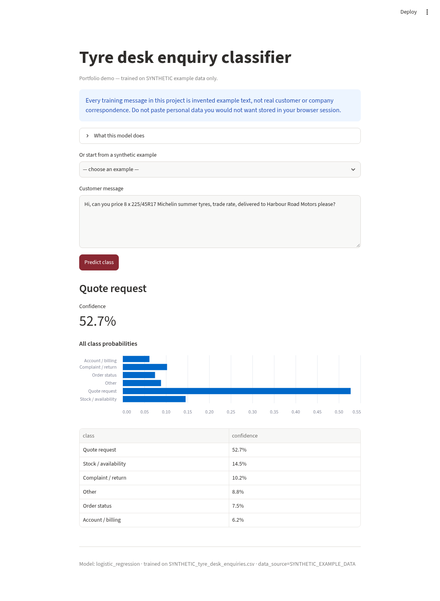
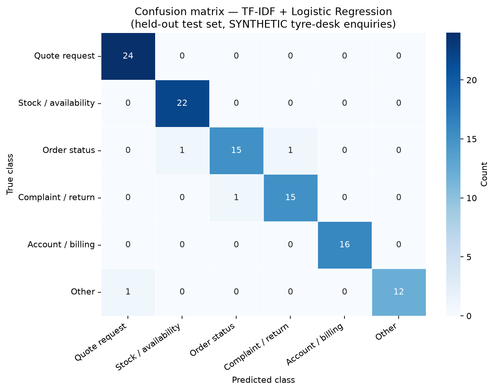
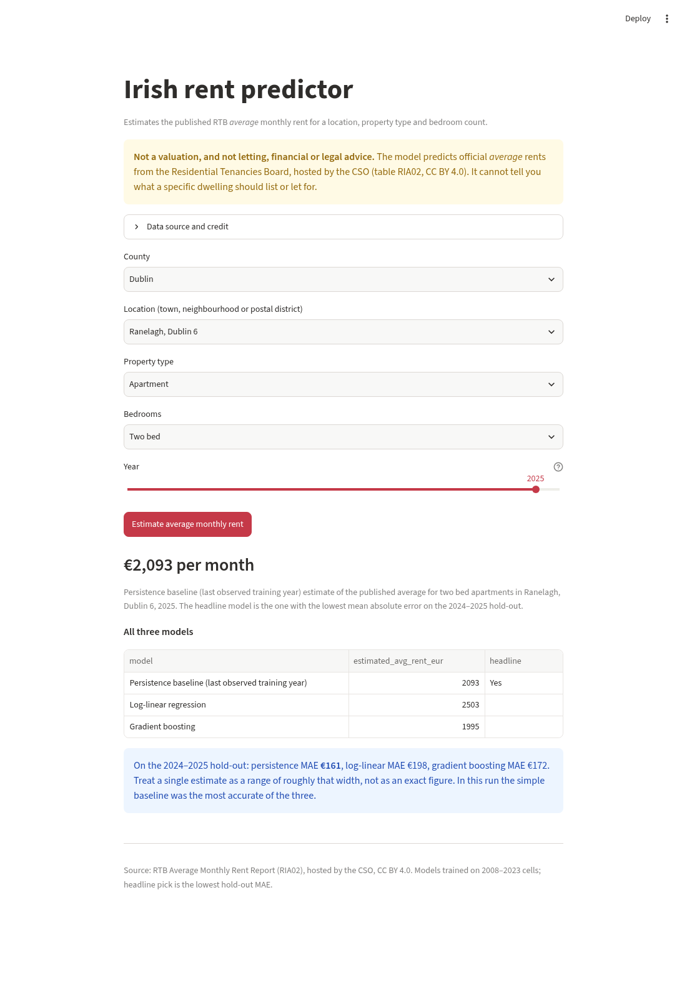
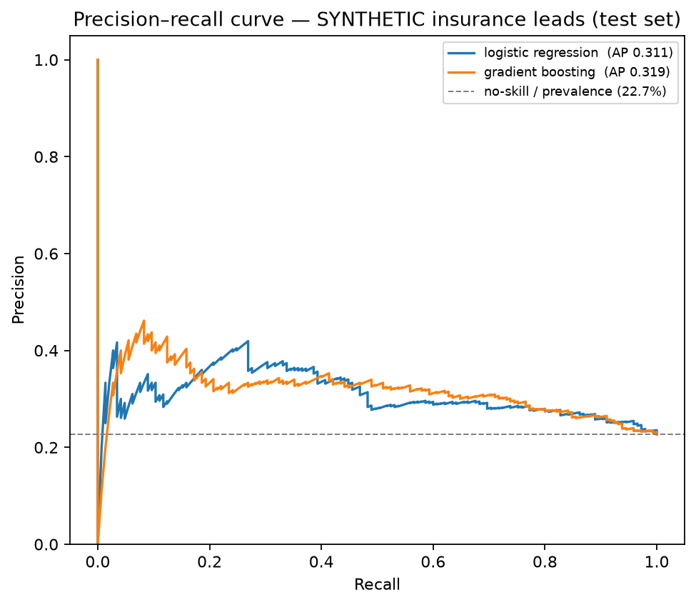
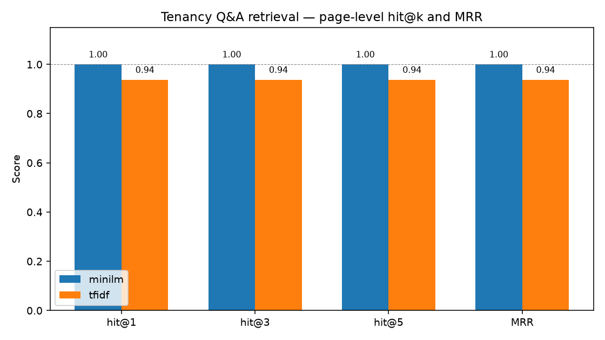

# AI / ML portfolio — Owen Quigley

Beginner-friendly machine learning work that is meant to do two jobs at once:

1. **Client-ready demos and case studies** — small, working prototypes a
   non-specialist can try, with a plain-English write-up of the business
   problem and the limits of the result.
2. **Documented evidence for a Recognition of Prior Learning (RPL)
   application** toward a **QQI Level 9 (Master's)** programme in the
   Irish NFQ, most likely in computing, data analytics, or a related
   field. The exact course is not yet confirmed, so the learning-outcome
   map uses the generic Level 9 NFQ descriptors and can be relabelled
   against a specific module list later.

Background: sales administrator at a tyre distributor
until November 2026, with further interests in Irish landlord / rental
work and commercial insurance lead generation. Project 1 draws on that
sales-desk context and uses **synthetic** enquiry text only — no real
customer mail. Project 2 uses **real public official statistics** (RTB
average rents hosted by the CSO, CC BY 4.0), not confidential tenancy
microdata. Project 5 retrieves over a **snapshot of public Citizens
Information and RTB guidance pages** (copyright remains with the
publishers); it is a reading aid, not legal advice.

This repository is a starting point, not a claim that a single baseline
model already satisfies a Master's award. Later projects should deepen
the research, evaluation and professional practice that Level 9 asks
for. The critical evaluations in
[project 1](projects/01-enquiry-classifier/README.md#critical-evaluation)
and [project 2](projects/02-irish-rent-predictor/README.md#critical-evaluation)
are there to show that distinction clearly.

---

## Project index

| # | Project | Domain | What you can try | Status |
| --- | --- | --- | --- | --- |
| 01 | [Enquiry classifier](projects/01-enquiry-classifier/) | B2B tyre / automotive-parts sales desk | [Streamlit app](projects/01-enquiry-classifier/app.py); [code walkthrough](projects/01-enquiry-classifier/CODE_WALKTHROUGH.md) | Complete baseline (trained 14 Nov 2026). SYNTHETIC data. |
| 02 | [Irish rent predictor](projects/02-irish-rent-predictor/) | Irish residential rents (official averages) | [Streamlit app](projects/02-irish-rent-predictor/app.py); [code walkthrough](projects/02-irish-rent-predictor/CODE_WALKTHROUGH.md) | Complete baseline (trained 14 Nov 2026). REAL public data (RTB / CSO RIA02, CC BY 4.0). |
| 03 | [Insurance lead scorer](projects/03-insurance-lead-scorer/) | Commercial insurance lead conversion | [Streamlit app](projects/03-insurance-lead-scorer/app.py); [code walkthrough](projects/03-insurance-lead-scorer/CODE_WALKTHROUGH.md) | Complete baseline (trained 14 Nov 2026). SYNTHETIC tabular data. |
| 04 | [Tyre demand forecast](projects/04-tyre-demand-forecast/) | Weekly tyre sales (Irish seasonal pattern) | [Streamlit app](projects/04-tyre-demand-forecast/app.py); [code walkthrough](projects/04-tyre-demand-forecast/CODE_WALKTHROUGH.md) | Complete baseline (trained 14 Nov 2026). SYNTHETIC weekly series. |
| 05 | [Tenancy Q&A assistant](projects/05-tenancy-qa-assistant/) | Public Irish tenancy guidance (CI / RTB) | [Streamlit app](projects/05-tenancy-qa-assistant/app.py); [code walkthrough](projects/05-tenancy-qa-assistant/CODE_WALKTHROUGH.md) | Complete baseline (evaluated 14 Nov 2026). REAL public web snapshot. |

Each finished project should contain:

- a beginner-friendly `README.md` (problem, data, method, **actual**
  metrics, limitations)
- a `CODE_WALKTHROUGH.md` that explains the files and key code in plain English
- a short `CASE_STUDY.md` written for a potential client
- runnable code, a requirements file, and saved artefacts from a real run

---

## How to run project 1

You need Python 3.11 or newer (the recorded run used 3.13.5).

A step-by-step tour of the files and the important lines of code is in
[`projects/01-enquiry-classifier/CODE_WALKTHROUGH.md`](projects/01-enquiry-classifier/CODE_WALKTHROUGH.md).

```bash
cd projects/01-enquiry-classifier
python3 -m venv .venv
source .venv/bin/activate          # Windows: .venv\Scripts\activate
pip install -r requirements.txt

python src/generate_synthetic_data.py
python src/train.py
streamlit run app.py
```

On the recorded run (14 November 2026, Europe/Dublin):

| Model | Accuracy | Macro-F1 | Weighted-F1 |
| --- | ---: | ---: | ---: |
| Dummy (most frequent class) | 0.2222 | 0.0606 | 0.0808 |
| TF-IDF + Logistic Regression (used in the app) | 0.9630 | 0.9607 | 0.9626 |
| TF-IDF + LinearSVC | 0.9815 | 0.9798 | 0.9814 |

These scores were produced by the training script on **synthetic**
messages. They are intentionally discussed as optimistic in the project
README.

The Streamlit demo after predicting a synthetic quote-request message
(captured 14 November 2026, Europe/Dublin):



Logistic Regression confusion matrix on the held-out synthetic test set:



---

## How to run project 2

Real official statistics: the RTB Average Monthly Rent Report (CSO
PxStat table RIA02), licensed [CC BY 4.0](https://creativecommons.org/licenses/by/4.0/).
Please credit the RTB and the CSO if you reuse the figures. A walkthrough
is in [`projects/02-irish-rent-predictor/CODE_WALKTHROUGH.md`](projects/02-irish-rent-predictor/CODE_WALKTHROUGH.md).

```bash
cd projects/02-irish-rent-predictor
python3 -m venv .venv
source .venv/bin/activate
pip install -r requirements.txt

python src/fetch_cso_ria02.py      # needs a network; or use the CSV already in data/
python src/train.py
streamlit run app.py
```

On the recorded run (14 November 2026, Europe/Dublin), a *temporal*
hold-out (train 2008–2023, test 2024–2025, n = 1,065) produced:

| Model | MAE (€) | RMSE (€) | R² | Mean bias (€) |
| --- | ---: | ---: | ---: | ---: |
| Persistence baseline (headline) | 160.71 | 203.90 | 0.8580 | −158.58 |
| Log-linear regression | 198.42 | 247.19 | 0.7913 | −167.26 |
| Gradient boosting | 172.40 | 219.35 | 0.8356 | −161.33 |

The simple baseline was the most accurate of the three. That finding is
discussed in the [project critical evaluation](projects/02-irish-rent-predictor/README.md#critical-evaluation).

The Streamlit demo (Ranelagh, Dublin 6, two-bed apartment, 2025):



Predicted vs actual official averages on the 2024–2025 hold-out:


---

## How to run project 3

SYNTHETIC commercial insurance leads only — not a real CRM extract.
Walkthrough: [`projects/03-insurance-lead-scorer/CODE_WALKTHROUGH.md`](projects/03-insurance-lead-scorer/CODE_WALKTHROUGH.md).

```bash
cd projects/03-insurance-lead-scorer
python3 -m venv .venv
source .venv/bin/activate
pip install -r requirements.txt

python src/generate_synthetic_leads.py
python src/train.py
streamlit run app.py
```

On the recorded run (14 November 2026, Europe/Dublin), a stratified
80/20 test set (n = 640, prevalence 22.7%) produced:

| Model | ROC-AUC | PR-AUC | Precision@50 |
| --- | ---: | ---: | ---: |
| Dummy (prior) | 0.5000 | 0.2266 | 0.26 |
| Logistic regression | 0.6352 | 0.3114 | 0.30 |
| Gradient boosting (headline) | 0.6433 | 0.3190 | 0.38 |

These scores describe invented data. The models beat the dummy, the
lift is modest, and predicted probabilities are somewhat high (see the
calibration plot in the project README).




---

## How to run project 4

SYNTHETIC weekly tyre sales, not a real depot extract. Walkthrough:
[`projects/04-tyre-demand-forecast/CODE_WALKTHROUGH.md`](projects/04-tyre-demand-forecast/CODE_WALKTHROUGH.md).

```bash
cd projects/04-tyre-demand-forecast
python3 -m venv .venv
source .venv/bin/activate
pip install -r requirements.txt

python src/generate_synthetic_series.py
python src/train.py
streamlit run app.py
```

On the recorded run (14 November 2026, Europe/Dublin):

Expanding-window back-test (51 origins, 8-week horizon) — the headline protocol:

| Model | Mean MAE (units) | Mean MAPE (%) |
| --- | ---: | ---: |
| ETS (Holt–Winters) | 48.28 | 4.72 |
| Gradient boosting (lags) | 53.01 | 5.16 |
| Seasonal naive | 54.47 | 5.26 |

A single 2025 hold-out ranks the models differently (gradient boosting
MAE 47.57, seasonal naive 51.67, ETS 53.95). Both tables are reported;
the back-test is treated as the primary comparison.


---

## How to run project 5

A snapshot of **public** Citizens Information and RTB guidance
(fetched 14 November 2026). This is not legal advice, and the stored
page text remains the publishers' copyright. Walkthrough:
[`projects/05-tenancy-qa-assistant/CODE_WALKTHROUGH.md`](projects/05-tenancy-qa-assistant/CODE_WALKTHROUGH.md).

```bash
cd projects/05-tenancy-qa-assistant
python3 -m venv .venv
source .venv/bin/activate
pip install -r requirements.txt

python src/fetch_pages.py          # optional; snapshot already in data/
python src/chunk_and_index.py      # downloads all-MiniLM-L6-v2 on first run
python src/evaluate.py
streamlit run app.py
```

On the recorded run (14 November 2026, Europe/Dublin), 16 questions
against 10 pages (148 passages) produced:

| Backend | hit@1 | hit@3 | hit@5 | MRR |
| --- | ---: | ---: | ---: | ---: |
| MiniLM (headline) | 1.0000 | 1.0000 | 1.0000 | 1.0000 |
| TF-IDF baseline | 0.9375 | 0.9375 | 0.9375 | 0.9375 |

These are page-level retrieval scores on a hand-built question set.
They are optimistic and are not a measure of legal correctness — see
the [project critical evaluation](projects/05-tenancy-qa-assistant/README.md#critical-evaluation).
TF-IDF missed a rent-review question and retrieved a notice-of-termination
page instead.




---

## RPL evidence

| File | Purpose |
| --- | --- |
| [`rpl/LEARNING_OUTCOMES_MAP.md`](rpl/LEARNING_OUTCOMES_MAP.md) | Editable table: NFQ Level 9 descriptor → technical outcome → project → evidence file |
| [`rpl/RPL_EVIDENCE_LOG.md`](rpl/RPL_EVIDENCE_LOG.md) | Dated activity log, with first entries for 14 November 2026 |

If a chosen programme publishes its own module outcomes, copy a new
column into the map rather than rewriting the projects.

---

## Data protection

Do not put live customer, tenant or claimant data in this repository.
Project 1 and project 3 use files explicitly named and tagged as
`SYNTHETIC` example data. Project 2 uses **public official averages**
(RTB / CSO table RIA02, CC BY 4.0), not confidential tenancy microdata
and not personal data of named tenants. Project 5 indexes a **snapshot
of public guidance pages** (Citizens Information and the RTB); the
text remains the publishers' copyright, and the demo is not legal
advice and should not be used with other people's case papers. A live
product that moved beyond published aggregates or official guidance
would need a lawful basis, minimisation, and usually a DPIA — see the
project critical evaluations.

---

## Repository layout

```
ai-ml-portfolio/
  README.md                          this file
  LICENSE                            MIT, Copyright (c) 2026 Owen Quigley
  rpl/LEARNING_OUTCOMES_MAP.md
  rpl/RPL_EVIDENCE_LOG.md
  projects/01-enquiry-classifier/
  projects/02-irish-rent-predictor/
  projects/03-insurance-lead-scorer/
  projects/04-tyre-demand-forecast/
  projects/05-tenancy-qa-assistant/
```

This repository is released under the [MIT License](LICENSE).
Copyright (c) 2026 Owen Quigley.
