# AI / ML portfolio — Owen Quigley

Machine learning and data work — beginner-friendly baselines (projects
1–5), advanced ML prototypes (projects 6–10), business analytics /
data engineering projects (11–15) and production-style ML and data
engineering (16–21) — meant to do two jobs at once:

1. **Client-ready demos and case studies** — small, working prototypes a
   non-specialist can try, with a plain-English write-up of the business
   problem and the limits of the result.
2. **Documented evidence for a Recognition of Prior Learning (RPL)
   application** toward a **QQI Level 9 (Master's)** programme in the
   Irish NFQ, most likely in computing, data analytics, or a related
   field. The exact course is not yet confirmed, so the learning-outcome
   map uses the generic Level 9 NFQ descriptors and can be relabelled
   against a specific module list later.

Background: sales administrator at a tyre distributor
until November 2026, with further interests in Irish landlord / rental
work and commercial insurance lead generation. Project 1 draws on that
sales-desk context and uses **synthetic** enquiry text only — no real
customer mail. Project 2 uses **real public official statistics** (RTB
average rents hosted by the CSO, CC BY 4.0), not confidential tenancy
microdata. Project 5 retrieves over a **snapshot of public Citizens
Information and RTB guidance pages** (copyright remains with the
publishers); it is a reading aid, not legal advice.

Projects 1–5 are deliberately beginner-level baselines. **Projects 6–10
are the advanced set** (added 15 November 2026): retrieval-augmented
generation with re-ranking and abstention, calibrated and explainable
churn modelling with a cost-based decision threshold, invoice
extraction tested on an unseen supplier layout and on OCR'd scans,
multi-series forecasting with a global model and a bootstrap
significance check, and sentiment plus topic modelling on 22,641 real
reviews. Each one reports what did *not* work as well as what did.

**Projects 11–15 are the analytics and data-engineering set** (added 17
November 2026): a manufacturing KPI dashboard (OEE, downtime, defects)
with a Power BI build kit and a Streamlit equivalent, a SQL + Python ETL
pipeline with quarantine and idempotency tests, a marketing campaign
dashboard whose attribution models are scored against a known causal
answer, a bronze/silver/gold lakehouse built locally on Delta tables and
mapped to Azure and Microsoft Fabric (**run locally, not deployed to
Azure**), and a customer segmentation checked against a later hold-out
period.

**Projects 16–21 are the production ML and engineering set** (added
17–18 November 2026): a tool-using LLM agent with a LoRA fine-tune
(in progress), an MLOps loop (MLflow registry, FastAPI
service, drift monitoring and a retraining policy), a dbt + Airflow
modern data stack over 5.97 million real taxi trips, a Kafka streaming
pipeline whose exactly-once results are checked window by window against
a batch truth after a simulated crash, PCB defect detection with a
golden-template baseline and anomaly detection, and predictive
maintenance on NASA turbofan data with an alert threshold chosen by cost.
Projects 20 and 21 draw on two years as a Test Engineer in automotive
electronics manufacturing; no employer data is used.

This repository is a starting point, not a claim that a single baseline
model already satisfies a Master's award. Later projects should deepen
the research, evaluation and professional practice that Level 9 asks
for. The critical evaluations in
[project 1](projects/01-enquiry-classifier/README.md#critical-evaluation)
and [project 2](projects/02-irish-rent-predictor/README.md#critical-evaluation)
are there to show that distinction clearly.

---

## Project index

| # | Project | Domain | What you can try | Status |
| --- | --- | --- | --- | --- |
| 01 | [Enquiry classifier](projects/01-enquiry-classifier/) | B2B tyre / automotive-parts sales desk | [Streamlit app](projects/01-enquiry-classifier/app.py); [code walkthrough](projects/01-enquiry-classifier/CODE_WALKTHROUGH.md) | Complete baseline (trained 14 Nov 2026). SYNTHETIC data. |
| 02 | [Irish rent predictor](projects/02-irish-rent-predictor/) | Irish residential rents (official averages) | [Streamlit app](projects/02-irish-rent-predictor/app.py); [code walkthrough](projects/02-irish-rent-predictor/CODE_WALKTHROUGH.md) | Complete baseline (trained 14 Nov 2026). REAL public data (RTB / CSO RIA02, CC BY 4.0). |
| 03 | [Insurance lead scorer](projects/03-insurance-lead-scorer/) | Commercial insurance lead conversion | [Streamlit app](projects/03-insurance-lead-scorer/app.py); [code walkthrough](projects/03-insurance-lead-scorer/CODE_WALKTHROUGH.md) | Complete baseline (trained 14 Nov 2026). SYNTHETIC tabular data. |
| 04 | [Tyre demand forecast](projects/04-tyre-demand-forecast/) | Weekly tyre sales (Irish seasonal pattern) | [Streamlit app](projects/04-tyre-demand-forecast/app.py); [code walkthrough](projects/04-tyre-demand-forecast/CODE_WALKTHROUGH.md) | Complete baseline (trained 14 Nov 2026). SYNTHETIC weekly series. |
| 05 | [Tenancy Q&A assistant](projects/05-tenancy-qa-assistant/) | Public Irish tenancy guidance (CI / RTB) | [Streamlit app](projects/05-tenancy-qa-assistant/app.py); [code walkthrough](projects/05-tenancy-qa-assistant/CODE_WALKTHROUGH.md) | Complete baseline (evaluated 14 Nov 2026). REAL public web snapshot. |
| 06 | [Document Q&A (RAG)](projects/06-document-qa-rag/) | Company documents (HR, finance, IT, SLA) | [Streamlit app](projects/06-document-qa-rag/app.py); [code walkthrough](projects/06-document-qa-rag/CODE_WALKTHROUGH.md) | Advanced (evaluated 15 Nov 2026). SYNTHETIC document pack; local models, optional LLM hook. |
| 07 | [Churn prediction with explainability](projects/07-telco-churn-explainable/) | Subscription / telecom customer retention | [Streamlit app](projects/07-telco-churn-explainable/app.py); [code walkthrough](projects/07-telco-churn-explainable/CODE_WALKTHROUGH.md) | Advanced (trained 15 Nov 2026). REAL public sample (IBM Telco, Apache 2.0). |
| 08 | [Invoice data extraction](projects/08-invoice-extraction/) | Accounts payable / document automation | [Streamlit app](projects/08-invoice-extraction/app.py); [code walkthrough](projects/08-invoice-extraction/CODE_WALKTHROUGH.md) | Advanced (evaluated 15 Nov 2026). SYNTHETIC invoices, digital + simulated scans. |
| 09 | [Retail sales forecasting dashboard](projects/09-retail-sales-forecast/) | Irish retail sales, 13 sectors | [Streamlit dashboard](projects/09-retail-sales-forecast/app.py); [code walkthrough](projects/09-retail-sales-forecast/CODE_WALKTHROUGH.md) | Advanced (back-tested 15 Nov 2026). REAL public data (CSO RSM05 + RSM08, CC BY 4.0). |
| 10 | [Review sentiment & topics](projects/10-review-sentiment-topics/) | E-commerce customer reviews | [Streamlit app](projects/10-review-sentiment-topics/app.py); [insights report](projects/10-review-sentiment-topics/reports/insights_report.md) | Advanced (trained 15 Nov 2026). REAL public reviews (CC0). |
| 11 | [Manufacturing KPI dashboard](projects/11-manufacturing-kpi-dashboard/) | Electronics assembly plant: OEE, downtime, defects | [Streamlit dashboard](projects/11-manufacturing-kpi-dashboard/app.py); [Power BI build guide](projects/11-manufacturing-kpi-dashboard/powerbi/POWERBI_BUILD_GUIDE.md) | Analytics (run 17 Nov 2026). SYNTHETIC plant data with planted issues. DAX written, not executed. |
| 12 | [SQL + Python ETL pipeline](projects/12-sql-python-etl-pipeline/) | Retail order extracts → warehouse → marts | [CLI](projects/12-sql-python-etl-pipeline/src/cli.py); [DQ report](projects/12-sql-python-etl-pipeline/reports/dq_report.md) | Data engineering (run 17 Nov 2026). SYNTHETIC extracts with injected defects. |
| 13 | [Marketing campaign dashboard](projects/13-marketing-campaign-dashboard/) | Paid media, attribution, incrementality | [Streamlit dashboard](projects/13-marketing-campaign-dashboard/app.py); [insights](projects/13-marketing-campaign-dashboard/reports/insights.md) | Analytics (run 17 Nov 2026). SYNTHETIC simulation with known causal truth. |
| 14 | [Medallion lakehouse (Azure / Fabric mapping)](projects/14-azure-fabric-medallion-lakehouse/) | Retail transactions, bronze/silver/gold | [Pipeline](projects/14-azure-fabric-medallion-lakehouse/src/run_pipeline.py); [Azure/Fabric mapping](projects/14-azure-fabric-medallion-lakehouse/docs/AZURE_FABRIC_MAPPING.md) | Data engineering (run 17 Nov 2026), **run locally, not on Azure**. REAL public data (UCI Online Retail II, CC BY 4.0). |
| 15 | [Customer segmentation](projects/15-customer-segmentation/) | Retail / CRM customer segments (method transfers to advisers) | [Streamlit app](projects/15-customer-segmentation/app.py); [code walkthrough](projects/15-customer-segmentation/CODE_WALKTHROUGH.md) | Analytics (run 17 Nov 2026). REAL public data (UCI Online Retail, CC BY 4.0). |
| 16 | [Tool-using LLM agent + LoRA](projects/16-tool-agent-lora/) | Business-data assistant: SQL, calculator, policy search | [Streamlit app](projects/16-tool-agent-lora/app.py); [code walkthrough](projects/16-tool-agent-lora/CODE_WALKTHROUGH.md) | **In progress** (evaluation running). SYNTHETIC company database; small local model on CPU. |
| 17 | [MLOps: tracked, served, monitored model](projects/17-mlops-model-serving/) | Hourly bike-share demand | [FastAPI service](projects/17-mlops-model-serving/app/main.py); [code walkthrough](projects/17-mlops-model-serving/CODE_WALKTHROUGH.md) | MLOps (run 17 Nov 2026). REAL public data (UCI Bike Sharing, CC BY 4.0). Docker and CI written, not run. |
| 18 | [dbt + Airflow modern data stack](projects/18-dbt-airflow-modern-data-stack/) | NYC taxi trips, monthly ELT | [Airflow DAG](projects/18-dbt-airflow-modern-data-stack/airflow/dags/); [code walkthrough](projects/18-dbt-airflow-modern-data-stack/CODE_WALKTHROUGH.md) | Data engineering (run 17 Nov 2026). REAL public data (NYC TLC, 5.97 m rows). |
| 19 | [Real-time streaming pipeline](projects/19-realtime-streaming-pipeline/) | Live taxi demand from Kafka | [Streamlit live dashboard](projects/19-realtime-streaming-pipeline/app.py); [code walkthrough](projects/19-realtime-streaming-pipeline/CODE_WALKTHROUGH.md) | Data engineering (run 17 Nov 2026). REAL public trips with injected delays and duplicates; single Kafka broker. |
| 20 | [PCB defect detection](projects/20-pcb-defect-vision/) | Automated optical inspection, electronics manufacturing | [Streamlit board scan](projects/20-pcb-defect-vision/app.py); [code walkthrough](projects/20-pcb-defect-vision/CODE_WALKTHROUGH.md) | Computer vision (run 17 Nov 2026). REAL public images (DeepPCB, MIT) with artificially added defects. |
| 21 | [Predictive maintenance](projects/21-predictive-maintenance-cmapss/) | Equipment health, remaining useful life, maintenance cost | [Streamlit engine replay](projects/21-predictive-maintenance-cmapss/app.py); [code walkthrough](projects/21-predictive-maintenance-cmapss/CODE_WALKTHROUGH.md) | Advanced ML (run 18 Nov 2026). Public SIMULATED data (NASA C-MAPSS, public domain). |

Each finished project should contain:

- a beginner-friendly `README.md` (problem, data, method, **actual**
  metrics, limitations)
- a `CODE_WALKTHROUGH.md` that explains the files and key code in plain English
- a short `CASE_STUDY.md` written for a potential client
- runnable code, a requirements file, and saved artefacts from a real run

---

## How to run project 1

You need Python 3.11 or newer (the recorded run used 3.13.5).

A step-by-step tour of the files and the important lines of code is in
[`projects/01-enquiry-classifier/CODE_WALKTHROUGH.md`](projects/01-enquiry-classifier/CODE_WALKTHROUGH.md).

```bash
cd projects/01-enquiry-classifier
python3 -m venv .venv
source .venv/bin/activate          # Windows: .venv\Scripts\activate
pip install -r requirements.txt

python src/generate_synthetic_data.py
python src/train.py
streamlit run app.py
```

On the recorded run (14 November 2026, Europe/Dublin):

| Model | Accuracy | Macro-F1 | Weighted-F1 |
| --- | ---: | ---: | ---: |
| Dummy (most frequent class) | 0.2222 | 0.0606 | 0.0808 |
| TF-IDF + Logistic Regression (used in the app) | 0.9630 | 0.9607 | 0.9626 |
| TF-IDF + LinearSVC | 0.9815 | 0.9798 | 0.9814 |

These scores were produced by the training script on **synthetic**
messages. They are intentionally discussed as optimistic in the project
README.

The Streamlit demo after predicting a synthetic quote-request message
(captured 14 November 2026, Europe/Dublin):


Logistic Regression confusion matrix on the held-out synthetic test set:


---

## How to run project 2

Real official statistics: the RTB Average Monthly Rent Report (CSO
PxStat table RIA02), licensed [CC BY 4.0](https://creativecommons.org/licenses/by/4.0/).
Please credit the RTB and the CSO if you reuse the figures. A walkthrough
is in [`projects/02-irish-rent-predictor/CODE_WALKTHROUGH.md`](projects/02-irish-rent-predictor/CODE_WALKTHROUGH.md).

```bash
cd projects/02-irish-rent-predictor
python3 -m venv .venv
source .venv/bin/activate
pip install -r requirements.txt

python src/fetch_cso_ria02.py      # needs a network; or use the CSV already in data/
python src/train.py
streamlit run app.py
```

On the recorded run (14 November 2026, Europe/Dublin), a *temporal*
hold-out (train 2008–2023, test 2024–2025, n = 1,065) produced:

| Model | MAE (€) | RMSE (€) | R² | Mean bias (€) |
| --- | ---: | ---: | ---: | ---: |
| Persistence baseline (headline) | 160.71 | 203.90 | 0.8580 | −158.58 |
| Log-linear regression | 198.42 | 247.19 | 0.7913 | −167.26 |
| Gradient boosting | 172.40 | 219.35 | 0.8356 | −161.33 |

The simple baseline was the most accurate of the three. That finding is
discussed in the [project critical evaluation](projects/02-irish-rent-predictor/README.md#critical-evaluation).

The Streamlit demo (Ranelagh, Dublin 6, two-bed apartment, 2025):


Predicted vs actual official averages on the 2024–2025 hold-out:

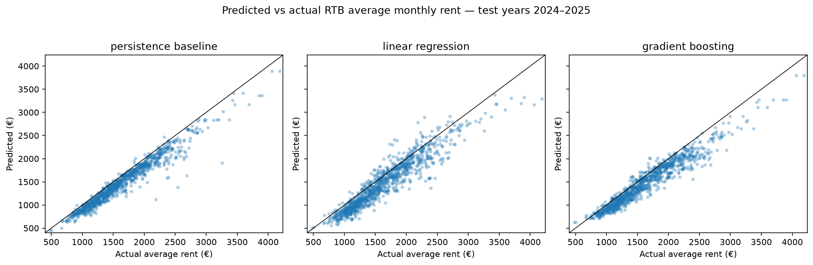

---

## How to run project 3

SYNTHETIC commercial insurance leads only — not a real CRM extract.
Walkthrough: [`projects/03-insurance-lead-scorer/CODE_WALKTHROUGH.md`](projects/03-insurance-lead-scorer/CODE_WALKTHROUGH.md).

```bash
cd projects/03-insurance-lead-scorer
python3 -m venv .venv
source .venv/bin/activate
pip install -r requirements.txt

python src/generate_synthetic_leads.py
python src/train.py
streamlit run app.py
```

On the recorded run (14 November 2026, Europe/Dublin), a stratified
80/20 test set (n = 640, prevalence 22.7%) produced:

| Model | ROC-AUC | PR-AUC | Precision@50 |
| --- | ---: | ---: | ---: |
| Dummy (prior) | 0.5000 | 0.2266 | 0.26 |
| Logistic regression | 0.6352 | 0.3114 | 0.30 |
| Gradient boosting (headline) | 0.6433 | 0.3190 | 0.38 |

These scores describe invented data. The models beat the dummy, the
lift is modest, and predicted probabilities are somewhat high (see the
calibration plot in the project README).

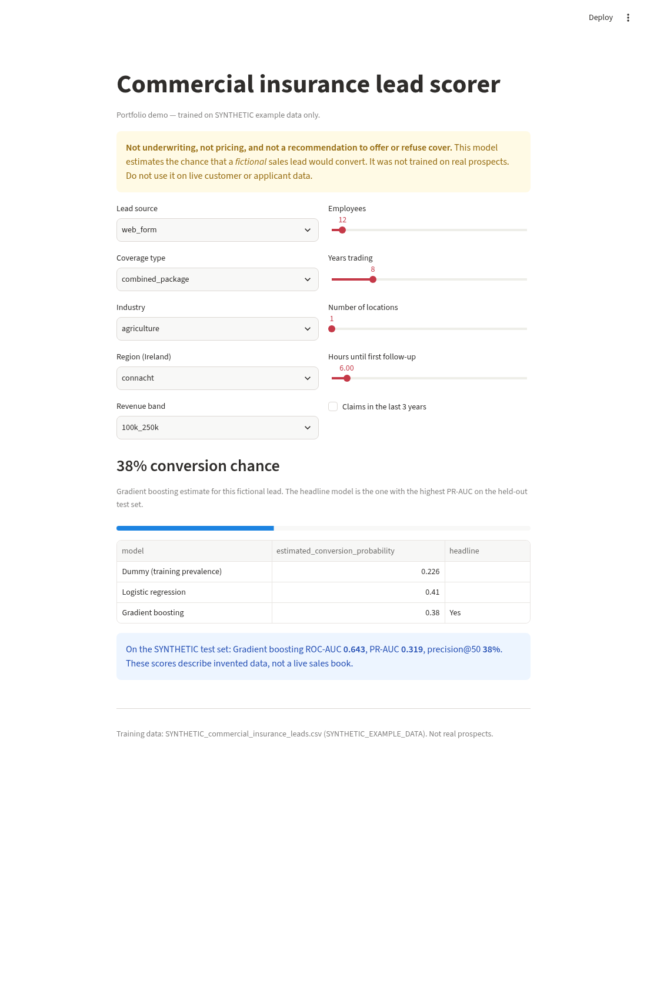


---

## How to run project 4

SYNTHETIC weekly tyre sales, not a real depot extract. Walkthrough:
[`projects/04-tyre-demand-forecast/CODE_WALKTHROUGH.md`](projects/04-tyre-demand-forecast/CODE_WALKTHROUGH.md).

```bash
cd projects/04-tyre-demand-forecast
python3 -m venv .venv
source .venv/bin/activate
pip install -r requirements.txt

python src/generate_synthetic_series.py
python src/train.py
streamlit run app.py
```

On the recorded run (14 November 2026, Europe/Dublin):

Expanding-window back-test (51 origins, 8-week horizon) — the headline protocol:

| Model | Mean MAE (units) | Mean MAPE (%) |
| --- | ---: | ---: |
| ETS (Holt–Winters) | 48.28 | 4.72 |
| Gradient boosting (lags) | 53.01 | 5.16 |
| Seasonal naive | 54.47 | 5.26 |

A single 2025 hold-out ranks the models differently (gradient boosting
MAE 47.57, seasonal naive 51.67, ETS 53.95). Both tables are reported;
the back-test is treated as the primary comparison.

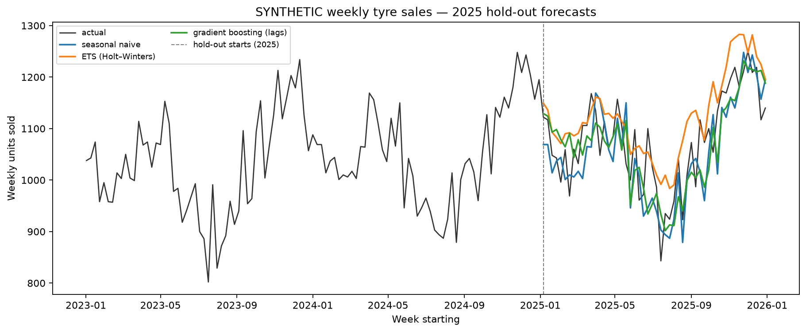

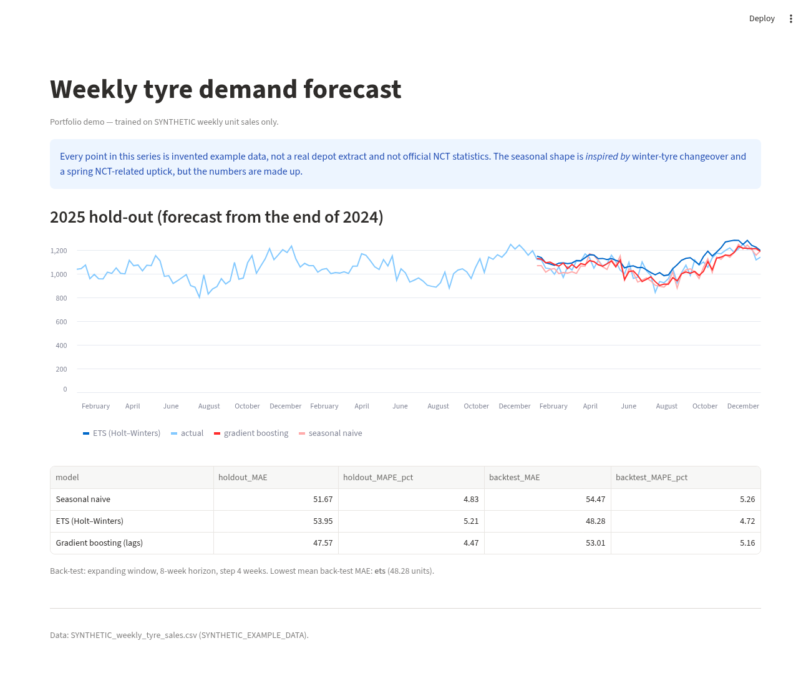

---

## How to run project 5

A snapshot of **public** Citizens Information and RTB guidance
(fetched 14 November 2026). This is not legal advice, and the stored
page text remains the publishers' copyright. Walkthrough:
[`projects/05-tenancy-qa-assistant/CODE_WALKTHROUGH.md`](projects/05-tenancy-qa-assistant/CODE_WALKTHROUGH.md).

```bash
cd projects/05-tenancy-qa-assistant
python3 -m venv .venv
source .venv/bin/activate
pip install -r requirements.txt

python src/fetch_pages.py          # optional; snapshot already in data/
python src/chunk_and_index.py      # downloads all-MiniLM-L6-v2 on first run
python src/evaluate.py
streamlit run app.py
```

On the recorded run (14 November 2026, Europe/Dublin), 16 questions
against 10 pages (148 passages) produced:

| Backend | hit@1 | hit@3 | hit@5 | MRR |
| --- | ---: | ---: | ---: | ---: |
| MiniLM (headline) | 1.0000 | 1.0000 | 1.0000 | 1.0000 |
| TF-IDF baseline | 0.9375 | 0.9375 | 0.9375 | 0.9375 |

These are page-level retrieval scores on a hand-built question set.
They are optimistic and are not a measure of legal correctness — see
the [project critical evaluation](projects/05-tenancy-qa-assistant/README.md#critical-evaluation).
TF-IDF missed a rent-review question and retrieved a notice-of-termination
page instead.

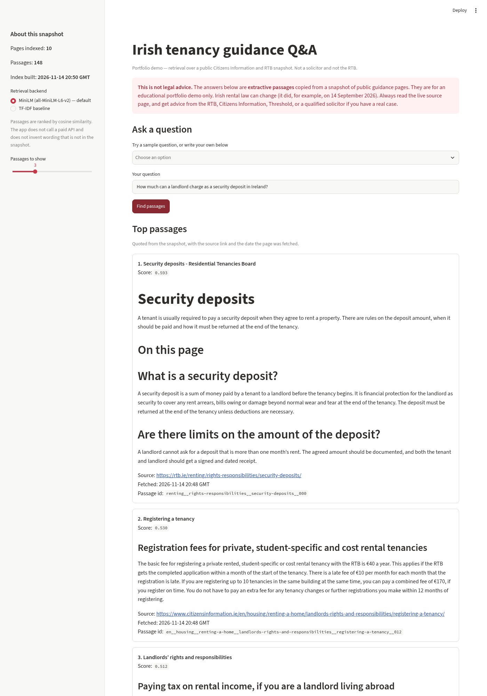


---

## Advanced projects 6–10: how to run and headline results

All five were run on 15 November 2026 (Europe/Dublin) on Python 3.13.5;
every number below is copied from that project's `reports/*.json`. Each
project folder has its own `requirements.txt`, `pytest` smoke tests,
README (problem, approach, results, client value, critical evaluation),
`CASE_STUDY.md` and `CODE_WALKTHROUGH.md`.

### Project 6 — document Q&A (RAG)

```bash
cd projects/06-document-qa-rag
pip install -r requirements.txt
python src/evaluate.py && pytest -q && streamlit run app.py
```

SYNTHETIC 8-document pack (Markdown, PDF, text), 47 chunks, 44
hand-written questions (36 answerable, 8 not in the documents).

| Retriever (36 answerable questions) | hit@1 | MRR@20 |
| --- | ---: | ---: |
| BM25 | 0.5556 | 0.6458 |
| Dense MiniLM | 0.8611 | 0.9259 |
| Hybrid RRF | 0.7778 | 0.8264 |
| **Hybrid + cross-encoder re-rank** | **0.9444** | **0.9653** |

Test split (22 questions, threshold tuned on dev): answer accuracy on
answerable questions 0.8889; only 1 of 4 unanswerable questions
correctly declined — abstention is the documented weak point.

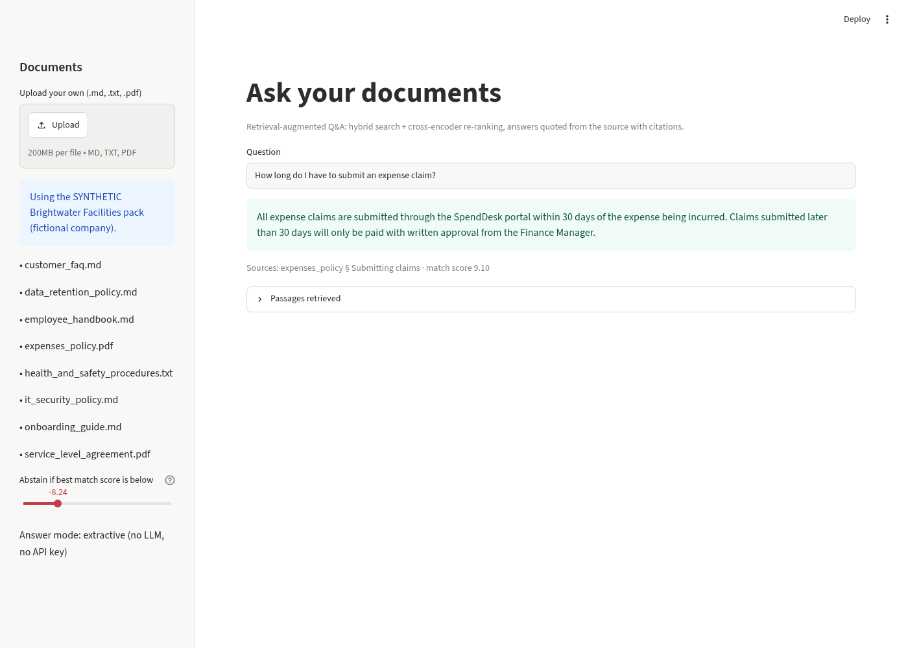

### Project 7 — churn prediction with explainability

```bash
cd projects/07-telco-churn-explainable
pip install -r requirements.txt
python src/train.py && pytest -q && streamlit run app.py
```

IBM Telco sample, 7,043 customers, held-out test n = 1,409.
Calibrated gradient boosting: ROC-AUC **0.8466**, Brier 0.1357
(logistic regression 0.8408 / 0.1386). Cost-optimal threshold 0.17
(chosen on out-of-fold training predictions) gave an illustrative net
benefit of **60,051** on the test set vs 43,754 at the default 0.5.

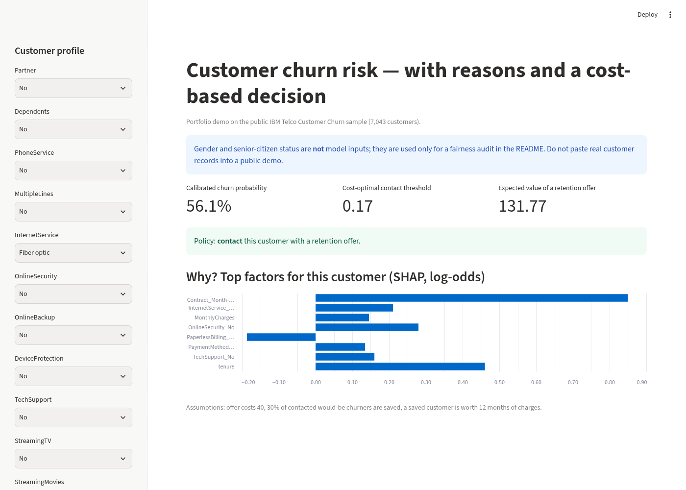

### Project 8 — invoice data extraction

```bash
cd projects/08-invoice-extraction
pip install -r requirements.txt   # plus poppler-utils
python src/generate_invoices.py && python src/evaluate.py && pytest -q && streamlit run app.py
```

240 SYNTHETIC invoices, 4 layouts. Hybrid (rules + ML ranker) mean
field accuracy: **0.9931** on OCR'd scans of known layouts; **0.8750**
on an unseen layout (0% of invoices fully correct — the invoice number
was always confused with the order reference); **1.0000** on that layout
after labelling 5 examples (ML ranker, digital PDFs).

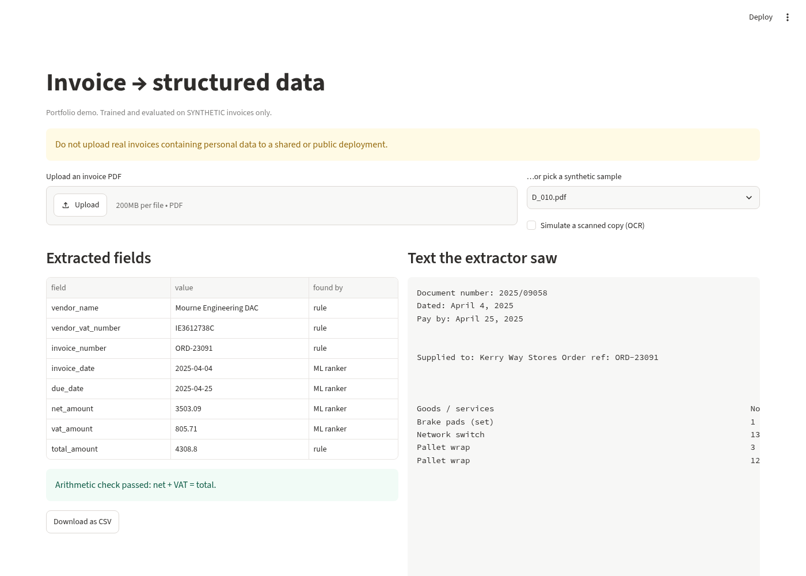

### Project 9 — retail sales forecasting dashboard

```bash
cd projects/09-retail-sales-forecast
pip install -r requirements.txt
OMP_NUM_THREADS=2 python src/backtest.py && python src/compare_models.py && pytest -q && streamlit run app.py
```

13 CSO retail sectors, Jan 2015 – Sep 2026; 1,950 rolling-origin
forecasts per model (horizons 1–6 months).

| Model | MASE | sMAPE (%) |
| --- | ---: | ---: |
| **Ensemble (global GBM on YoY + growth-adjusted seasonal naive)** | **0.5142** | **3.67** |
| Seasonal naive ("same month last year") | 0.5432 | 3.70 |
| Holt–Winters ETS | 0.9625 | 8.27 |

The ensemble is ~5% better on MASE, but the origin-block bootstrap 95%
interval for the ratio (0.891–1.012) includes 1, and the new models were
designed after a first round in which seasonal naive won — both
disclosed.

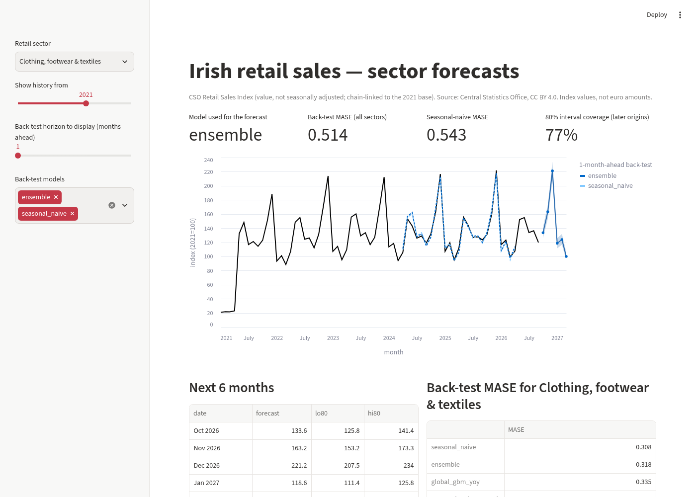

### Project 10 — review sentiment & topics

```bash
cd projects/10-review-sentiment-topics
pip install -r requirements.txt
python src/train_sentiment.py && python src/topics.py && pytest -q && streamlit run app.py
```

22,641 real clothing reviews; test n = 4,529. TF-IDF + logistic
regression macro-F1 **0.6679** (MiniLM embeddings + LR 0.6134; dummy
0.2901); negative-vs-positive ROC-AUC **0.9725**. NMF (k = 15 by NPMI
coherence): the fabric/quality topic is 2.26× as likely to be a 1–2
star review as the average.

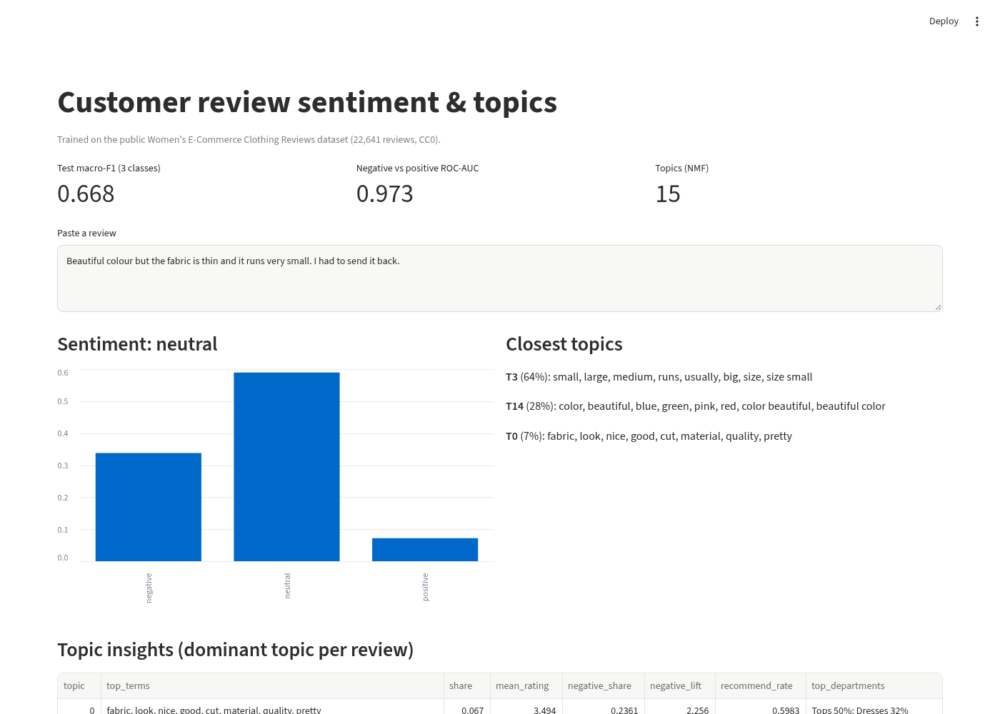

---

## Analytics and data-engineering projects 11–15: how to run and headline results

All five were run on 17 November 2026 (Europe/Dublin) on Python 3.13.5;
every number below is copied from that project's `reports/metrics.json`.
Each folder has its own `requirements.txt`, `pytest` tests, README
(problem, approach, results, client value, critical evaluation),
`CASE_STUDY.md` and `CODE_WALKTHROUGH.md`.

### Project 11 — manufacturing KPI dashboard (Power BI kit + Streamlit)

```bash
cd projects/11-manufacturing-kpi-dashboard
pip install -r requirements.txt
python src/generate_data.py && python src/analyse.py && pytest -q && streamlit run app.py
```

SYNTHETIC four-line electronics assembly plant (SMT, assembly, end-of-line
test), July–October 2026, with four problems deliberately planted. Plant
OEE **79.25%** (availability 89.40%, performance 89.78%, quality 98.73%);
SMT-2 is the weakest line at 74.32%. Changeover overruns are 30.7% of
unplanned downtime. pandas and SQL KPI implementations agree to 1 × 10⁻¹⁵.
The monitoring rules found all four planted issues (2 of 2 solder-spike
weeks, 3 of 5 fixture-fault weeks), with 3 false p-chart alarms in 88
checks. The Power BI kit ([build guide](projects/11-manufacturing-kpi-dashboard/powerbi/POWERBI_BUILD_GUIDE.md),
DAX measures, theme) was written but **not executed** (no Power BI on the
Linux build machine).

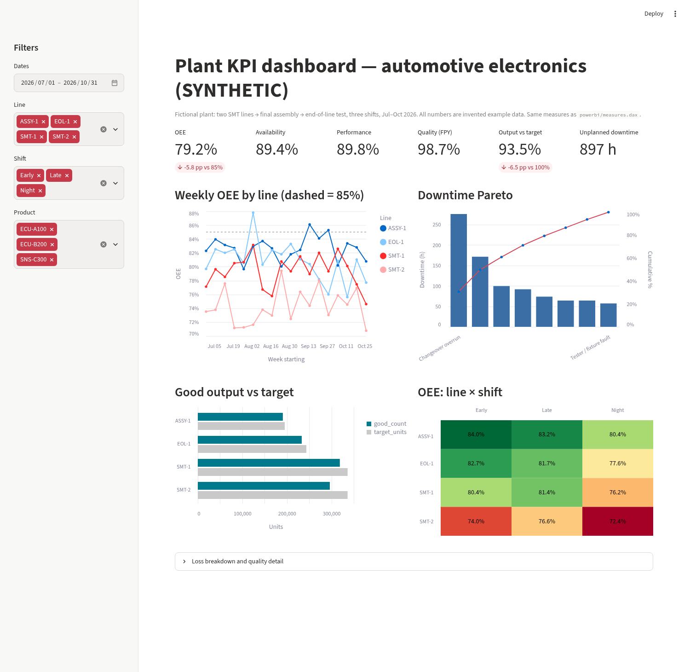

### Project 12 — SQL + Python ETL pipeline

```bash
cd projects/12-sql-python-etl-pipeline
pip install -r requirements.txt
python src/generate_sources.py && python src/cli.py reset && python src/cli.py run-all && python src/evaluate.py && pytest -q
```

Two overlapping SYNTHETIC extract batches with six injected defect types,
loaded into a DuckDB warehouse (cleaned extracts → core tables with SCD1 customers →
marts). Net revenue **€858,984.52**, exactly matching the expected answer;
all six defect types caught with recall and precision **1.00**; 809
late-arriving orders loaded automatically by the retry. Re-runs, forced
reprocessing and batch-by-batch loads give identical output; loading
batches **newest first does not** (29 customers keep a stale county), which
is documented. 18 tests.

### Project 13 — marketing campaign dashboard with attribution

```bash
cd projects/13-marketing-campaign-dashboard
pip install -r requirements.txt
python src/simulate.py && python src/analyse.py && pytest -q && streamlit run app.py
```

SYNTHETIC six-channel campaign world (€224,533 spend, €2.67 m revenue)
where the true causal effect of every channel is known. Platforms claimed
**1.79×** the orders that had any ad contact; only 9,513 orders were truly
caused by marketing. Last click misallocated **53.1%** of credit and
overstated affiliate ROAS about 50× (4.47 vs a true 0.09); Markov (33.2%)
and Shapley (31.6%) were no better than linear credit. A 10% randomised
hold-out estimated 1,685 extra sales (95% CI 1,211–2,159) against a true
1,966.

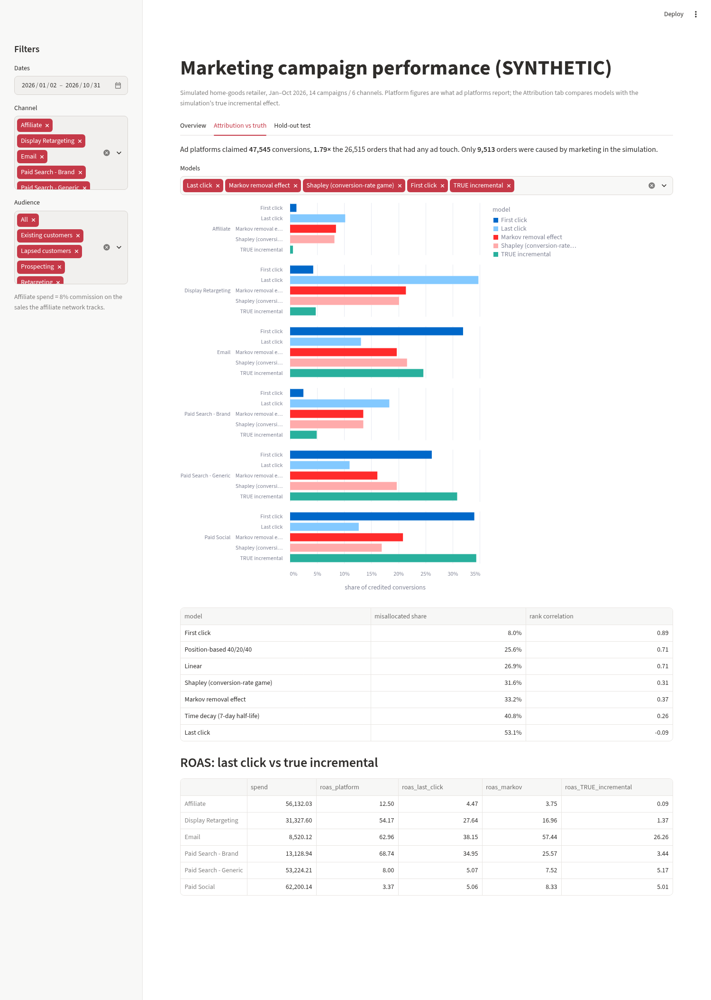

### Project 14 — medallion lakehouse, mapped to Azure / Fabric (run locally)

```bash
cd projects/14-azure-fabric-medallion-lakehouse
pip install -r requirements.txt
cd src && python fetch_and_land.py && python run_pipeline.py --reset && python evaluate.py && cd .. && pytest -q
```

**Run locally with Python, DuckDB and Delta tables (delta-rs), not on
Azure.** No Azure subscription or Fabric workspace was used; the Bicep
template compiled with 0 warnings but was never deployed, and the ADF
pipeline JSON and Fabric notebooks were not executed. On REAL UCI Online
Retail II data: 1,067,371 bronze rows → 34,335 exact duplicates removed →
**1,033,036** silver rows. Three incremental loads were **identical** to a
full load across all 7 silver and gold tables; replay and a corrected
re-delivery (only 2011-03 rebuilt) behaved correctly; Delta time travel
still read the pre-correction version; 10 / 10 data-quality checks
passed; full run 5.4 s.

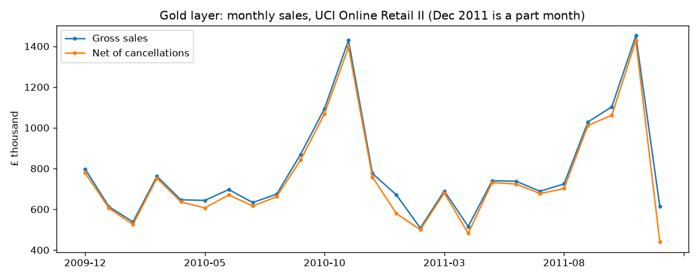

### Project 15 — customer segmentation

```bash
cd projects/15-customer-segmentation
pip install -r requirements.txt
python src/fetch_and_features.py && python src/segment.py && pytest -q && streamlit run app.py
```

3,360 REAL customers (UCI Online Retail), features from 2010-12-01 to
2011-09-09, checked against the next 91 days. A fixed rule chose **k = 4**
k-means segments (silhouette 0.309, bootstrap ARI 0.76 ± 0.28, so only
moderately stable). The VIP / wholesale-scale segment is 36.8% of
customers, 83.6% of spend and 79.2% of the next quarter's revenue. On the
hold-out test, the simple **RFM score beat k-means** at predicting who
buys again (AUC 0.739 vs 0.661), which is reported as the main finding.

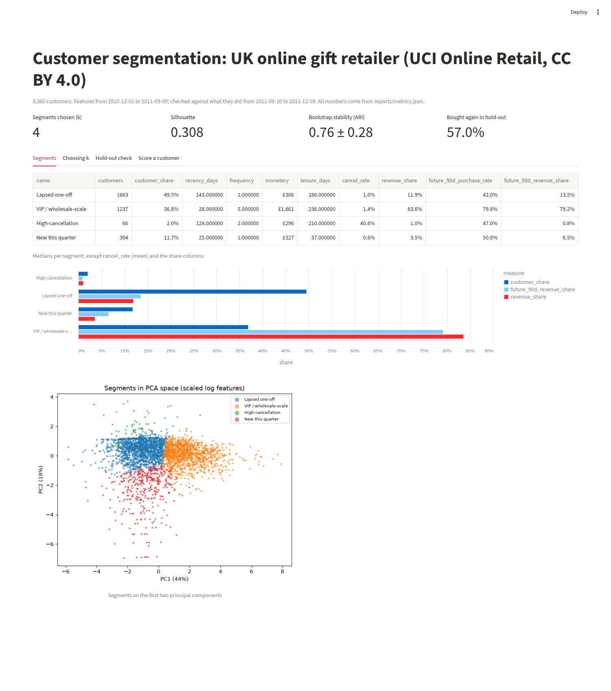

## Production ML and engineering projects 16–21: how to run and headline results

Run on 17–18 November 2026 (Europe/Dublin) on Python 3.13.5, CPU only;
every number below is copied from that project's `reports/metrics.json`.
Each folder has its own requirements, `pytest` tests, README (problem,
approach, results, client value, critical evaluation, next steps),
`CASE_STUDY.md` and `CODE_WALKTHROUGH.md`, and states what was **not**
run.

### Project 16 — tool-using LLM agent with LoRA (in progress)

The evaluation is still running. This section will be filled in from its
`reports/metrics.json` once it is complete.

### Project 17 — MLOps: tracked, registered, served and monitored model

```bash
cd projects/17-mlops-model-serving
pip install -r requirements.txt
python src/train.py && python src/monitor.py && python src/load_test.py && pytest -q
```

REAL UCI Bike Sharing data (CC BY 4.0). Five candidates tracked in MLflow;
gradient boosting beat the best naive baseline by **37.5%** on validation
(MAE 34.09 vs 54.51) and was registered as `champion`. A month-by-month
replay of Apr–Dec 2012 triggered one retrain (May 2012); with the policy,
MAE was **37.02** against 49.65 if never retrained. Drift alerts fired in
all 9 months, so only the accuracy check pointed at the month that
mattered. FastAPI service: single-record p50 8.4 ms, p95 21.4 ms; batch of
100 at 6,490 records/s. 11 tests. The Dockerfile and GitHub Actions
workflow are written but **not run** (no Docker daemon; the push token
lacks the `workflow` scope, so the workflow sits in `ci/`).

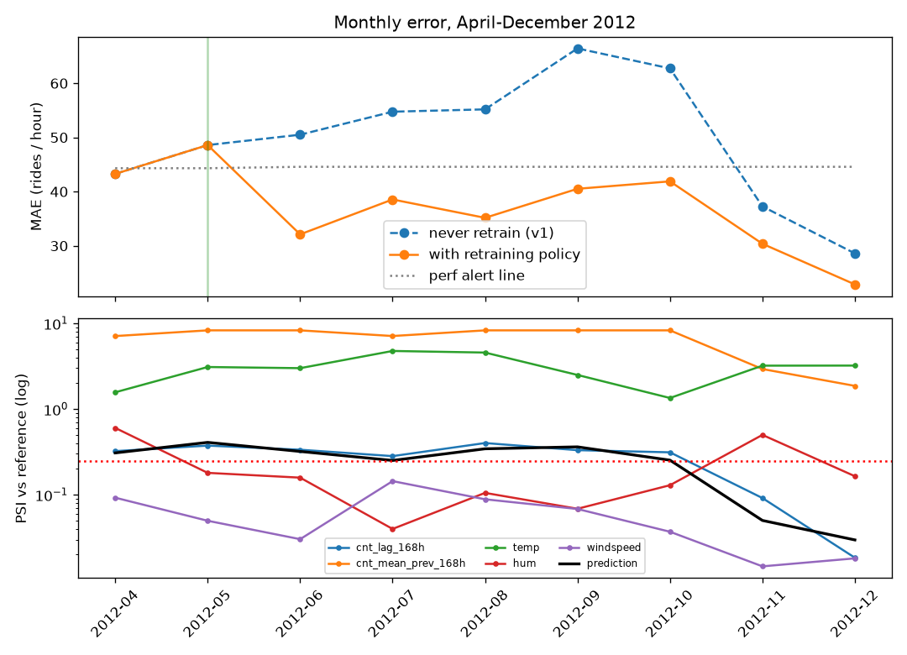

### Project 18 — dbt + Airflow modern data stack

```bash
cd projects/18-dbt-airflow-modern-data-stack
# two venvs (dbt, Airflow): see the project README
./run_backfill.sh
```

REAL NYC TLC yellow-taxi trips, January–February 2024: **5,972,150** raw
rows → **5,704,614** in `fct_trips`. An Airflow 3.4 DAG ran each month
(15.6 s and 16.8 s) through extract-load, `dbt seed`, `dbt build` with **23
dbt tests** and a quality gate. Re-running a month and a full refresh gave
identical MD5s to the incremental build, and a planted bad zone id was
caught by a relationships test. 5 tests.

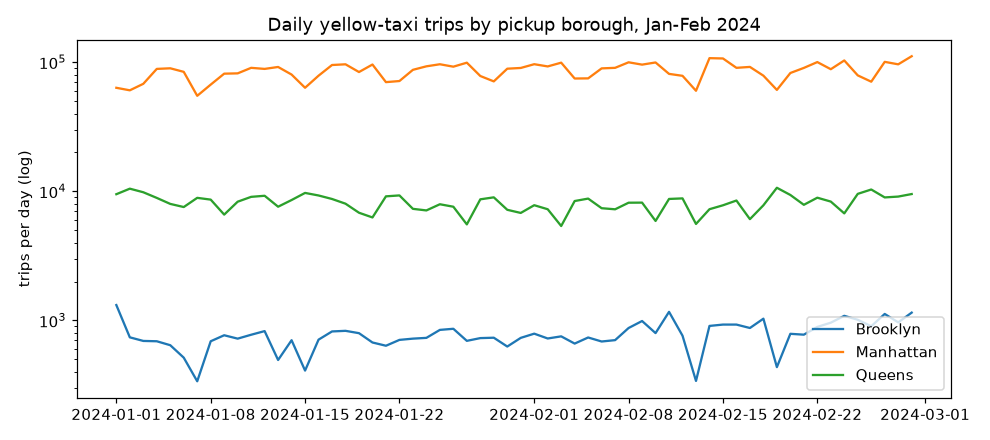

### Project 19 — real-time streaming pipeline (Kafka, exactly-once results)

```bash
cd projects/19-realtime-streaming-pipeline
pip install -r requirements.txt
KAFKA_HOME=/path/to/kafka scripts/start_kafka.sh   # separate terminal
python src/events.py && python src/run_experiment.py && pytest -q
```

169,920 messages built from REAL TLC trips (15–16 Jan 2024) with injected
delays, 1.5% late events and 1.0% duplicates, through a single-node Kafka
4.4 broker. The processor was killed after 60,000 messages with 4,000
uncommitted, then resumed: **all 2,246 five-minute windows matched an
independent batch truth exactly** (165,673 trips, $4,778,022.44), and the
2,554 late events were reported as an identical set. A naive design
crashed at the same point **over-counted trips by 33.6%**. Producer
102,198 msg/s; at 2,000 msg/s, p95 produce-to-processed latency 103 ms and
p95 produce-to-committed 996 ms. Finding: keying by borough put 99% of
messages on one partition. 6 tests. Not run on a multi-broker cluster.

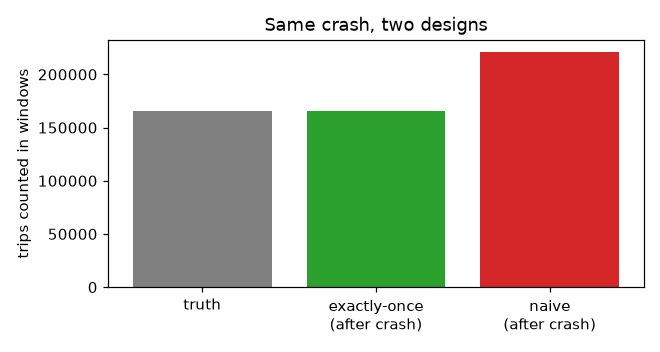

### Project 20 — PCB defect detection (computer vision)

```bash
cd projects/20-pcb-defect-vision
pip install -r requirements.txt
python src/prepare_patches.py && python src/train.py --threads 4 && python src/evaluate.py && pytest -q
```

DeepPCB (MIT licence): real board images with **artificially added**
defects, 4,640 test patches. Fine-tuned ResNet-18 reached **98.02%
accuracy, macro-F1 0.981** over 7 classes (small CNN from scratch: 93.73%,
0.935), and did as well on image groups never seen in training. For
defect vs OK, it missed **12 of 3,140 defects with 5.3% false alarms**,
against 45 missed / 6.0% for a golden-template diff. PatchCore-lite, which
saw only defect-free patches, reached AUROC 0.947 (36 missed, 24.3% false
alarms). Grad-CAM attention sits on the defects. 9 tests. Patch-level
only; whole-board detection was not scored.

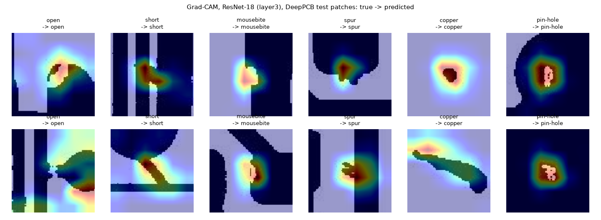

### Project 21 — predictive maintenance (NASA C-MAPSS)

```bash
cd projects/21-predictive-maintenance-cmapss
pip install -r requirements.txt
cd src && python run.py && python charts.py && cd .. && pytest -q
```

Public, **simulated** turbofan run-to-failure data (NASA, public domain),
split by engine. An Isolation Forest health score learnt from healthy
early cycles only separated healthy from end-of-life cycles with test
AUROC **0.999** (median warning 37.5 cycles ahead); a PCA residual score
failed (0.54), which is reported. Gradient boosting RUL: official FD001
test RMSE **15.58** against 37.69 for a fleet-life baseline. With
assumed costs (a failure costs 10× a planned job, 10 cycles' notice), an
alert at predicted RUL ≤ 16 cost **1.48 per engine** (1 failure in 20),
against 3.07 for a fixed service interval and 10.0 for run-to-failure
(oracle 1.00); 1.57 ± 0.38 over 5 engine splits. On FD003 the health
score policy was cheaper (1.16, no failures). 10 tests.

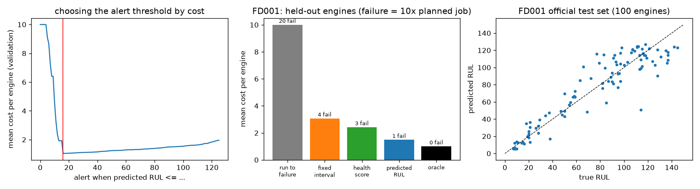

---

## RPL evidence

| File | Purpose |
| --- | --- |
| [`rpl/LEARNING_OUTCOMES_MAP.md`](rpl/LEARNING_OUTCOMES_MAP.md) | Editable table: NFQ Level 9 descriptor → technical outcome → project → evidence file |
| [`rpl/RPL_EVIDENCE_LOG.md`](rpl/RPL_EVIDENCE_LOG.md) | Dated activity log: projects 1–5 on 14 November 2026, projects 6–10 on 15 November 2026, projects 11–15 on 17 November 2026, projects 16–21 on 17–18 November 2026 |

If a chosen programme publishes its own module outcomes, copy a new
column into the map rather than rewriting the projects.

---

## Data protection

Do not put live customer, tenant or claimant data in this repository.
Project 1 and project 3 use files explicitly named and tagged as
`SYNTHETIC` example data. Project 2 uses **public official averages**
(RTB / CSO table RIA02, CC BY 4.0), not confidential tenancy microdata
and not personal data of named tenants. Project 5 indexes a **snapshot
of public guidance pages** (Citizens Information and the RTB); the
text remains the publishers' copyright, and the demo is not legal
advice and should not be used with other people's case papers. A live
product that moved beyond published aggregates or official guidance
would need a lawful basis, minimisation, and usually a DPIA — see the
project critical evaluations.

Projects 6 and 8 use **SYNTHETIC** documents and invoices for a
fictional company and invented suppliers. Project 7 uses IBM's public
Telco churn *sample* (Apache 2.0); gender and senior-citizen status are
excluded from the model and used only for a fairness audit. Project 9
uses **CSO official statistics** (CC BY 4.0). Project 10 uses a **CC0
public dataset** of anonymised reviews; reviewer age is not used.

Projects 11, 12 and 13 use **SYNTHETIC** data generated by seeded scripts
(a fictional plant, retailer and campaign set); no employer or client data
was used. Projects 14 and 15 use the **UCI Online Retail II / Online
Retail** datasets (CC BY 4.0), whose customer IDs are pseudonymous numbers
with no names or contact details; the raw files are downloaded and
checksum-verified by the code and are not committed.

Project 16 queries a **SYNTHETIC** database for a fictional company
("Northlight Components Ltd"); the customer names are invented. Projects
17, 18 and 19 use public open data (UCI Bike Sharing, CC BY 4.0; NYC TLC
trip records, which hold taxi zones and fares but no names). Project 20
uses the DeepPCB images (MIT licence) and project 21 NASA's simulated
C-MAPSS data (public domain); neither contains personal data. Projects 20
and 21 are framed by manufacturing experience, but **no employer data,
images or documents** are used. Raw downloads are fetched and checked by
the code and are not committed.

---

## Repository layout

```
ai-ml-portfolio/
  README.md                          this file
  LICENSE                            MIT, Copyright (c) 2026 Owen Quigley
  rpl/LEARNING_OUTCOMES_MAP.md
  rpl/RPL_EVIDENCE_LOG.md
  projects/01-enquiry-classifier/
  projects/02-irish-rent-predictor/
  projects/03-insurance-lead-scorer/
  projects/04-tyre-demand-forecast/
  projects/05-tenancy-qa-assistant/
  projects/06-document-qa-rag/
  projects/07-telco-churn-explainable/
  projects/08-invoice-extraction/
  projects/09-retail-sales-forecast/
  projects/10-review-sentiment-topics/
  projects/11-manufacturing-kpi-dashboard/
  projects/12-sql-python-etl-pipeline/
  projects/13-marketing-campaign-dashboard/
  projects/14-azure-fabric-medallion-lakehouse/
  projects/15-customer-segmentation/
  projects/16-tool-agent-lora/
  projects/17-mlops-model-serving/
  projects/18-dbt-airflow-modern-data-stack/
  projects/19-realtime-streaming-pipeline/
  projects/20-pcb-defect-vision/
  projects/21-predictive-maintenance-cmapss/
```

This repository is released under the [MIT License](LICENSE).
Copyright (c) 2026 Owen Quigley.
