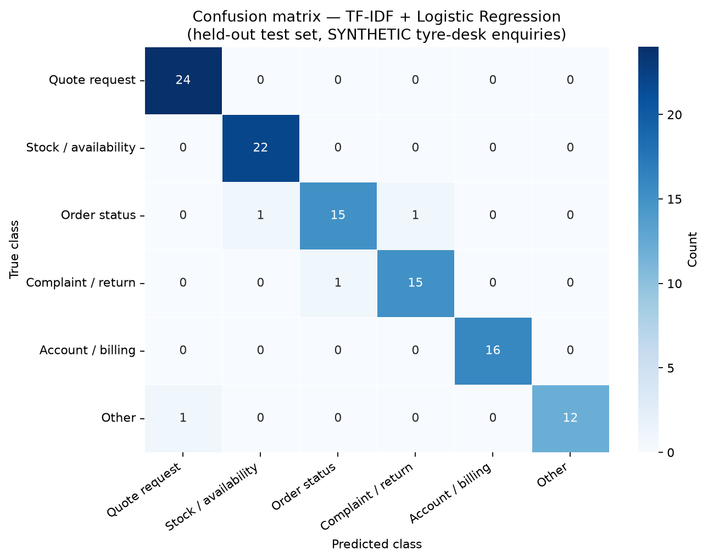
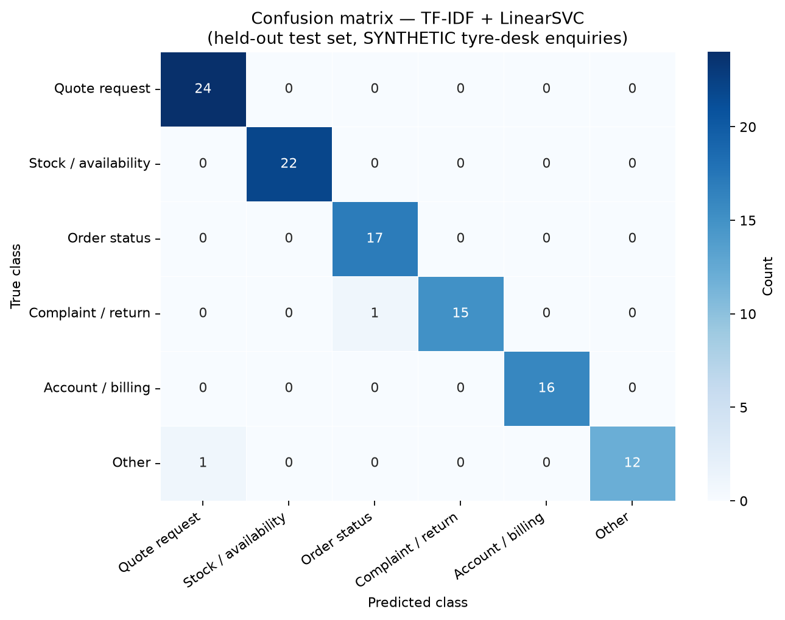
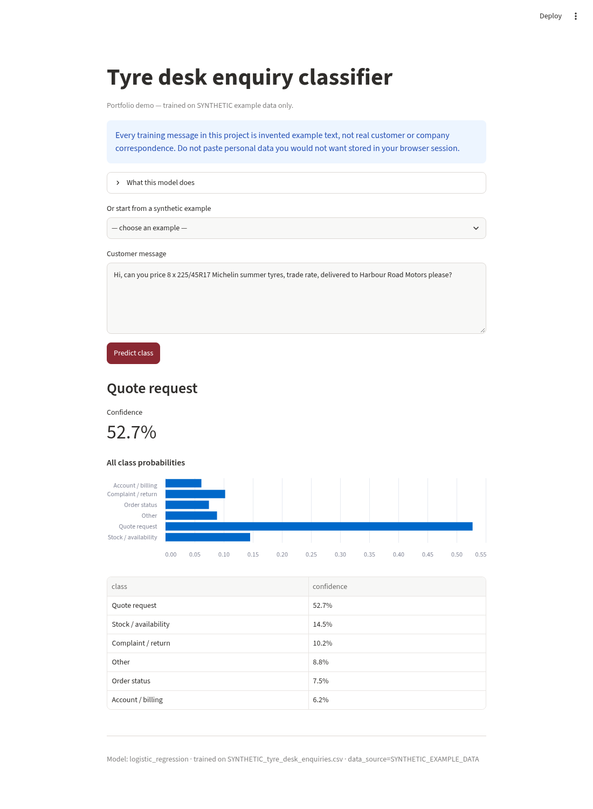

# Enquiry classifier for a B2B tyre / automotive-parts sales desk

A beginner-friendly, fully reproducible text-classification project. It is also
the first case-study in this portfolio: a working demo a sales manager can try,
and documented evidence toward a QQI Level 9 (Master's) RPL file.

The model suggests how an incoming customer message should be routed:

| Class id | Meaning |
| --- | --- |
| `quote_request` | Asking for a price or a formal quote |
| `stock_availability` | Asking whether goods are in stock, and when |
| `order_status` | Chasing an existing order, delivery or collection |
| `complaint_return` | Damage, wrong goods, warranty or a return |
| `account_billing` | Invoices, credit notes, statements, account stop |
| `other` | Hours, catalogues, account opening, everything else |

**Data status:** the training file is **SYNTHETIC example data only**. It does
not contain real customer or company correspondence.

New to the code? Start with the [code walkthrough](CODE_WALKTHROUGH.md). It
explains each file, the run order (`generate` → `train` → `app`), and the
key lines in plain English.

---

## Problem

A trade sales desk lives in the inbox. Quote requests, stock checks, "where's
my order?", complaints, and invoice queries arrive in the same stream, often
written in a hurry. A junior administrator spends a lot of time reading and
forwarding messages to the right person.

The question this project asks is modest and practical: *can a simple,
inspectable machine-learning baseline already sort most of those messages
well enough to be useful — and what would we still need before anyone should
trust it on a live desk?*

That second half of the question is as important as the first. The metrics
below are real numbers from the run on 14 November 2026; they are also
optimistic, for reasons set out in the [critical evaluation](#critical-evaluation).

---

## Data

| Item | Detail |
| --- | --- |
| File | [`data/SYNTHETIC_tyre_desk_enquiries.csv`](data/SYNTHETIC_tyre_desk_enquiries.csv) |
| Rows | 540 labelled messages |
| Source flag | every row has `data_source = SYNTHETIC_EXAMPLE_DATA` |
| Generator | [`src/generate_synthetic_data.py`](src/generate_synthetic_data.py) (seeded, reproducible) |

Class mix (mildly imbalanced, on purpose — a real desk inbox is not uniform):

| Class | Messages |
| --- | ---: |
| quote_request | 120 |
| stock_availability | 110 |
| order_status | 85 |
| complaint_return | 80 |
| account_billing | 80 |
| other | 65 |

Messages are written in the register of Irish trade email and short notes
(tyre sizes, fleet accounts, VAT invoices, collection vs delivery). Names,
order numbers and invoices are invented. See [`data/README.md`](data/README.md).

No live mailbox, CRM export, or real customer record was used.

---

## Approach

The pipeline is classical on purpose: it is easy to explain, cheap to run,
and a fair baseline before anyone reaches for a large language model.

1. **Split.** 80/20 train/test, *stratified* so the test set keeps the same
   class mix, `random_state=42`. That gives 432 training messages and 108
   held-out test messages.
2. **Features.** TF-IDF on unigrams and bigrams (`min_df=2`, English
   stop-words). The vectorizer is fitted on the training text only, so the
   test set cannot leak into the vocabulary. The fitted vocabulary has
   **1,439** terms.
3. **Models** (same features, same split):
   - **DummyClassifier (`most_frequent`)** — a sanity-check baseline.
     Always predicts `quote_request`. If a "real" model cannot beat this,
     it is not learning anything useful.
   - **Logistic Regression** (`class_weight='balanced'`) — the *primary*
     model, because `predict_proba` gives a confidence score the Streamlit
     app can show.
   - **LinearSVC** (`class_weight='balanced'`) — a second classical linear
     baseline, often strong on TF-IDF text.
4. **Metrics.** Accuracy, macro-F1 (treats every class equally, important
   with imbalance) and weighted-F1, plus a full classification report and
   confusion-matrix plots.
5. **Artefacts.** A joblib bundle and a scikit-learn pipeline are saved for
   the demo app.

Code is in [`src/train.py`](src/train.py), with comments aimed at a learner.

---

## Results

Figures below are from the training run on **14 November 2026 (Europe/Dublin)**.
They are copied from [`reports/metrics.json`](reports/metrics.json) and
[`reports/classification_reports.txt`](reports/classification_reports.txt),
not estimated by hand. Re-run `python src/train.py` to regenerate them.

Test set: **108** messages.

| Model | Accuracy | Macro-F1 | Weighted-F1 |
| --- | ---: | ---: | ---: |
| Dummy (most frequent class) | 0.2222 | 0.0606 | 0.0808 |
| **TF-IDF + Logistic Regression** (served in the app) | **0.9630** | **0.9607** | **0.9626** |
| TF-IDF + LinearSVC | 0.9815 | 0.9798 | 0.9814 |

Both linear models beat the dummy baseline by a wide margin, which is the
first thing we needed to check.

### Logistic Regression — per-class test results

| Class | Precision | Recall | F1 | Support |
| --- | ---: | ---: | ---: | ---: |
| quote_request | 0.960 | 1.000 | 0.980 | 24 |
| stock_availability | 0.957 | 1.000 | 0.978 | 22 |
| order_status | 0.938 | 0.882 | 0.909 | 17 |
| complaint_return | 0.938 | 0.938 | 0.938 | 16 |
| account_billing | 1.000 | 1.000 | 1.000 | 16 |
| other | 1.000 | 0.923 | 0.960 | 13 |

The model misclassified **4 of 108** test messages. All four had *low*
confidence (about 0.21–0.29), which is the behaviour we would want if a
desk used a "leave it for a person" threshold. The errors were boundary
cases, not random:

- A late-delivery / driver complaint labelled `complaint_return`, predicted
  `order_status` (delivery language dominates).
- "Has the back order come in yet?" labelled `order_status`, predicted
  `stock_availability` (overlap between "is it in" and "where's my order").
- An order collection question predicted as `complaint_return` at very low
  confidence.
- A question about a loyalty / volume rebate labelled `other`, predicted
  `quote_request` (commercial / pricing language).

### LinearSVC — brief comparison

LinearSVC scored slightly higher on this split (2 misclassifications rather
than 4). The two remaining errors were the late-delivery complaint and the
rebate question — genuinely ambiguous even for a person. LinearSVC is not
the served model because the default estimator does not provide class
probabilities; Logistic Regression does, which matters for a confidence
threshold in a demo (and in any real "auto-route vs human review" design).

Confusion matrices (relative image paths, so they render on GitHub):

Logistic Regression (the model served in the app):



LinearSVC (comparison model):



---

## Demo

The Streamlit app after predicting a synthetic quote-request message
(captured 14 November 2026, Europe/Dublin). This is one example
prediction, not a test-set score.



---

## How to run

From this folder, with Python 3.11+ (developed on 3.13.5). A slower,
annotated tour of the same steps is in [CODE_WALKTHROUGH.md](CODE_WALKTHROUGH.md):

```bash
python3 -m venv .venv
source .venv/bin/activate        # Windows: .venv\Scripts\activate
pip install -r requirements.txt

python src/generate_synthetic_data.py   # writes the SYNTHETIC CSV
python src/train.py                     # metrics, plots, saved model

streamlit run app.py                    # paste a message, see class + confidence
```

Saved model path: `models/tfidf_logistic_regression.joblib`.

The training and data-generation scripts are seeded (`random_state=42` /
`RANDOM_SEED=42`) so a clean re-run should reproduce the same split and
the same metrics.

---

## Critical evaluation

This section is written with QQI / NFQ Level 9 expectations in mind:
critical evaluation of method and evidence, not just a report of a high
score. A single classical baseline does not, by itself, meet a Master's
standard; the evaluation of *why the score looks like this*, *where the
method is weak*, and *what a responsible deployment would require* is the
part that starts to do that work.

### Limitations of the method

- **One train/test split.** With 108 test rows, and only 13–24 examples
  per class, the headline figures have sampling uncertainty. A more
  robust claim would use stratified k-fold cross-validation (and, if we
  start tuning hyperparameters, a nested setup so the test data is not
  used twice).
- **No hyperparameter search.** TF-IDF settings and model regularisation
  are sensible defaults, not a tuned result. LinearSVC's small edge over
  Logistic Regression might move, or even reverse, under a different
  split or grid.
- **Bag-of-n-grams cannot model real discourse well.** The classifier
  sees weighted word and two-word features. It does not model negation
  scope, long-range context, or the difference between "not a complaint,
  just checking" and an actual complaint, except insofar as those words
  happened to appear in the synthetic templates.
- **Single-label assumption.** Real messages are often mixed ("the order
  is late *and* the invoice is wrong"). The current schema forces one
  class. A production design would need multi-label classification or a
  "route to more than one team" option.
- **No external / temporal validation.** Everything is drawn from the
  same generator. That is not a test of whether the model survives next
  month's language, a new product line, or a different writer.

### Bias and optimism in synthetic data

The 0.96–0.98 accuracy figures should **not** be read as "this is ready
for a live sales desk." They are expected to be optimistic, for reasons
that are built into how the data was made:

- Templates create a cleaner class signal than real inboxes. Quote
  messages talk like quotes; billing messages talk like billing. Real
  customers ramble, mix topics, use one-word emails ("stock?"), forward
  chains, and drop in screenshots with no text.
- Lexical overlap between classes is under-represented. The errors we
  *did* see (late delivery as complaint vs order chase; "has the back
  order come in" as stock vs order status; rebate as quote vs other)
  are a hint of the confusion a real mailbox would produce much more
  often.
- The generator reflects one author's idea of a tyre-desk inbox, informed
  by sales-administration experience, but it is still a model of the
  world. It will under-represent accents of English, languages other
  than English, very short messages, and rare but important cases
  (legal threats, safety issues, vulnerable customers).
- Because the same style of template is used in train and test, the
  test set is not a true out-of-distribution check. High accuracy here
  mainly shows that the models can recover a structured template
  language. That is a necessary first test, not a sufficient one.

There is also a fairness / representation issue: if a later version were
trained on real mail, some accounts, regions or ways of writing could be
systematically routed worse than others. That cannot be measured on this
file, and it would need to be measured before any automated routing.

### What a real deployment would need

A responsible deployment is a **decision-support** tool, not an
unsupervised auto-replier. At minimum it would need:

1. **A lawful data basis and a DPIA.** Live enquiries are personal
   data, often of sole traders as well as companies, and may include
   financial details. Under GDPR that means a documented purpose,
   minimisation, access control, retention limits, a path for
   correction/erasure, and usually a Data Protection Impact Assessment
   before profiling is used to route people's messages. Training on
   real mail would need a legal basis, a processing record, and
   preferably anonymisation or tightly scoped pseudonymisation — not a
   CSV sitting in a portfolio repo.
2. **A gold-standard labelled sample from the live mailbox**, annotated
   by more than one staff member, with inter-annotator agreement
   reported. Disagreement is itself evidence about whether the class
   scheme is fit for purpose.
3. **A human-in-the-loop threshold.** Auto-suggest a folder or assignee
   only above a confidence cut-off; leave ambiguous mail (like the four
   low-confidence errors above) in a human queue. Log corrections and
   use them to retrain.
4. **Evaluation that matches the job.** Macro-F1 and a confusion matrix
   are a start. A desk also cares about the cost of a miss: burying a
   complaint is worse than misfiling a catalogue request. A
   cost-sensitive or "never auto-file complaints / legal / safety"
   rule should sit on top of the model.
5. **Monitoring for drift**, a rollback path, and a clear owner. Models
   go stale when product lines, season (winter tyres), or staff change.
6. **A stronger baseline comparison** before any expensive approach is
   sold in: keyword / rules, the linear models here, and only then
   perhaps a small transformer. On real data the ranking may change.
7. **Security and access.** The demo app is local. A hosted version
   would need authentication, no unnecessary logging of message bodies,
   and a data-processing agreement if a third-party host is used.

Until those pieces exist, the honest claim is: *this is a reproducible
baseline and a client-facing demonstration of the workflow*, not a
finished operations product.

---

## Next steps

- Replace a slice of the test set with held-out, hand-written messages
  that were not produced by the template generator, to measure the
  optimism gap.
- Add stratified k-fold results next to the single-split numbers.
- Try a simple keyword / regular-expression baseline, so we can say
  how much the machine-learning step is actually adding.
- Explore multi-label classification for mixed-intent mail.
- If a real desk dataset can be used lawfully, run a DPIA-first pilot
  and compare domain-shift performance against this synthetic baseline.
- Optional later comparison with a compact transformer, only after the
  evaluation protocol above is in place.

---

## Project layout

```
01-enquiry-classifier/
  app.py                          Streamlit demo
  requirements.txt
  README.md                       this file (technical + critical evaluation)
  CODE_WALKTHROUGH.md             beginner tour of the files and key code
  CASE_STUDY.md                   short client-facing write-up
  src/generate_synthetic_data.py
  src/train.py
  data/SYNTHETIC_tyre_desk_enquiries.csv
  data/README.md
  models/tfidf_logistic_regression.joblib
  reports/metrics.json
  reports/classification_reports.txt
  reports/confusion_matrix_logistic_regression.png
  reports/confusion_matrix_linear_svc.png
  reports/app_screenshot.png
```
