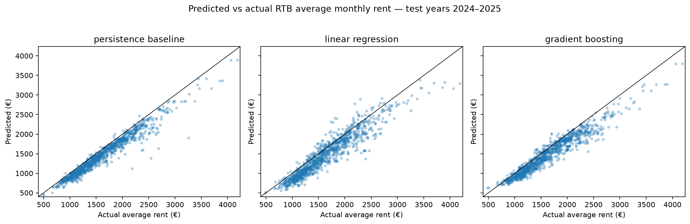
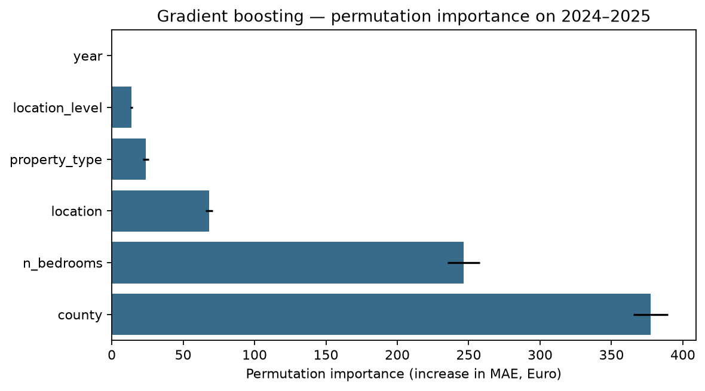
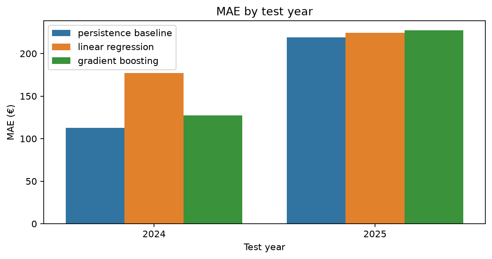
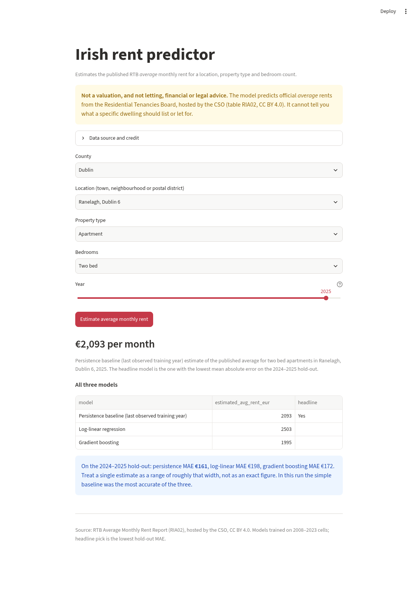

# Irish rent predictor (RTB / CSO official averages)

A regression project that estimates the **published average monthly rent**
for an Irish location, property type and bedroom count. It is a
client-facing demo and a documented piece of evidence toward a QQI
Level 9 (Master's) RPL file.

**Data status:** this project uses **real public official statistics** —
the Residential Tenancies Board (RTB) Average Monthly Rent Report
(CSO PxStat table **RIA02**), licensed under
[CC BY 4.0](https://creativecommons.org/licenses/by/4.0/).
It does **not** use confidential tenancy microdata, and it does not
predict the asking price of a named dwelling.

New to the code? Start with the [code walkthrough](CODE_WALKTHROUGH.md).

This is **not** a valuation and not letting, financial or legal advice.

---

## Problem

Landlords, agents and renters often want a sensible figure for "what
does a two-bed apartment in this area usually cost, on average?" The
RTB already publishes those averages, but they live in a large
statistical cube. This project asks two questions:

1. Can a simple, inspectable model estimate a published average for a
   location / type / bedroom combination, including recent years?
2. Does a machine-learning model actually beat a careful baseline once
   we hold out *future* years, rather than shuffling rows at random?

The second question is the Level 9 one. The metrics below are from a
real run on 14 November 2026 (Europe/Dublin). They are not estimates.

---

## Data

| Item | Detail |
| --- | --- |
| Table | RIA02 — RTB Average Monthly Rent Report |
| Producer | Residential Tenancies Board (RTB) |
| Host | Central Statistics Office (CSO) PxStat |
| API | [ReadDataset/RIA02/JSON-stat/2.0/en](https://ws.cso.ie/public/api.restful/PxStat.Data.Cube_API.ReadDataset/RIA02/JSON-stat/2.0/en) |
| Landing page | [data.gov.ie — RIA02](https://data.gov.ie/dataset/ria02-rtb-average-monthly-rent-report) |
| Licence | [CC BY 4.0](https://creativecommons.org/licenses/by/4.0/) |
| Cube last updated (API field) | 14 May 2026, 11:00 UTC |
| Fetched | 14 November 2026 (Europe/Dublin) |
| Tidy extract | [`data/ria02_average_monthly_rent.csv`](data/ria02_average_monthly_rent.csv) |

Please credit the RTB and the CSO if you reuse the figures. See
[`data/README.md`](data/README.md) and
[`data/source_metadata.json`](data/source_metadata.json).

Each row is one published **average monthly rent in Euro** for a
year × location × property type × bedroom-count cell. Filters applied
before modelling:

- dropped overlapping aggregates ("All bedrooms", "1 to 2 bed", "1 to 3 bed", "All property types")
- dropped **county-wide totals**, which nest the towns already in the file

What remains: **21,350** rows, **378** locations (cities, Dublin postal
districts, towns and neighbourhoods), years **2008–2025**. Bedroom
counts kept: one, two, three, four-plus. Property types: detached,
semi-detached, terrace, apartment, other flats.

The number of published (non-suppressed) cells falls in later years —
from 709 non-county cells in 2023 to 585 in 2024 and 480 in 2025. That
is a feature of the official table, not of this script.

---

## Approach

1. **Temporal hold-out, not a random split.** Train on **2008–2023**
   (20,285 rows). Test on **2024–2025** (1,065 rows). This matches the
   real use of the model and stops future rent levels leaking into
   training.
2. **Features.** Year, location, county (derived from the location
   label), location level, property type, and bedroom count (1–4).
3. **Three models, same split:**
   - **Persistence baseline** — the last observed training-year rent
     for the same location / type / bedrooms, with county and global
     mean fallbacks. This is the obvious naive forecast for a slow-moving
     official average.
   - **Log-linear regression** — linear regression on `log(rent)`,
     one-hot categoricals, scaled year and bedrooms; predictions
     converted back to Euro.
   - **Gradient boosting** — `HistGradientBoostingRegressor` (sklearn).
     Chosen as the tree model because a large random forest produced a
     200 MB+ artefact, which is not practical in this repository.
     Location has more than 255 unique values, so only county, level
     and type are declared as categorical; location is passed as an
     ordinal integer (a limitation, discussed below).
4. **Metrics** in Euro: MAE, RMSE, R², and mean bias (predicted −
   actual). Feature importance is permutation importance (increase in
   MAE) on the 2024–2025 hold-out.

Code: [`src/fetch_cso_ria02.py`](src/fetch_cso_ria02.py),
[`src/train.py`](src/train.py), [`src/baseline.py`](src/baseline.py).

---

## Results

Figures below are copied from
[`reports/metrics.json`](reports/metrics.json) after the run on
14 November 2026 (Europe/Dublin). Re-run `python src/train.py` to
regenerate them.

Test set: **1,065** published cells in 2024 and 2025.

| Model | MAE (€) | RMSE (€) | R² | Mean bias (€) |
| --- | ---: | ---: | ---: | ---: |
| **Persistence baseline** (headline) | **160.71** | **203.90** | **0.8580** | **−158.58** |
| Log-linear regression | 198.42 | 247.19 | 0.7913 | −167.26 |
| Gradient boosting | 172.40 | 219.35 | 0.8356 | −161.33 |

The simple baseline is the most accurate of the three. That is a real
result, not a setup error, and it is discussed in the critical
evaluation. The Streamlit app uses persistence as the headline figure
and still shows the other two models for comparison.

By test year (MAE, €):

| Year | n | Persistence | Log-linear | Gradient boosting |
| --- | ---: | ---: | ---: | ---: |
| 2024 | 585 | 112.96 | 177.04 | 127.50 |
| 2025 | 480 | 218.91 | 224.48 | 227.12 |

All three models **under-predict** on average (negative bias), and the
error is larger in 2025 than in 2024 — consistent with rents continuing
to rise after the last training year (2023). For the persistence
baseline, MAE and the absolute bias are almost the same, which means
most of its error is a systematic level shift, not scatter.

Permutation importance for gradient boosting on the 2024–2025 hold-out
(increase in MAE, Euro):

| Feature | Importance | Std |
| --- | ---: | ---: |
| county | 377.55 | 12.10 |
| n_bedrooms | 246.45 | 11.17 |
| location | 68.17 | 2.70 |
| property_type | 23.77 | 2.02 |
| location_level | 13.80 | 1.00 |
| year | 0.00 | 0.00 |

Year importance of zero on this test set is expected: the test years
are *after* the last year the tree saw, and permuting 2024 with 2025
does not change a model that cannot extrapolate a time trend. County
and bedroom count carry most of the signal that remains.

Plots:







### Informal post-hoc check (not a pre-registered model)

After seeing that almost all of the persistence error was a downward
bias, a single diagnostic was run: grow the last observed rent by the
median 2020–2023 year-on-year change in the training data (**4.63%**).
That unofficial variant had MAE **€84.21**, RMSE **€128.97**,
R² **0.9432**, bias **−€55.43**. Because it was designed *after*
looking at the residuals, it is not a confirmatory result. It is
included only to show where the remaining error lives — in unmodelled
drift — and as a candidate for a later, pre-declared comparison.

---

## Demo

The Streamlit app after estimating a two-bed apartment in Ranelagh,
Dublin 6, for 2025 (captured 14 November 2026, Europe/Dublin). The
headline figure is the persistence baseline, which had the lowest
hold-out MAE.



---

## How to run

From this folder, with Python 3.11+ (developed on 3.13.5). A slower,
annotated tour is in [CODE_WALKTHROUGH.md](CODE_WALKTHROUGH.md):

```bash
python3 -m venv .venv
source .venv/bin/activate        # Windows: .venv\Scripts\activate
pip install -r requirements.txt

python src/fetch_cso_ria02.py    # downloads RIA02 (needs a network)
python src/train.py              # metrics, plots, saved model

streamlit run app.py
```

If the CSO API cannot be reached, the committed tidy CSV and metadata
in `data/` are enough to run `train.py` and the app. Please keep the
attribution if you redistribute them.

---

## Critical evaluation

Written with QQI / NFQ Level 9 expectations in mind: evaluate the
claim, not just the pipeline.

### The baseline won, and that matters

On a temporal hold-out, last-observed official averages beat both a
log-linear model and gradient boosting (MAE €160.71 vs €172.40 vs
€198.42). A portfolio that hid the baseline, or that reported only a
random-split score, would have been misleading. Official RTB averages
are highly persistent: next year's published cell is usually close to
the last one, plus a drift that none of the three *pre-declared*
models captured well.

Trees are a particularly poor tool for extrapolating a time trend.
Once `year` is past 2023, histogram boosting cannot follow the slope;
permutation importance of year on 2024–2025 is exactly zero. The
log-linear model *can* extrapolate a global slope, and still lost,
which suggests that a single national year effect is too crude for
this market.

### What the target actually is

The model estimates a **published average**, not a rent that a
particular tenant will pay. Averages hide within-area spread, new
builds, rent pressure zones, and asking-versus-agreed differences.
A good score on this file is not evidence that we can price a single
property.

### Data limits and possible bias

- Later years have fewer published cells. If suppression is more
  common in thin or unusual markets, the 2024–2025 test set is not a
  random sample of all location / type / bedroom combinations.
- Cities, Dublin postal districts and neighbourhoods still nest. We
  dropped county totals, but "Dublin 6" and "Ranelagh, Dublin 6" are
  both present, so rows are not fully independent.
- Location is a high-cardinality feature (378 levels). sklearn's
  histogram booster caps categorical cardinality at 255, so location
  was passed as an ordinal integer. That encoding has no natural
  order and likely mutes local-area signal — which is consistent with
  county outranking location in the importance plot.
- The cube is annual. It cannot speak to intra-year seasonality.

### What a serious deployment would need

- A pre-declared growth-adjusted or time-series baseline (the post-hoc
  4.63% check suggests this is the first thing to try, not a deeper
  tree).
- Evaluation on a rolling origin (train to 2021 / test 2022, train to
  2022 / test 2023, and so on), not a single cut at 2023.
- Uncertainty intervals, not a single Euro figure.
- Clear labelling in any product UI that the output is an estimate of
  an official average, with the RTB / CSO attribution, and is not a
  valuation.
- A plan for each annual PxStat update, including a check for
  definitional changes in the cube.

Until those are in place, the honest claim is: *this is a reproducible
estimator of published RTB averages, and on the 2024–2025 hold-out a
persistence baseline is the best of the three models we compared.*

---

## Next steps

- Pre-register a growth-adjusted persistence model and a rolling-origin
  evaluation, then compare it with the three models already here.
- Try a location-specific drift term, or a mixed model with a county
  or location random slope on year.
- Target-encode location so a boosted model can use it as a proper
  categorical without hitting the 255-level cap.
- Add a plot of residuals against 2023 rent, to see whether drift is
  proportional or additive.

---

## Project layout

```
02-irish-rent-predictor/
  app.py
  requirements.txt
  README.md
  CODE_WALKTHROUGH.md
  CASE_STUDY.md
  src/fetch_cso_ria02.py
  src/baseline.py
  src/train.py
  data/README.md
  data/source_metadata.json
  data/ria02_average_monthly_rent.csv
  data/ria02_raw.json
  models/rent_predictor.joblib
  reports/metrics.json
  reports/metrics.txt
  reports/pred_vs_actual.png
  reports/feature_importance.png
  reports/mae_by_year.png
  reports/app_screenshot.png
```
