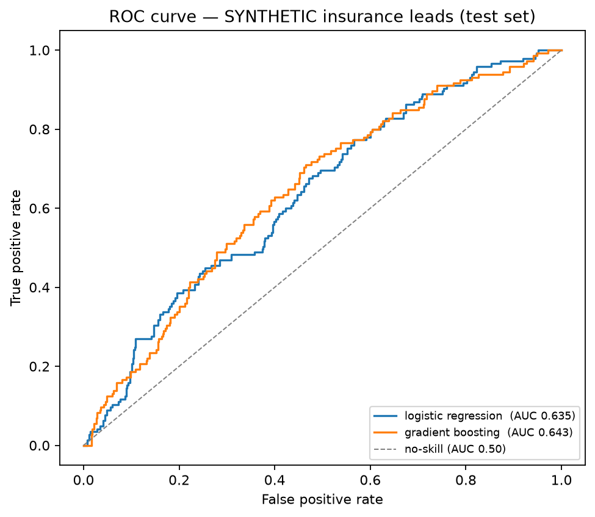
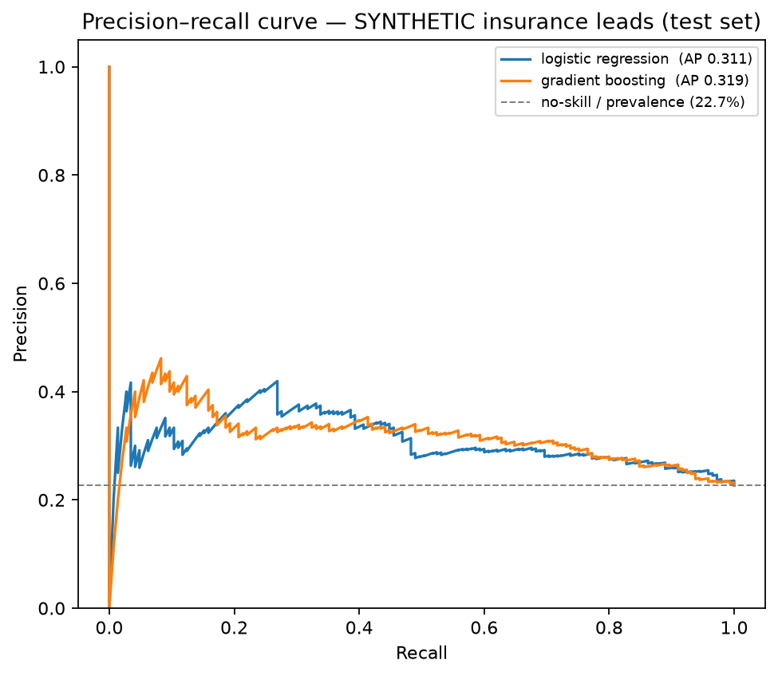
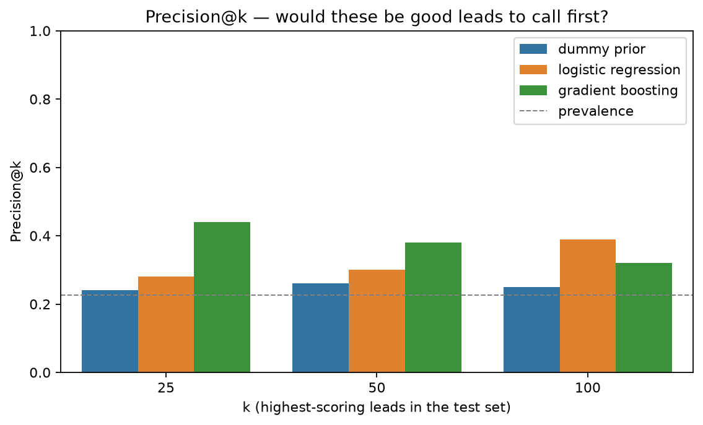
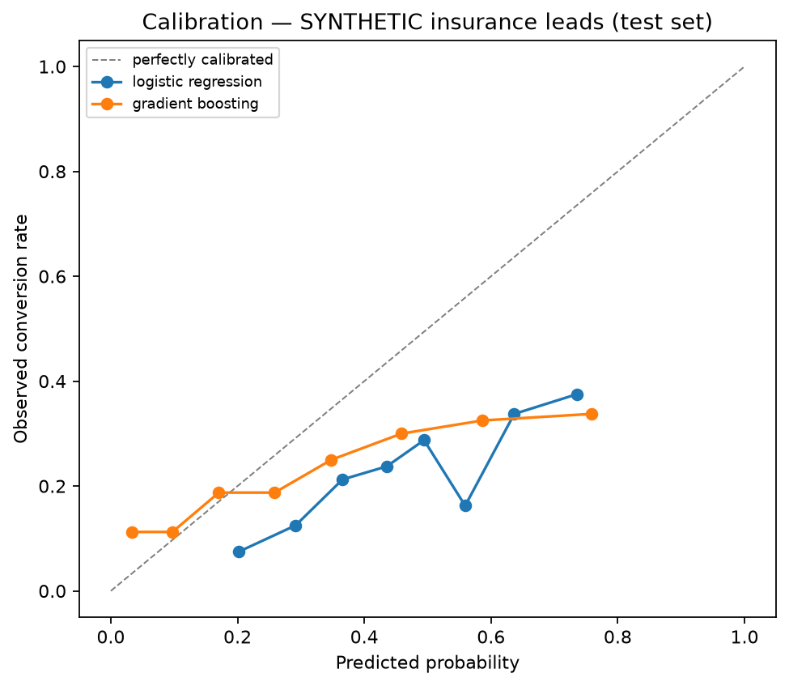
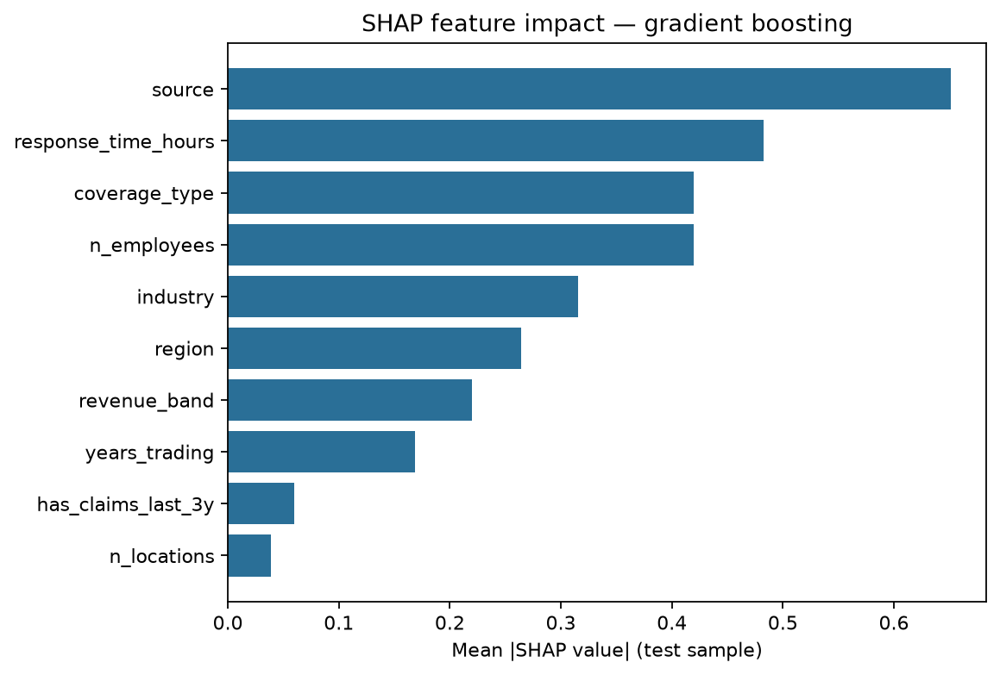
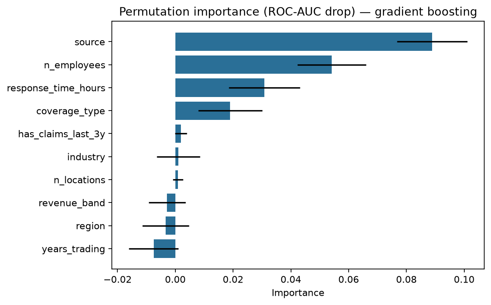
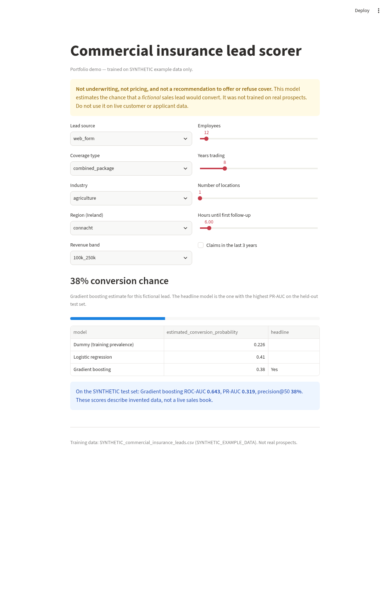

# Commercial insurance lead scorer

A binary classifier that estimates whether a commercial insurance *sales
lead* would convert. It is a client-facing demo and a documented piece
of evidence toward a QQI Level 9 (Master's) RPL file.

**Data status:** the training file is **SYNTHETIC example data only**.
It is not taken from any broker, insurer or CRM. Every row is tagged
`SYNTHETIC_EXAMPLE_DATA`.

New to the code? Start with the [code walkthrough](CODE_WALKTHROUGH.md).

This is **not underwriting**, not a pricing tool, and not a
recommendation to offer or refuse cover.

---

## Problem

A commercial insurance desk does not work every incoming lead with the
same intensity. Referral business and existing clients often convert;
cold outbound less often; a slow follow-up wastes a warm enquiry.
The practical question is: *if a salesperson can only work the next 50
leads carefully, how should they be ranked — and can we trust the
probability the model prints?*

Because conversions are the minority class (22.6% in this file),
accuracy would be a misleading headline. We report ROC-AUC, PR-AUC,
precision@k, and a calibration plot. The numbers below are from a real
run on 14 November 2026 (Europe/Dublin).

---

## Data

| Item | Detail |
| --- | --- |
| File | [`data/SYNTHETIC_commercial_insurance_leads.csv`](data/SYNTHETIC_commercial_insurance_leads.csv) |
| Rows | 3,200 invented leads |
| Positives | 723 converted (22.6%) |
| Generator | [`src/generate_synthetic_leads.py`](src/generate_synthetic_leads.py) (seeded) |

Features (no protected characteristics — see the ethics note):

- industry, employee count, revenue band, years trading, number of locations
- coverage type (public liability, employers' liability, property, fleet, PI, combined package, cyber)
- source (broker referral, existing client, web form, inbound call, comparison site, cold outbound)
- region in Ireland (Dublin, rest of Leinster, Munster, Connacht, Ulster–ROI)
- hours until first follow-up, and whether there were claims in the last three years

Labels are produced by a *documented, noisy process* in the generator
(source, response time, size, cover type and a few interactions).
Region was given only a small effect so we can later ask whether a
fitted model over-uses it. See [`data/README.md`](data/README.md).

---

## Approach

1. **Stratified 80/20 split** (`random_state=42`): 2,560 train, 640
   test, test prevalence 22.7% (145 positives).
2. **Imbalance handling.** `class_weight="balanced"` on both learning
   models, so the minority class is not ignored. This helps ranking; it
   often *hurts* calibration — which is why a calibration plot is part
   of the evaluation, not an afterthought.
3. **Three models, same split:**
   - **Dummy prior** — predicts the training prevalence. The no-skill
     baseline for PR-AUC.
   - **Logistic regression** — one-hot categoricals, scaled numeric
     features, balanced class weights.
   - **Histogram gradient boosting** — sklearn
     `HistGradientBoostingClassifier`, balanced class weights,
     categoricals declared explicitly.
4. **Metrics.** ROC-AUC, PR-AUC, precision at k = 25, 50, 100 and at
   the top 10% of the test set, plus a reliability diagram.
5. **Explainability.** SHAP 0.54.1 installed cleanly and was used for
   a mean-|SHAP| bar plot on the test set. Permutation importance
   (ROC-AUC drop) is also reported, because the two methods can
   disagree.
6. **Slice analysis** by region, industry and source, as a fairness /
   operational-ethics check.

---

## Results

Copied from [`reports/metrics.json`](reports/metrics.json) after the
run on 14 November 2026 (Europe/Dublin). Test set: **640** leads,
**145** conversions.

| Model | ROC-AUC | PR-AUC | P@25 | P@50 | P@100 | P@top 10% (k=64) |
| --- | ---: | ---: | ---: | ---: | ---: | ---: |
| Dummy (prior) | 0.5000 | 0.2266 | 0.24 | 0.26 | 0.25 | 0.25 |
| Logistic regression | 0.6352 | 0.3114 | 0.28 | 0.30 | **0.39** | 0.3125 |
| **Gradient boosting** (headline) | **0.6433** | **0.3190** | **0.44** | **0.38** | 0.32 | **0.375** |

Both learning models beat the dummy on ROC-AUC and PR-AUC. The lift is
**real but modest**. Gradient boosting is the headline model (highest
PR-AUC). At the very top of the list it is the more precise of the two
(P@25 = 0.44, P@50 = 0.38, against a 22.7% prevalence). At k = 100,
logistic regression actually ranks better (0.39 vs 0.32). A sales desk
that only works a shortlist should look at precision@k, not only AUC.







### Calibration



Both models, especially once scores get large, **over-predict**
conversion. A predicted 0.6 is not close to an observed 0.6. That is
the expected side-effect of `class_weight="balanced"`: it boosts
recall on the minority class and inflates probabilities. The app
therefore shows a score that is useful for *ranking*, and the README
warns against reading it as a well-calibrated chance. A later version
should add a calibration step (for example isotonic regression on a
validation fold) if the number will be shown to a person as a
percentage.

### Explainability

SHAP (installed and used) and permutation importance agree that
**source**, **response time** and **size / cover type** carry most of
the signal — which matches the process that generated the labels.





Permutation importance of **region** is essentially zero (−0.003).
SHAP still attributes some average impact to region. The slice table
below is the more important fairness check: Dublin leads were
systematically scored too high, and ranking quality there was weak
(ROC-AUC 0.56).

---

## Demo

The Streamlit app scoring a fictional web-form lead (captured
14 November 2026, Europe/Dublin):



---

## How to run

From this folder, with Python 3.11+ (developed on 3.13.5). A slower
tour is in [CODE_WALKTHROUGH.md](CODE_WALKTHROUGH.md):

```bash
python3 -m venv .venv
source .venv/bin/activate
pip install -r requirements.txt

python src/generate_synthetic_leads.py
python src/train.py
streamlit run app.py
```

`shap` is pinned because it installed cleanly on this run and produced
the explainability plot. If it fails to install in another environment,
delete that line and re-run: `train.py` will fall back to permutation
importance only.

---

## Critical evaluation, fairness and ethics

Written with QQI / NFQ Level 9 expectations in mind.

### The scores are modest, and they should be

A ROC-AUC of 0.64 on a file *we ourselves generated* is not a triumph.
The planted signal (source, follow-up speed, a mid-size bump) is
recoverable, but it is noisy, and the two learning models are close to
each other. On a real CRM the lift could be larger, smaller, or
unstable. These figures must not be quoted as "the model is 64%
accurate," which would be false in two ways (AUC is not accuracy, and
the data are invented).

### Synthetic labels are not a market

The conversion process is a formula plus noise, written by the same
author as the model. That is useful for a reproducible demo and
dangerous as evidence of real-world skill. There is no concept drift,
no missing fields, no salesperson who marks a lead "converted" late,
and no rejection by an underwriter after the sales team is hopeful.

### Imbalance, threshold and calibration

22.6% positives is a moderate imbalance, not a rare-event problem. We
still used class weights and PR-AUC, which is the right habit. The
cost of the habit is visible in the calibration plot. For a desk, the
actionable number is usually precision@k ("if we call these 50, how
many convert?"), not a raw 0–1 score.

### Fairness and ethics

- **No protected characteristics were used.** Gender, age, nationality,
  religion and disability are not in the file. That is a design choice,
  not proof of fairness: region, industry and firm size can still
  stand in for who gets a callback.
- **Region was given only a small effect in the generator.**
  Permutation importance treated it as unused, which is encouraging,
  but slice metrics did not: Dublin's mean predicted score (0.37) sat
  well above its actual conversion rate (0.22), and Dublin ROC-AUC was
  only 0.56. A live ranking rule could quietly spend too much effort
  in one area and too little in another.
- **This is a sales-conversion model, not a risk model.** Using a
  score like this to price or refuse cover would be a different, and
  regulated, activity. The app and case study say so explicitly.
- **Live prospect data is personal data.** Email addresses, phone
  numbers and even a sole trader's trading name fall under GDPR. This
  portfolio file stays synthetic. A real deployment would need a
  lawful basis, minimisation, a retention limit, and usually a DPIA
  before profiling people for "who to call first."
- **Feedback loops.** If the desk only works high-scoring leads, later
  training data will no longer represent the leads that were ignored.
  Any later real project should log overrides and sample the
  low-scoring tail.

### What a serious deployment would need

A labelled sample from the real book (with agreement on what
"converted" means), a time-based split, a calibrated probability if a
percentage will be displayed, a human override, a monitoring plan, and
a clear rule that the score cannot be reused for underwriting.

---

## Next steps

- Add a calibration layer and re-report precision@k alongside
  calibrated probabilities.
- Use a temporal split once leads have a date, and test for drift.
- Threshold analysis: pick k from capacity (how many a desk can work),
  not from a default 0.5 cut-off.
- If a lawful live-data pilot ever happens, keep it out of this
  public repository.

---

## Project layout

```
03-insurance-lead-scorer/
  app.py
  requirements.txt
  README.md
  CODE_WALKTHROUGH.md
  CASE_STUDY.md
  src/generate_synthetic_leads.py
  src/train.py
  data/SYNTHETIC_commercial_insurance_leads.csv
  data/README.md
  models/lead_scorer.joblib
  reports/metrics.json
  reports/roc_curve.png
  reports/pr_curve.png
  reports/calibration.png
  reports/precision_at_k.png
  reports/explainability.png
  reports/permutation_importance.png
  reports/app_screenshot.png
```
