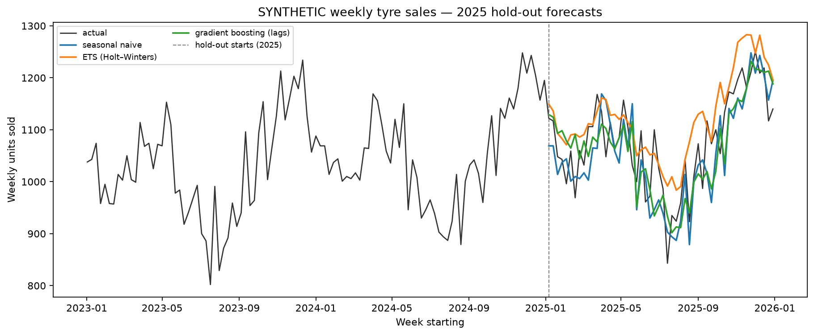
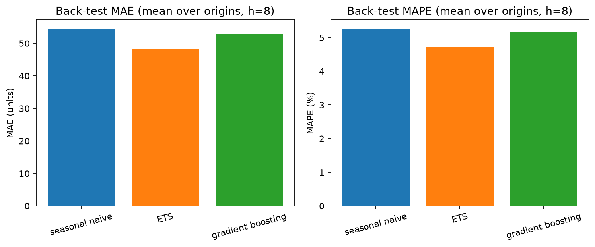
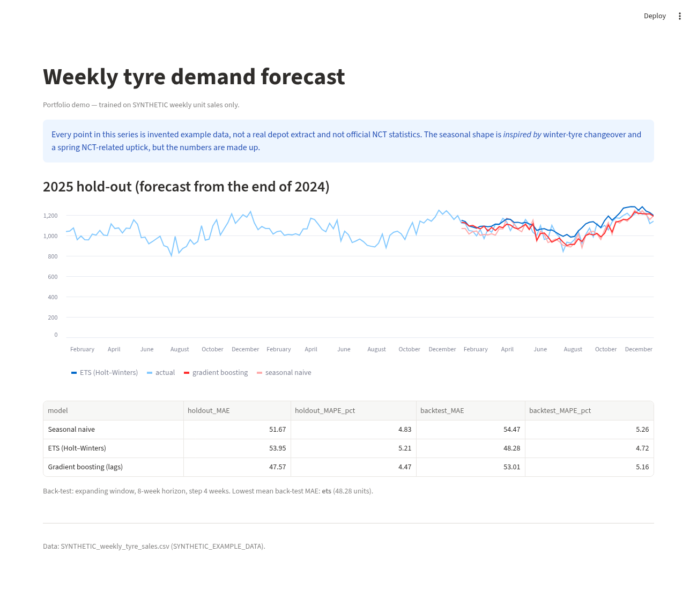

# Tyre demand forecast (weekly, SYNTHETIC)

A weekly sales-forecasting project for a fictional Irish tyre desk. It
is a client-facing demo and documented evidence toward a QQI Level 9
(Master's) RPL file.

**Data status:** the series is **SYNTHETIC example data only**. It is
not a real depot extract and not official NCT or CSO volume data.
Seasonal bumps are *inspired by* winter-tyre changeover and a spring
NCT-related uptick; the numbers themselves are invented.

New to the code? Start with the [code walkthrough](CODE_WALKTHROUGH.md).

---

## Problem

A trade tyre desk needs to know, a few weeks ahead, roughly how many
units to hold. Demand is seasonal: winter-tyre changeover in late
autumn, a quieter mid-summer, a spring rise when cars come out of
winter and NCT bookings pick up. The practical question is whether a
classical seasonal model, a lag-based machine-learning model, or
simply "the same week last year" is the most reliable 8-week forecast
— and whether that answer is stable when we roll the origin forward
rather than testing on a single year.

---

## Data

| Item | Detail |
| --- | --- |
| File | [`data/SYNTHETIC_weekly_tyre_sales.csv`](data/SYNTHETIC_weekly_tyre_sales.csv) |
| Frequency | Weekly, weeks starting Monday |
| Span | 7 January 2019 – 29 December 2025 (**365** weeks) |
| Generator | [`src/generate_synthetic_series.py`](src/generate_synthetic_series.py) (seed 42) |

The series is built from a gentle upward trend, a late-year winter-tyre
bump, a spring NCT-inspired bump, an early-autumn check, a mid-summer
lull, a short invented 2020 dip, and noise. See
[`data/README.md`](data/README.md).

---

## Approach

1. **Time-based evaluation only.** No shuffled train/test split.
2. **Expanding-window back-test** (the headline protocol): at each
   origin, train on all history up to that week, forecast the next
   **8** weeks, then step the origin forward **4** weeks. Origins
   start after three years of history. **51** origins in this run.
3. **A single 2025 hold-out** is also scored and plotted: models are
   fitted through the end of 2024 and asked to forecast all 52 weeks
   of 2025. This is easier to look at, but it is *one* origin, so it
   can disagree with the back-test.
4. **Three models:**
   - **Seasonal naive** — \(\hat y_t = y_{t-52}\) (same week last year).
   - **ETS (Holt–Winters)** — statsmodels `ExponentialSmoothing` with
     additive trend and additive seasonality of period 52.
   - **Gradient boosting with lag features** — `HistGradientBoostingRegressor`
     on lags 1, 2, 4, 13, 26, 52, rolling means, week-of-year and
     Fourier terms; forecasts are produced recursively (each step's
     prediction is fed into the next lag).

Metrics: MAE (units) and MAPE (%). All numbers are from the run on
14 November 2026 (Europe/Dublin).

---

## Results

Copied from [`reports/metrics.json`](reports/metrics.json).

### Expanding-window back-test (51 origins, 8-week horizon)

| Model | Mean MAE (units) | Mean MAPE (%) |
| --- | ---: | ---: |
| **ETS (Holt–Winters)** | **48.28** | **4.72** |
| Gradient boosting (lags) | 53.01 | 5.16 |
| Seasonal naive | 54.47 | 5.26 |

ETS is the most accurate of the three under this protocol, which is
the one we treat as the primary comparison.

### 2025 hold-out (one origin, 52 weeks)

| Model | MAE (units) | MAPE (%) |
| --- | ---: | ---: |
| Gradient boosting (lags) | 47.57 | 4.47 |
| Seasonal naive | 51.67 | 4.83 |
| ETS (Holt–Winters) | 53.95 | 5.21 |

On this *single* year the ranking reverses: gradient boosting wins and
ETS is last. That disagreement is a finding, not a bug. A one-year
picture can flatter a model that happens to fit 2025; the back-test
averages over many origins and is the fairer headline. The app and
this README report both.





All three models track the seasonal shape in 2025. ETS sits a little
high in the autumn of the hold-out year; the seasonal naive and the
lag model hug the actual series more closely there, which is why they
win on that one origin.

---

## Demo

The Streamlit app showing the 2025 hold-out and both metric tables
(captured 14 November 2026, Europe/Dublin):



---

## How to run

From this folder, Python 3.11+ (developed on 3.13.5). A slower tour
is in [CODE_WALKTHROUGH.md](CODE_WALKTHROUGH.md):

```bash
python3 -m venv .venv
source .venv/bin/activate
pip install -r requirements.txt

python src/generate_synthetic_series.py
python src/train.py
streamlit run app.py
```

`train.py` refits ETS and the lag model at every back-test origin and
may take a minute.

---

## Critical evaluation

Written with QQI / NFQ Level 9 expectations in mind.

### The evaluation protocol is the result

If we had only published the 2025 hold-out, we would have declared
gradient boosting the winner. The expanding-window back-test, which is
closer to how a desk would actually use a forecast, prefers ETS by a
clear but not huge margin (MAE 48.28 vs 53.01 vs 54.47). Reporting
both, and saying which one is the headline, is the Level 9 habit this
project is meant to show.

The three models are also *close*. On a series we designed ourselves
to be strongly seasonal, "same week last year" is already a serious
baseline (MAPE 5.26%). Any later claim of a "better" model has to beat
that, not just a mean forecast.

### Limits of the data and the models

- The seasonality was planted. Recovering it is necessary, not
  evidence that we can forecast a live depot.
- ETS raised `ConvergenceWarning` on some origins. The fits still
  produced forecasts, but an official process would inspect those
  origins and consider a damped trend or a Box-Cox variant.
- The lag model's 8-step (and 52-step) forecasts are recursive, so
  errors can compound. A direct multi-horizon model might behave
  differently.
- The 2020 dip is a one-off invented shock. Seasonal naive repeats it
  a year later; ETS and the lag model have to absorb it in the
  history. A real shock (a strike, a snow week) would need a similar
  hard look.
- Weekly MAPE of around 5% looks tidy because the series is smooth
  relative to its level. A live series with cancelled orders and
  stock-outs would be noisier.

### What a serious deployment would need

A real weekly extract, a pre-declared back-test (horizon, step, start
date), prediction intervals, and a review each time the forecast is
used to buy stock. Until then, the honest claim is: *on this invented
seasonal series, ETS was the most reliable 8-week forecast across
rolling origins, and a single-year hold-out is not enough to pick a
model.*

---

## Next steps

- Add prediction intervals (ETS residual quantiles, or quantile
  regression for the lag model).
- Try a damped-trend ETS and a SARIMA(1,1,1)(1,1,1,52) as a fourth
  comparison, with a note on convergence.
- A direct 8-step lag model, to see whether recursion is costing
  accuracy.
- Residual-week plots, to check whether the spring or winter peak is
  systematically missed.

---

## Project layout

```
04-tyre-demand-forecast/
  app.py
  requirements.txt
  README.md
  CODE_WALKTHROUGH.md
  CASE_STUDY.md
  src/generate_synthetic_series.py
  src/train.py
  data/SYNTHETIC_weekly_tyre_sales.csv
  models/tyre_demand_forecast.joblib
  reports/metrics.json
  reports/forecast_plot.png
  reports/backtest_mae_mape.png
  reports/app_screenshot.png
```
