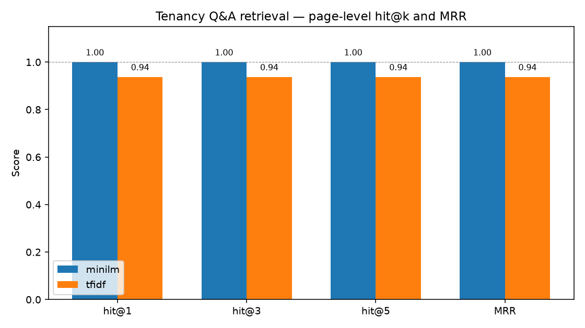
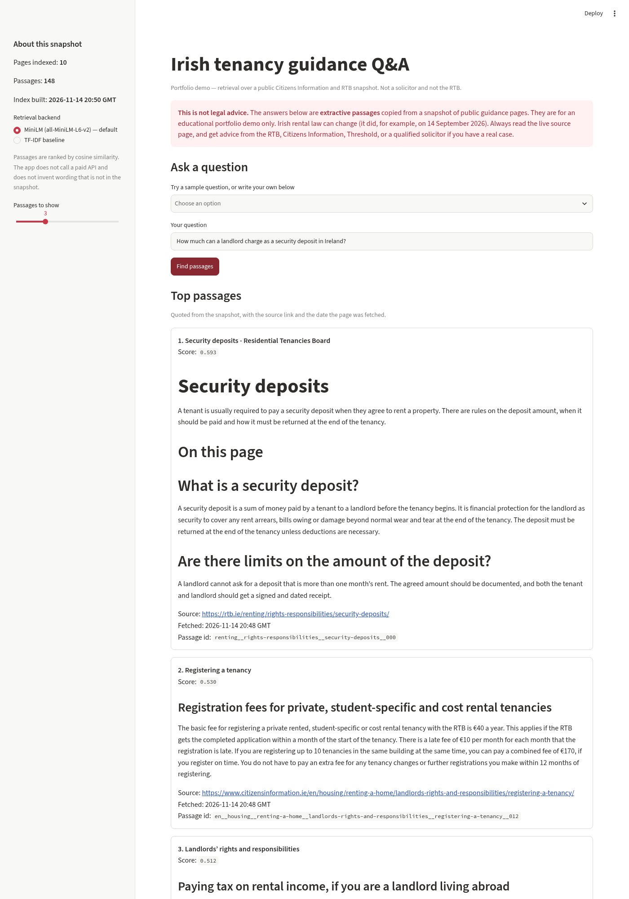

# Tenancy Q&A assistant (retrieval over public Irish guidance)

A beginner-friendly, fully reproducible retrieval project. It is also
the fifth case-study in this portfolio: a working demo a landlord or
property manager can try, and documented evidence toward a QQI Level 9
(Master's) RPL file.

The assistant answers questions by **retrieving and quoting passages**
from a snapshot of public Citizens Information and Residential
Tenancies Board (RTB) guidance — landlord obligations, notice periods,
deposits and registration, plus the rental-law changes of 14 September
2026. It does **not** generate new legal wording, and it is **not
legal advice**.

**Data status:** **REAL public web pages**, snapshotted on 14 November
2026 (Europe/Dublin). The text remains the publishers' copyright. No
tenant, landlord or case-file data was used.

New to the code? Start with the [code walkthrough](CODE_WALKTHROUGH.md).

---

## Problem

Irish tenancy rules sit across several official pages and they change.
A landlord who wants a straight answer — “how large can a deposit be?”,
“how quickly must I register?”, “can I email a notice of termination?” —
is asked to read long guidance and keep up with reforms (including those
that took effect on 14 September 2026).

The question this project asks is modest: *can a small, local,
citation-based retriever already surface the right official passage
for a typical question — and what would still be unsafe about treating
that passage as advice?*

---

## Data

| Item | Detail |
| --- | --- |
| Snapshot date | 14 November 2026, 20:48 GMT (Europe/Dublin) |
| Pages | 10 (4 Citizens Information, 6 RTB) |
| Passages after chunking | 148 |
| Fetcher | [`src/fetch_pages.py`](src/fetch_pages.py) |
| Manifest | [`data/manifest.json`](data/manifest.json) |
| Extracted pages | [`data/pages/`](data/pages/) (URL + fetch time + text) |
| Raw HTML | [`data/raw/`](data/raw/) |

Topics covered: landlords’ rights and obligations, registering a
tenancy, security deposits, notice of termination, how a landlord can
end a tenancy, tenant rights, and the 14 September 2026 changes.

Citizens Information returned **HTTP 403** to a custom educational
User-Agent on the recorded fetch, and served the same public pages to
a standard browser User-Agent. That is documented in
[`data/README.md`](data/README.md). The committed snapshot uses the
successful browser-UA fetch. Requests were still polite: no login, a
hand-picked list, and a short delay between pages.

These pages are official public guidance, not a Creative Commons
dataset. Copyright remains with the publishers. The MIT licence of
this repository covers the project code, not the stored page text.

---

## Approach

The pipeline is extractive and local on purpose. There is no paid API
key and no generative model that could invent a section of the
Residential Tenancies Act.

1. **Fetch** the hand-picked pages and record the source URL and fetch
   time. Text is taken from `<main>` / `<article>` where possible, so
   site navigation is not indexed.
2. **Chunk** into overlapping passages of roughly 180–900 characters,
   keeping headings with the body so a table of notice periods stays
   together where it can.
3. **Embed** each passage with sentence-transformers
   `all-MiniLM-L6-v2`, running locally. A **TF-IDF** (unigram +
   bigram) cosine index is always built as a baseline, and would be
   the fallback if MiniLM could not be loaded. On this run MiniLM
   installed and encoded cleanly.
4. **Retrieve** the top passages by cosine similarity and show them
   with the title, URL and fetch date. The app does not rewrite them.
5. **Evaluate** on a 16-question set
   ([`eval/questions.json`](eval/questions.json)) whose gold labels
   are the source *pages* that actually contain the answer in this
   snapshot. Report hit@1, hit@3, hit@5 and MRR.

---

## Results

Recorded run: 14 November 2026, 20:50 GMT (Europe/Dublin). 16
questions, 10 pages, 148 passages. MiniLM is the headline backend.

| Backend | hit@1 | hit@3 | hit@5 | MRR |
| --- | ---: | ---: | ---: | ---: |
| MiniLM (`all-MiniLM-L6-v2`, headline) | 1.0000 | 1.0000 | 1.0000 | 1.0000 |
| TF-IDF baseline | 0.9375 | 0.9375 | 0.9375 | 0.9375 |

TF-IDF missed one question at every k: “How much notice must a
private landlord give a tenant before a rent review?” It retrieved a
**notice of termination** page instead of a rent-review passage.
MiniLM retrieved the RTB tenant-rights passage that states “at least
90 days’ notice.”

A hit means *at least one gold source page* appeared in the top-k
passages. It is not a score for legal correctness. The figures should
be read with the [critical evaluation](#critical-evaluation).



The Streamlit demo answering a question about the security-deposit cap
(captured 14 November 2026, Europe/Dublin):



---

## Critical evaluation

**These retrieval scores are optimistic, and they are not a measure
of legal quality.** Several design choices inflate them, and several
failure modes remain even when hit@1 is 1.0.

- **The questions were written after reading the pages.** They use
  the same register as the official wording (“security deposit”,
  “notice of termination”, “14 September 2026”). That is closer to a
  closed-book check of the snapshot than to a log of real, messy
  questions from landlords. A user who types “can I keep the last
  month if they wrecked the place?” may not be as well served.
- **The corpus is small and closed.** With only ten pages, a
  reasonably worded question has few places to go. Hit@k would be
  harder on a wider crawl, or once older and newer versions of the
  same rule sit side by side.
- **Some questions have more than one acceptable page.** Citizens
  Information and the RTB overlap. That is honest about the snapshot,
  but it makes a page-level hit easier than a single-document search.
- **A page-level hit is not the same as a complete answer.** For the
  deposit-cap question, MiniLM’s first passage *does* contain “a
  landlord cannot ask for a deposit that is more than one month’s
  rent.” Its second passage, though, is a registration-fee section
  that merely mentions “a month.” Rank-2 distractors of that kind
  would be easy to miss if a reader only skimmed citations.
- **Chunking is imperfect.** One rent-review passage starts mid-sentence
  because of a sliding window. A few Citizens Information pages also
  left related-link chrome (including stray numbers) in the extracted
  text. Neither stopped the recorded metrics; both would annoy a
  real user.
- **The snapshot can go stale.** Rental law changed on 14 September
  2026, and the Citizens Information “what’s new” page in this set is
  only a short news summary (1,769 characters). A retriever will
  confidently quote yesterday’s rule if we do not refresh the pages.
- **Extractive retrieval cannot apply the law to a case.** It will
  not notice that a tenancy started before 1 March 2026, or that a
  notice was posted rather than emailed. Those distinctions matter,
  and they are exactly where “the official page said so” becomes
  unsafe.

What would strengthen this before anyone should rely on it: a
question set written *before* looking at retrieved text (or drawn
from anonymised real enquiries, with a lawful basis); chunk-level
gold labels, not only page-level ones; a reranker; regular
re-fetching with a change log; and a hard product rule that the
interface is a reading aid, never a determination of rights.

---

## Ethics, copyright and a necessary disclaimer

**This project is not legal advice, not a substitute for the RTB or
Citizens Information, and not a solicitor.** The app repeats that
prominently. If you have a live dispute, use the official pages and
get advice from the RTB, Citizens Information, Threshold, or a
qualified solicitor.

The indexed text is reproduced only to demonstrate citation-based
retrieval for an educational portfolio. Copyright remains with the
publishers. Do not paste other people’s tenancy documents, PPS
numbers, or names into the demo. A live product that logged user
questions would be processing personal data about housing
circumstances and would need a lawful basis, minimisation, and
usually a DPIA.

---

## How to run

You need Python 3.11 or newer (the recorded run used 3.13.5) and a
network connection the first time MiniLM is downloaded.

```bash
cd projects/05-tenancy-qa-assistant
python3 -m venv .venv
source .venv/bin/activate          # Windows: .venv\Scripts\activate
pip install -r requirements.txt

python src/fetch_pages.py          # optional; the snapshot is already in data/
python src/chunk_and_index.py
python src/evaluate.py
streamlit run app.py
```

`fetch_pages.py` is optional if you are happy to reuse the committed
snapshot. Re-running it will overwrite `data/` with a newer fetch
date. `chunk_and_index.py` downloads `all-MiniLM-L6-v2` into the
local Hugging Face cache on the first run. No paid API key is used.

---

## Next steps

- Write a second question set without looking at the passages, and
  report the drop.
- Add chunk-level labels and a simple reranker; keep MiniLM as the
  first-stage retriever.
- Refresh the snapshot on a schedule and diff the pages, especially
  after law changes.
- Improve boilerplate stripping on Citizens Information related-link
  blocks.

---

## Licence and attribution

Project code is covered by the repository [MIT licence](../../LICENSE).
The stored guidance pages remain the copyright of Citizens Information
and the Residential Tenancies Board. Please follow the source links
and check the live pages before relying on any quoted sentence.
