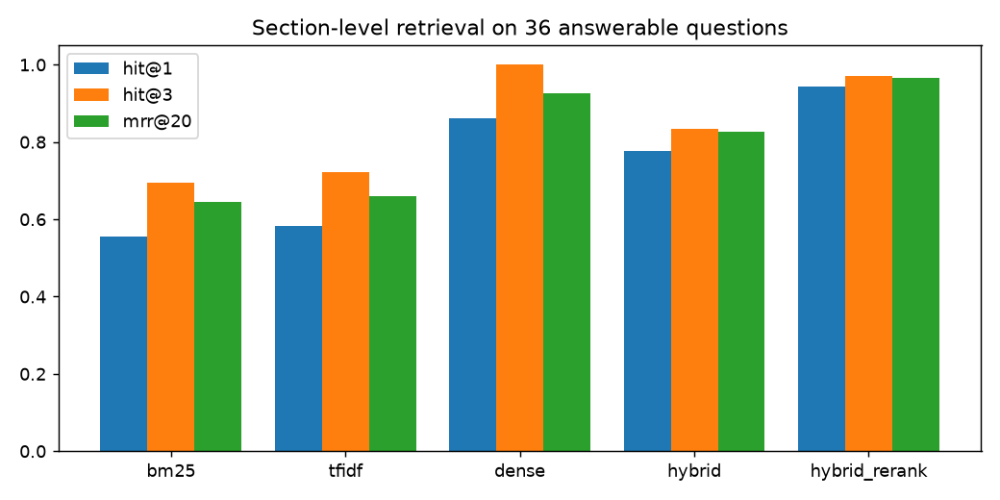
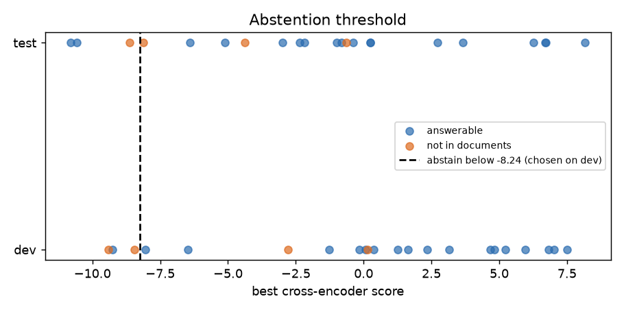
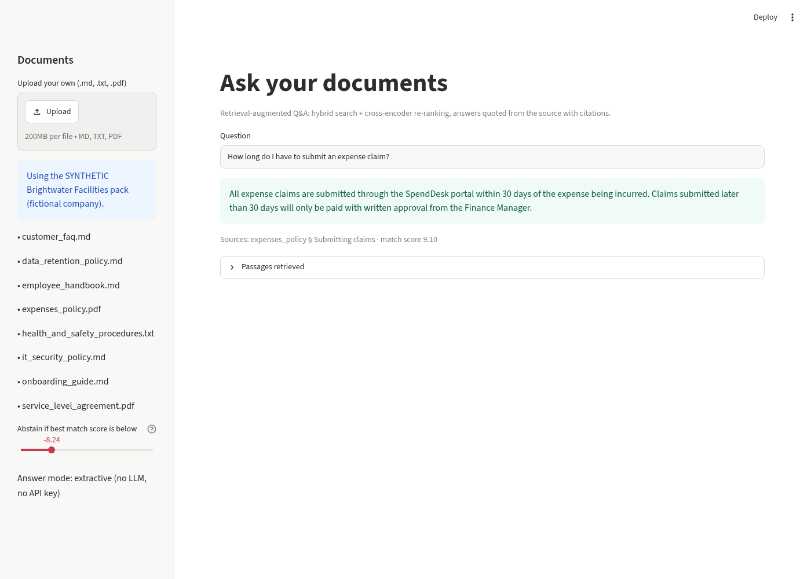

# Document Q&A over a client's own files (retrieval-augmented generation)

Ask a question in plain English and get an answer **quoted from the
company's own documents, with the source cited** — or an honest "not
found". Runs fully locally with small open models; **no paid API key**.
An optional hook sends the retrieved passages to any OpenAI-compatible
LLM endpoint (for example a local Ollama server) for a generated answer.

**Data status:** a **SYNTHETIC** eight-document pack for a fictional
company (Markdown, PDF and text). See [`data/README.md`](data/README.md).

New to the code? Start with the [code walkthrough](CODE_WALKTHROUGH.md).
Non-technical summary: [case study](CASE_STUDY.md).

---

## Problem

Staff and customers ask the same questions again and again ("how long
do I have to submit expenses?", "what's the response time for a P1?").
The answers exist, spread across handbooks, policies and contracts. A
chatbot that *invents* an answer is worse than useless; the useful
product **retrieves the right passage, answers from it, shows where it
came from, and declines when the documents do not say.**

Project 5 in this portfolio did single-method retrieval over public web
pages. This project goes further: mixed file formats, four retrievers
compared, cross-encoder re-ranking, an abstention rule tuned on a dev
split and tested on a separate split, and an LLM hook.

---

## Approach

| Stage | What happens | Code |
| --- | --- | --- |
| Ingest | Read `.md`, `.txt` and `.pdf` (pypdf); detect headings (Markdown `#`, or a short-line heuristic for PDFs); split each section into 90-word windows with 30-word overlap; prefix each chunk with its heading | `src/rag.py` `chunk_documents` |
| Retrieve | **BM25** (implemented in ~20 lines), **TF-IDF** cosine, **dense** embeddings (`all-MiniLM-L6-v2`), and **hybrid** reciprocal-rank fusion of BM25 + dense (k = 60) | `Index.rank_*` |
| Re-rank | Cross-encoder `ms-marco-MiniLM-L-6-v2` scores the hybrid top-20 against the question | `Index.rank_rerank` |
| Answer | Extractive: the best-scoring sentence from the top passages (plus one more from the *same* passage), with citations. Abstain if the best cross-encoder score is below a threshold | `extractive_answer` |
| Optional LLM | If `RAG_LLM_BASE_URL` and `RAG_LLM_MODEL` are set, the top 3 passages go to an OpenAI-compatible `/chat/completions` endpoint with an "answer only from the context and cite" instruction | `llm_answer` |

**Evaluation set** ([`eval/questions.json`](eval/questions.json)): 44
hand-written questions — 36 answerable (each with a gold document,
gold section and key facts that a correct answer must contain) and 8
whose answer is *not* in the documents. Questions are deliberately
paraphrased ("holidays" for "annual leave", "memory stick" for "USB
storage"). They are split 22 dev / 22 test (18 + 4 each).

**Protocol.** Retrieval has nothing to tune, so it is scored on all 36
answerable questions at section level (a hit = the chunk comes from the
gold document *and* gold section). The abstention threshold is chosen
on the **dev** questions only (midpoints between dev scores; ties broken
towards answering more often), then applied unchanged to **test**.

---

## Results

From [`reports/metrics.json`](reports/metrics.json), produced by
`python src/evaluate.py` on 15 November 2026 (Europe/Dublin). Corpus:
8 documents, 47 chunks.

### Retrieval (36 answerable questions, section-level)

| Retriever | hit@1 | hit@3 | hit@5 | MRR@20 | Median latency |
| --- | ---: | ---: | ---: | ---: | ---: |
| BM25 | 0.5556 | 0.6944 | 0.8056 | 0.6458 | <0.1 ms |
| TF-IDF | 0.5833 | 0.7222 | 0.7778 | 0.6610 | 0.3 ms |
| Dense (MiniLM) | 0.8611 | **1.0000** | **1.0000** | 0.9259 | 4.9 ms |
| Hybrid RRF (BM25 + dense) | 0.7778 | 0.8333 | 0.8611 | 0.8264 | 4.5 ms |
| **Hybrid + cross-encoder re-rank** | **0.9444** | 0.9722 | **1.0000** | **0.9653** | 96.7 ms |



### Answering (abstention threshold −8.243, chosen on dev)

| Split | Answer accuracy (answerable) | Abstention recall (not in docs) | Abstention precision | Overall accuracy |
| --- | ---: | ---: | ---: | ---: |
| Dev (n = 22) | 0.8889 | 0.50 | 0.6667 | 0.8182 |
| **Test (n = 22)** | **0.8889** | **0.25** | 0.3333 | **0.7727** |
| Test, never abstain | 0.8889 | 0.00 | – | 0.7273 |

Per-question answers, scores and citations: [`reports/answer_eval.csv`](reports/answer_eval.csv).



---

## Demo

The Streamlit app answering an expenses question from the PDF policy,
with its citation (captured 15 November 2026, Europe/Dublin):



---

## How to run

From this folder, Python 3.11+ (developed on 3.13.5):

```bash
python3 -m venv .venv
source .venv/bin/activate
pip install -r requirements.txt

python src/generate_client_docs.py   # writes the synthetic pack (already committed)
python src/evaluate.py               # ~20 s on CPU after the first model download
pytest -q                            # 6 tests
streamlit run app.py                 # upload your own files in the sidebar

# optional: generated answers from a local LLM via Ollama
export RAG_LLM_BASE_URL=http://localhost:11434/v1 RAG_LLM_MODEL=llama3.1
streamlit run app.py
```

---

## Client value

- **Works on the client's own folder**, on their own machine — nothing
  leaves the building unless they choose to connect an LLM.
- **Every answer is traceable** to a document and section, so staff can
  check it and policy owners can fix the source rather than the bot.
- **Measured, not demoed**: the same evaluation harness can be filled
  with 50–100 real questions from the client's helpdesk to prove (or
  disprove) value before rollout.

---

## Critical evaluation

Written with QQI / NFQ Level 9 expectations in mind.

- **Re-ranking is where the quality comes from.** Dense retrieval alone
  already found the gold section in the top 3 every time; the
  cross-encoder moved it to rank 1 in 34 of 36 cases. Lexical methods
  struggled with paraphrase (hit@1 ≈ 0.56–0.58).
- **Hybrid fusion made things worse here.** RRF with BM25 *lowered*
  dense hit@1 from 0.86 to 0.78, because BM25 confidently ranked the
  wrong section for paraphrased questions. Hybrid search is common
  advice; on this corpus and question style it did not pay until the
  re-ranker was added. A client corpus with product codes or exact
  clause numbers could reverse this.
- **Abstention is the weak point.** With only 4 unanswerable questions
  per split, the threshold is poorly determined: on test it caught 1 of
  4 unanswerable questions while wrongly abstaining on 2 answerable
  ones (q12 "pint" and q18 "memory stick", where the re-ranker scored
  the right passage very low). Several unanswerable questions scored
  *higher* than answerable ones (e.g. "company car" matched the mileage
  section). A score threshold alone is not enough; a production system
  would add an answer-verification step (NLI or an LLM judge) and many
  more negative examples.
- **Small, author-written test set.** 44 questions written by the same
  person who wrote the documents, on a 47-chunk corpus. The numbers show
  the method works end-to-end, not how it would perform on a messy
  10,000-page SharePoint. Key-fact matching is a strict but crude proxy
  for answer quality.
- **The threshold protocol was revised once — disclosed.** The first
  run accidentally included test-question scores among the candidate
  thresholds and broke ties towards a threshold near zero; it abstained
  far too often (test overall accuracy 0.6364). The leak was removed
  and the tie-break rule changed to "answer more often" in the same
  edit. Because that run's test results had been seen, the reported
  test numbers are slightly less independent than a single clean run.
- **The LLM path is untested.** No LLM was run for the recorded
  results. Generated answers would need their own faithfulness
  evaluation.
- **Data protection.** Internal documents can contain personal data.
  The default local mode avoids transfers; connecting a hosted LLM
  would need a processor agreement and a DPIA.
