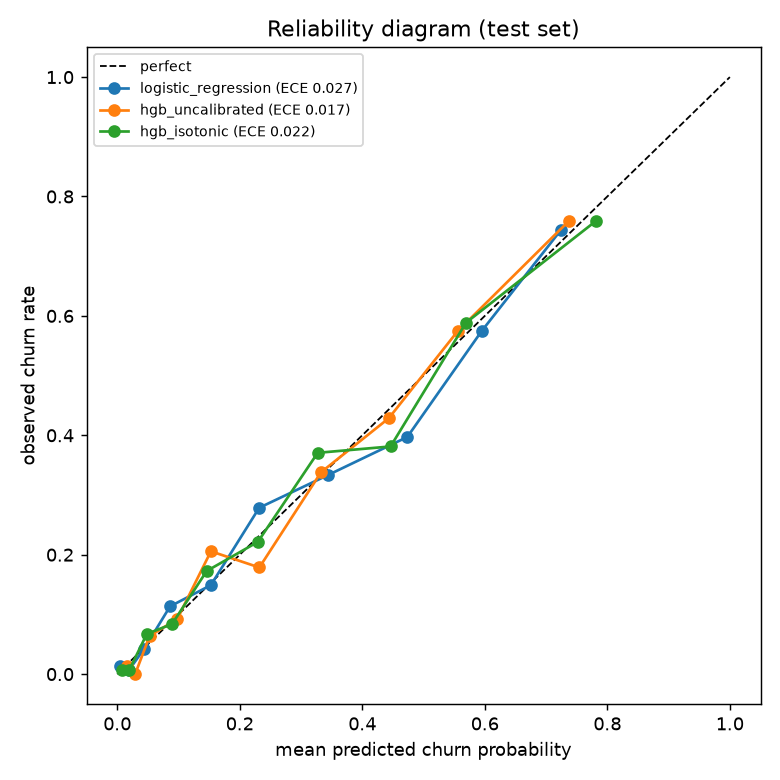
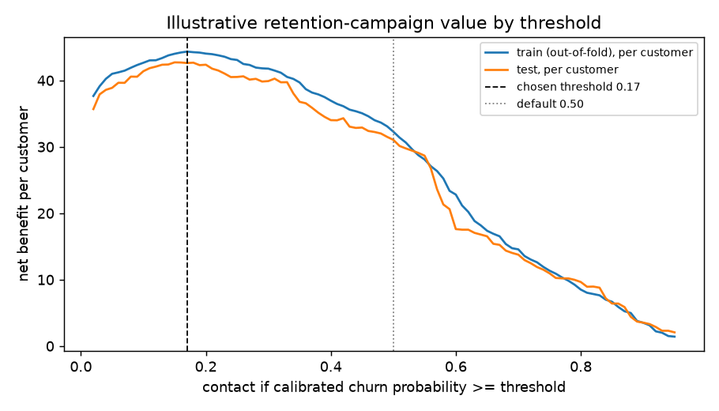
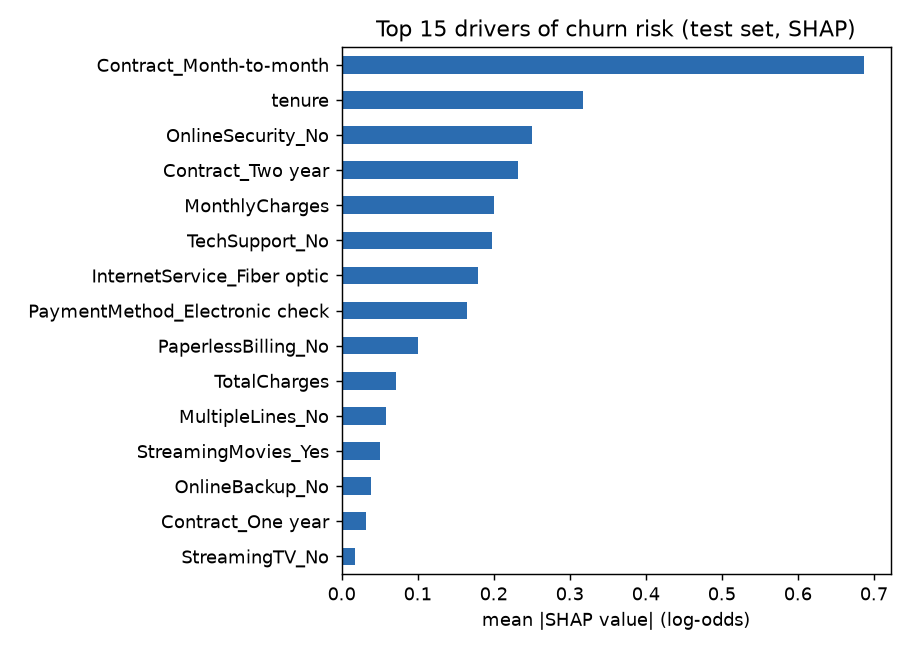
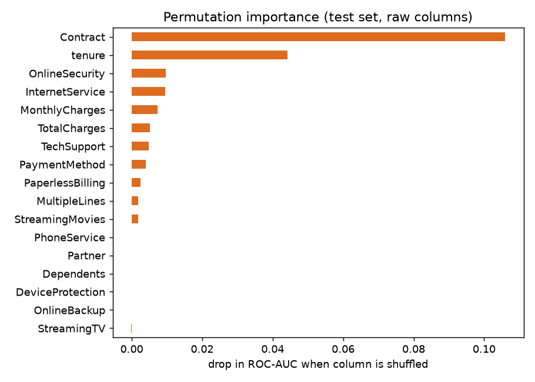
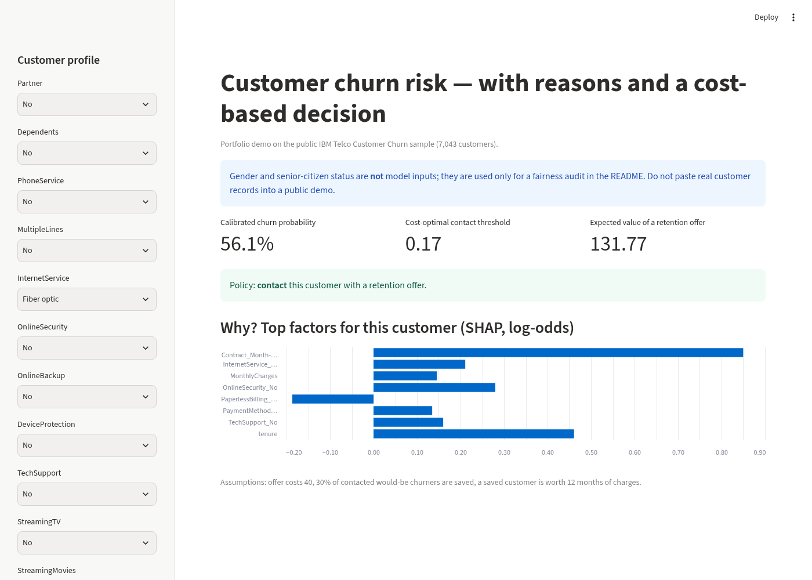

# Customer churn prediction with explainability and a cost-based threshold

Predicts which telecom customers are about to leave, explains *why* for
each customer, and turns the probability into a contact / don't-contact
decision using the economics of a retention offer. It is a client-facing
demo and a piece of evidence toward a QQI Level 9 (Master's) RPL file.

**Data status:** the **public IBM Telco Customer Churn sample** (7,043
customers, Apache 2.0). Realistic in structure, but a published teaching
dataset, not a live operator's book. See [`data/README.md`](data/README.md).

New to the code? Start with the [code walkthrough](CODE_WALKTHROUGH.md).
For a non-technical summary, read the [case study](CASE_STUDY.md).

---

## Problem

A subscription business loses revenue every time a customer leaves.
Retention offers (a discount, a free upgrade, a call from a senior
agent) cost money, so the useful question is not "who might churn?" but
**"whom should we contact this month, so that the expected value saved
is larger than the cost of the offers?"** That needs three things a
basic classifier does not give you:

1. **Probabilities you can trust** (calibration), because the decision
   multiplies the probability by money.
2. **A threshold chosen from the economics**, not the default 0.5.
3. **Reasons**, so an agent knows what to talk about and a manager can
   sanity-check the model.

---

## Data

| Item | Detail |
| --- | --- |
| Rows | 7,043 customers; 1,869 churned (26.5%) |
| Split | Stratified 80/20, `random_state=42`: 5,634 train, 1,409 test (374 churners) |
| Inputs | 17 columns: contract, tenure, monthly / total charges, payment method, paperless billing, internet and phone services and add-ons, partner, dependants |
| Not inputs | `gender` and `SeniorCitizen` (kept only for the fairness audit), `customerID` |

---

## Approach

1. **Cross-validated model selection on the training set only.**
   Five-fold stratified CV compared a dummy prior, a logistic-regression
   baseline (one-hot + scaling) and an 8-point grid of histogram
   gradient boosting models (learning rate × leaves × min leaf size,
   early stopping). The best grid point by mean CV ROC-AUC was
   `learning_rate=0.03, max_leaf_nodes=8, min_samples_leaf=80`.
2. **Calibration.** The chosen model was wrapped in
   `CalibratedClassifierCV` with isotonic and with sigmoid (Platt)
   calibration (internal 5-fold). Which one to deploy was decided by
   **out-of-fold Brier score on the training set** (never by test
   score). Both scored 0.1339; the tie went to isotonic (first in the
   list).
3. **Business threshold.** Illustrative retention economics (editable
   in `src/train.py`):
   - each offer costs **40** (dataset currency, assumed USD);
   - **30%** of contacted customers who *would* have churned are saved;
   - a saved customer is worth **12 months** of their monthly charge.
   The threshold that maximises net benefit was picked on the
   **out-of-fold** calibrated probabilities of the training set, then
   applied unchanged to the test set.
4. **Explainability.** SHAP 0.54.1 `TreeExplainer` on the gradient
   boosting model (global mean |SHAP| and per-customer explanations in
   the app), plus permutation importance on raw columns as a
   model-agnostic cross-check.
5. **Fairness audit.** Test-set ROC-AUC, contact rate and recall sliced
   by gender and senior-citizen status.

---

## Results

All numbers are copied from [`reports/metrics.json`](reports/metrics.json),
produced by `python src/train.py` on 15 November 2026 (Europe/Dublin).

### Cross-validation on the training set (5 folds, mean ± sd)

| Model | ROC-AUC | PR-AUC | Brier | Log loss |
| --- | ---: | ---: | ---: | ---: |
| Dummy (prior) | 0.5000 ± 0.0000 | 0.2654 | 0.1949 | 0.5786 |
| Logistic regression | 0.8463 ± 0.0129 | 0.6617 | 0.1350 | 0.4166 |
| Gradient boosting (best grid point) | **0.8476 ± 0.0105** | **0.6678** | **0.1343** | **0.4137** |

### Held-out test set (n = 1,409)

| Model | ROC-AUC | PR-AUC | Brier | ECE |
| --- | ---: | ---: | ---: | ---: |
| Dummy (prior) | 0.5000 | 0.2654 | 0.1950 | 0.0001 |
| Logistic regression | 0.8408 | 0.6315 | 0.1386 | 0.0272 |
| Gradient boosting, uncalibrated | 0.8462 | 0.6635 | 0.1352 | 0.0166 |
| **Gradient boosting + isotonic (deployed)** | **0.8466** | **0.6592** | **0.1357** | 0.0220 |
| Gradient boosting + sigmoid | 0.8479 | 0.6625 | 0.1348 | 0.0240 |

Gradient boosting is only slightly better than a well-specified logistic
regression: the CV difference in ROC-AUC (0.0013) is far smaller than
its fold-to-fold standard deviation (≈0.01). On this dataset a linear
model would be a perfectly defensible production choice.



### Who to contact: policy comparison on the test set

| Policy | Contacted | Precision | Recall | Net benefit |
| --- | ---: | ---: | ---: | ---: |
| Contact nobody | 0 | – | 0.0000 | 0.00 |
| Contact everybody | 1,409 | 0.2654 | 1.0000 | 41,613.64 |
| Default threshold 0.50 | 307 | 0.6547 | 0.5374 | 43,754.18 |
| **Cost-optimal threshold 0.17** (chosen on train OOF) | 733 | 0.4543 | 0.8904 | **60,050.54** |

Under these assumptions the cost-based threshold is worth about
**37% more than the default 0.5** (60,051 vs 43,754) and **44% more than
contacting everyone**. Because a saved customer is worth far more than
the offer, the best policy contacts more than half the base. Change the
assumptions and the threshold moves; that is the point of computing it.



### Why customers churn (explainability)

| Rank | SHAP (mean \|value\|, one-hot features) | Permutation importance (ROC-AUC drop, raw columns) |
| ---: | --- | --- |
| 1 | Contract = month-to-month (0.688) | Contract (0.106) |
| 2 | tenure (0.318) | tenure (0.044) |
| 3 | OnlineSecurity = No (0.250) | OnlineSecurity (0.010) |
| 4 | Contract = two year (0.232) | InternetService (0.010) |
| 5 | MonthlyCharges (0.200) | MonthlyCharges (0.007) |

Both methods agree: **contract type and tenure dominate**, followed by
missing security / tech-support add-ons, fibre internet and paying by
electronic cheque. These are associations, not causes — a month-to-month
contract does not *make* people leave; people who want flexibility
choose it.





### Fairness audit (attributes not used by the model)

| Group | n | Actual churn | Mean predicted | ROC-AUC | Contact rate | Recall |
| --- | ---: | ---: | ---: | ---: | ---: | ---: |
| gender = Female | 687 | 0.2809 | 0.2667 | 0.8445 | 0.5211 | 0.8860 |
| gender = Male | 722 | 0.2507 | 0.2654 | 0.8496 | 0.5194 | 0.8950 |
| SeniorCitizen = No | 1,187 | 0.2325 | 0.2411 | 0.8487 | 0.4735 | 0.8623 |
| SeniorCitizen = Yes | 222 | 0.4414 | 0.3994 | 0.7858 | 0.7703 | 0.9694 |

Gender looks balanced. Senior citizens are contacted far more often
(77% vs 47%) — which matches their much higher actual churn (44% vs
23%) — but ranking quality inside the senior group is noticeably worse
(ROC-AUC 0.79 vs 0.85) and their risk is under-predicted on average
(0.40 vs 0.44). Excluding the attribute did not make the model blind to
age: other columns act as proxies.

---

## Demo

The Streamlit app scoring a fibre, month-to-month, electronic-cheque
customer with five months' tenure (captured 15 November 2026,
Europe/Dublin):



---

## How to run

From this folder, Python 3.11+ (developed on 3.13.5):

```bash
python3 -m venv .venv
source .venv/bin/activate
pip install -r requirements.txt

python src/fetch_data.py     # optional; the CSV is already in data/
python src/train.py          # ~15 s on a laptop CPU
pytest -q                    # 4 smoke tests
streamlit run app.py
```

---

## Client value

- A **ranked contact list** with a probability that behaves like a
  probability (Brier 0.136, ECE 0.022 on unseen customers).
- A **threshold tied to the client's own numbers** (offer cost, save
  rate, customer value) with a curve that shows how sensitive the
  decision is.
- **Per-customer reasons** an agent can use in the conversation, and a
  global view a manager can challenge.
- A **fairness table** that should be reviewed before any rollout.

---

## Critical evaluation

Written with QQI / NFQ Level 9 expectations in mind.

- **The model is not much better than logistic regression.** The gain
  from boosting is within CV noise. The business value here comes from
  calibration and the threshold, not from a more complex learner.
- **Calibration barely mattered — and that is a finding.** The
  uncalibrated booster was already well calibrated (ECE 0.017); isotonic
  calibration did not improve test Brier (0.1357 vs 0.1352). The
  selection rule (OOF Brier) was a tie, so the deployed variant was
  effectively an arbitrary choice between two equivalent options.
- **The economics are invented.** A 30% save rate and 12-month value
  are illustrative. In a real engagement they must come from a
  controlled retention test (treatment vs hold-out group), otherwise the
  model will over-claim. Ideally the target would be *uplift* (who
  changes behaviour because of the offer), not churn risk.
- **Teaching dataset.** IBM's sample is clean, static and single-snapshot.
  A live system needs time-based validation (train on earlier months,
  test on later), drift monitoring, and features built only from data
  available *before* the prediction date.
- **Proxy discrimination.** Removing `SeniorCitizen` did not remove age
  effects; the slice audit shows weaker ranking for older customers. A
  real deployment should decide, with the client's DPO, whether a
  differential contact rate is acceptable and document it (GDPR Art. 22
  and the Irish Equal Status Acts are relevant if offers differ by
  group).

## Next steps

Uplift modelling with a randomised hold-out, time-split validation,
monitoring of calibration over time, and a cost curve with confidence
bands from bootstrapping.
