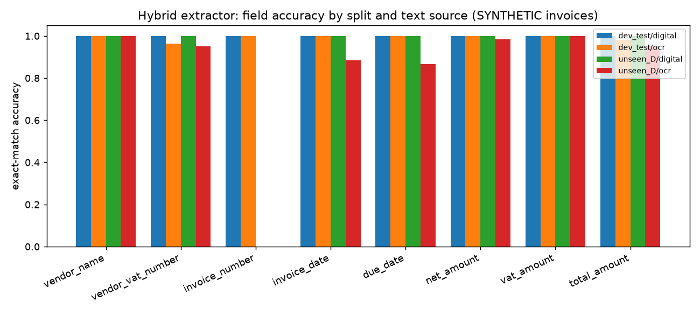
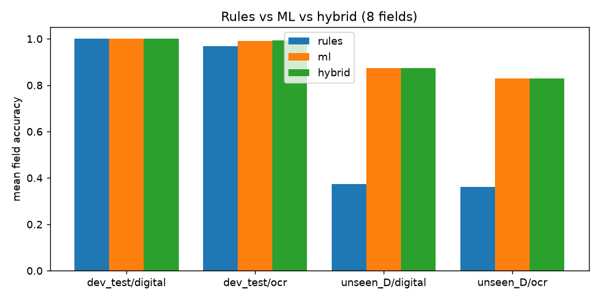
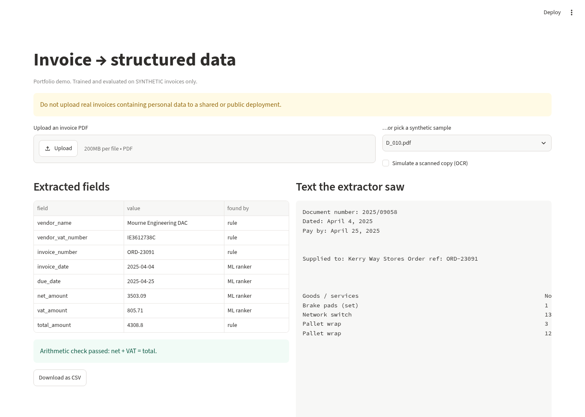

# Invoice data extraction: PDF / scan → structured CSV

Reads supplier invoices (digital PDFs or scanned images), pulls out
eight accounting fields, checks the arithmetic, and writes a clean CSV
ready for an accounts-payable system. Compares hand-written rules with a
machine-learning candidate ranker, tests on a **supplier layout the
system has never seen**, and measures how quickly the ML model adapts
when a few examples of that new layout are labelled.

**Data status:** **SYNTHETIC** invoices only (240 PDFs in four layouts),
generated by this project. See [`data/README.md`](data/README.md).

New to the code? Start with the [code walkthrough](CODE_WALKTHROUGH.md).
Non-technical summary: [case study](CASE_STUDY.md).

---

## Problem

Small finance teams still key invoice data by hand: supplier, VAT
number, invoice number, dates, net, VAT and total. Template-based tools
break whenever a new supplier sends a different layout, and scanned
invoices add OCR errors. The useful questions are:

1. How accurate is extraction per field, on clean PDFs **and** scans?
2. What happens on a **new supplier layout**?
3. Can the system **flag its own likely errors** for human review?

Target fields: `vendor_name`, `vendor_vat_number`, `invoice_number`,
`invoice_date`, `due_date`, `net_amount`, `vat_amount`, `total_amount`.

---

## Approach

**Text extraction**

- Digital PDFs: `pdftotext -layout` (poppler), which keeps columns apart
  with runs of spaces.
- Simulated scans: each test page is rendered at 150 dpi, rotated
  ±1.2°, blurred and given Gaussian noise, then OCR'd with
  **RapidOCR** (PP-OCR models on ONNX Runtime). OCR word boxes are
  re-assembled into lines. A small documented clean-up fixes full-width
  punctuation and "2.322.82"-style thousands separators. (Tesseract
  was the first choice but could not be installed on the build
  machine.)

**Three extractors**

| Extractor | How it works |
| --- | --- |
| **Rules** | Label + regex rules written while looking at layouts A–C only (e.g. `Subtotal`, `Net amount`, `Goods total` → net). Generic fallbacks: VAT-number regex, company-suffix line for the vendor, largest amount for the total. |
| **ML candidate ranker** | For each field, every plausible candidate is generated (all money amounts, all dates, all ID-like tokens, top-of-page text segments). A logistic regression per field scores candidates from layout-independent features: words to the left, position on the page, amount rank, *is this amount the sum of two others*, *is it ≈ 23% / 13.5% of another amount*, earliest / latest date, ID shape. The top-scoring candidate wins. |
| **Hybrid** | Rules first; the ML ranker fills any field the rules could not find. |

**Arithmetic check.** `net + VAT = total` (±1 cent). Invoices that fail
are routed to a person.

**Splits.** Layouts A–C: 70% train (126 invoices), 30% test (54).
Layout D: all 60 held out — never used to write rules or train. Each test
set is scored on digital text and on OCR text. A final experiment labels
**5** layout-D invoices, retrains the ranker, and scores the other 55.

---

## Results

From [`reports/metrics.json`](reports/metrics.json), produced by
`python src/evaluate.py` on 15 November 2026 (Europe/Dublin). "Mean field
accuracy" = exact-match accuracy averaged over the 8 fields (dates
compared as ISO dates, amounts to the cent, vendor names case- and
space-insensitive). "All fields" = share of invoices with all 8 correct.

| Test set | Text | Rules | ML ranker | Hybrid | Hybrid: all 8 fields correct |
| --- | --- | ---: | ---: | ---: | ---: |
| Layouts A–C (54 invoices) | digital | 1.0000 | 1.0000 | 1.0000 | 1.0000 |
| Layouts A–C (54) | OCR scan | 0.9676 | 0.9907 | **0.9931** | 0.9444 |
| **Unseen layout D (60)** | digital | 0.3750 | 0.8750 | 0.8750 | 0.0000 |
| Unseen layout D (60) | OCR scan | 0.3625 | 0.8292 | 0.8292 | 0.0000 |

**Few-shot adaptation to layout D** (ML ranker, scored on the 55 D
invoices not used for adaptation):

| Text | Before | After labelling 5 D invoices | All 8 correct after |
| --- | ---: | ---: | ---: |
| digital | 0.8750 | **1.0000** | 1.0000 |
| OCR scan | 0.8318 | **0.9568** | 0.7091 |

Per-field view for the hybrid extractor:





**What failed on layout D.** The rules found only the vendor name,
VAT number and total (the generic fallbacks): every layout-specific
label was new. The ML ranker recovered dates, net and VAT from
layout-independent clues (date order, "this amount = the other two
added", "this one is 23% of that one") — but got the **invoice number
wrong on every D invoice**, picking the order reference instead.
Hybrid was no better, because the rule `Ref:` matched "Order **ref:**".
Five labelled examples fixed it completely on digital PDFs.

**What the arithmetic check can and cannot catch.** On OCR'd A–C
invoices, 98.1% of hybrid outputs passed the check, and 96.2% of
those that passed had all eight fields right. On layout D every
invoice passed the check yet none was fully correct — the check only
tests the amounts, so a wrong invoice number sails through.

Example of the structured output: [`reports/sample_output_unseen_D_hybrid.csv`](reports/sample_output_unseen_D_hybrid.csv).

---

## Demo

The Streamlit app on a held-out layout-D invoice (captured 15 November
2026, Europe/Dublin). Note the **invoice number is wrong** (it shows the
order reference) — exactly the failure described above, and the
arithmetic check does not catch it:



---

## How to run

From this folder, Python 3.11+ (developed on 3.13.5) and poppler-utils
(`apt install poppler-utils` / `brew install poppler`):

```bash
python3 -m venv .venv
source .venv/bin/activate
pip install -r requirements.txt

python src/generate_invoices.py   # 240 SYNTHETIC PDFs + ground truth
python src/evaluate.py            # uses cached OCR; add --re-ocr to redo it (~4 min)
pytest -q                         # 4 smoke tests
streamlit run app.py
```

---

## Client value

- **Hours back** for AP staff on repetitive keying, with a CSV that
  drops straight into Excel, Sage, Xero or a data warehouse.
- **Safe automation:** invoices that fail the arithmetic check go to a
  person; the rest can be fast-tracked (with spot checks — see below).
- **New suppliers are cheap to add:** labelling ~5 examples of a new
  layout fixed the ML model in this test, versus writing and
  maintaining new rules.

---

## Critical evaluation

Written with QQI / NFQ Level 9 expectations in mind.

- **Synthetic invoices flatter everything.** Four clean templates, one
  page each, consistent fonts, no stamps, handwriting, multi-page line
  tables, credit notes or foreign currencies. 100% on digital layouts
  A–C mostly shows the code is correct, not that the problem is solved.
- **The held-out layout is the honest result.** 0.875 mean field
  accuracy but **0% fully-correct invoices** on an unseen layout is a
  realistic picture of template drift. Any vendor claim of "works on any
  invoice" needs this kind of test.
- **Development decisions touched test data twice, and that is
  disclosed.** (1) A rule bug (amounts more than 20 characters to the
  right of their label were missed in layout A) was found from dev-test
  errors and fixed. (2) The VAT-number regex was relaxed after
  reviewing OCR errors on layout D ("numberIE2004976PA" with no space).
  Both are generic fixes, but they were prompted by test results.
- **Simulated scans are not real scans.** Noise, blur and slight rotation
  at 150 dpi are a mild stand-in for phone photos, crumpled paper or
  fax-quality pages.
- **Line items are not extracted.** Only header and total fields. Line
  tables are the hard part in real AP automation.
- **The arithmetic check is necessary but not sufficient**, as layout D
  showed. A production system should add per-field confidence, a
  supplier master-data lookup (VAT number → known supplier → expected
  invoice-number pattern) and duplicate detection.
- **GDPR.** Sole-trader invoices contain personal data (names,
  addresses, sometimes bank details). A real deployment needs a lawful
  basis, retention limits and access control.

## Next steps

Layout-aware models (token + bounding-box features, e.g. LayoutLM-style),
line-item tables, real scans, per-field confidence and review queues,
and supplier master-data validation.
