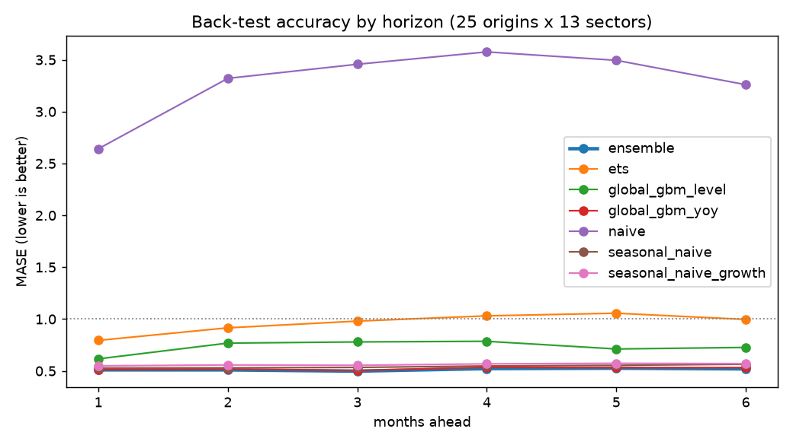
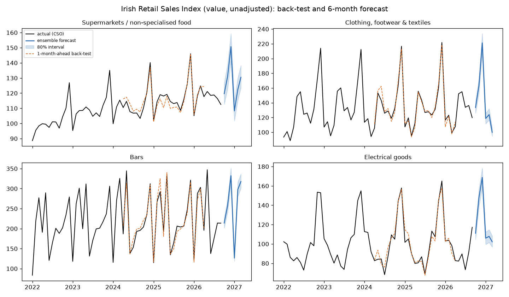
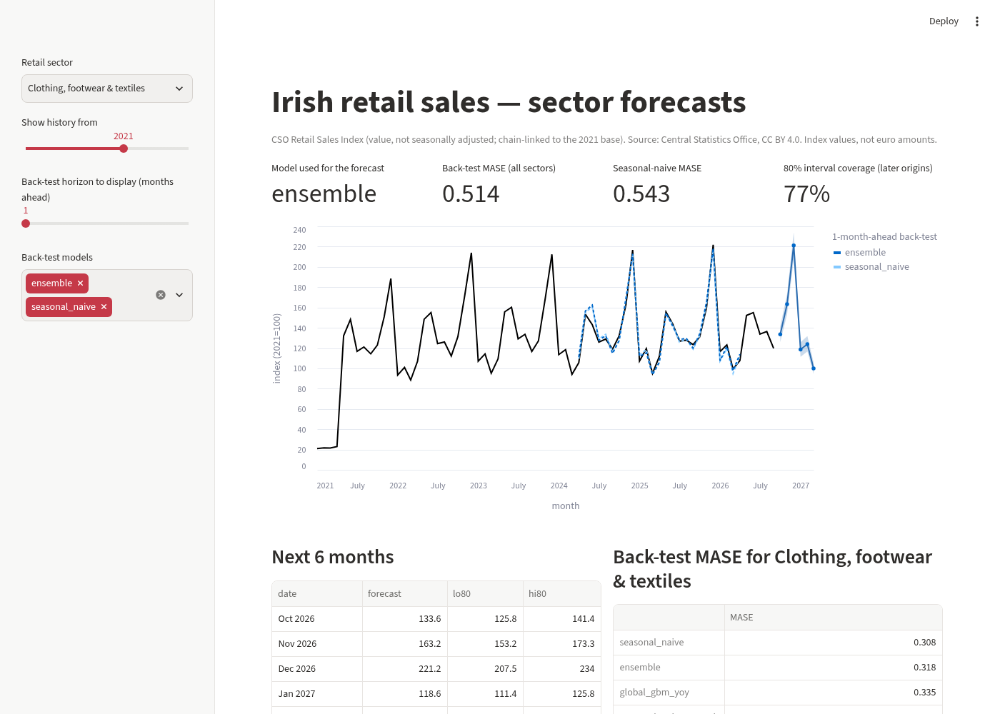

# Sales forecasting dashboard: 13 Irish retail sectors

Forecasts monthly retail sales six months ahead for 13 sectors of the
Irish economy, compares seven methods on a rolling back-test of 1,950
forecasts each, tests whether the winner is *really* better than "same
month last year", and serves the result in an interactive Streamlit
dashboard with prediction intervals.

**Data status:** **real public statistics** — the CSO Retail Sales Index
(tables RSM05 + RSM08, value, not seasonally adjusted, CC BY 4.0),
January 2015 to September 2026. See [`data/README.md`](data/README.md).

New to the code? Start with the [code walkthrough](CODE_WALKTHROUGH.md).
Non-technical summary: [case study](CASE_STUDY.md).

---

## Problem

Retailers, wholesalers and suppliers plan stock, staff and cash months
ahead. Many teams use last year's number for the same month. Is a
machine-learning forecast actually better, by how much, and is the
difference bigger than luck? Project 4 in this portfolio answered that
for one synthetic series; this project does it for **13 real series at
once**, with a **global** model that learns across sectors, a pandemic
structural break to deal with, and a statistical check on the result.

---

## Approach

**Data preparation.** Two CSO tables with different base years were
chain-linked using calendar-month-specific ratios (a single ratio
distorted seasonality — see the data README). 13 non-overlapping sectors
× 141 months.

**Models** (each forecasts 1–6 months ahead from an origin, using only
data up to that origin):

| Model | Description |
| --- | --- |
| `naive` | last observed value |
| `seasonal_naive` | same month last year — the baseline to beat |
| `seasonal_naive_growth` | same month last year × trailing 12-month growth |
| `ets` | Holt–Winters on logs per series: damped additive trend, additive seasonality (statsmodels) |
| `global_gbm_level` | **round 1**: one gradient boosting model across all 13 series, direct multi-horizon, on lags scaled by the last-12-month level |
| `global_gbm_yoy` | **round 2**: one global gradient boosting model whose target is the *year-on-year* log ratio; features are recent YoY and month-on-month changes, calendar month and sector; training rows touching Mar 2020 – Dec 2021 lockdowns are excluded |
| `ensemble` | mean of `seasonal_naive_growth` and `global_gbm_yoy` |

**Back-test.** Rolling origins every month from **March 2024 to March
2026** (25 origins) × 13 sectors × horizons 1–6 = **1,950 forecasts per
model**. Every model is refitted at every origin.

**Metrics.** MASE — error divided by the in-sample error of a
same-month-last-year forecast on post-2021 data up to the origin (so
the lockdown months do not inflate the scale); and sMAPE.

**Is it real?** Origin-block bootstrap (resample the 25 origins, 2,000
times) for a 95% interval on the MASE ratio vs seasonal naive.

**Prediction intervals.** Empirical 80% intervals from the 10th and
90th percentiles of past log errors, by horizon. Calibrated on the
first half of origins and checked on the second half.

---

## Results

From [`reports/metrics.json`](reports/metrics.json), produced by
`python src/backtest.py` and `python src/compare_models.py` on 15
November 2026 (Europe/Dublin).

### Overall back-test (1,950 forecasts per model)

| Model | MASE | sMAPE (%) | MASE ratio vs seasonal naive (95% bootstrap CI) |
| --- | ---: | ---: | --- |
| **ensemble** | **0.5142** | **3.67** | 0.947 (0.891 – 1.012) |
| global_gbm_yoy | 0.5220 | 3.67 | 0.961 (0.902 – 1.021) |
| seasonal_naive | 0.5432 | 3.70 | 1 (baseline) |
| seasonal_naive_growth | 0.5623 | 4.04 | 1.035 (0.962 – 1.119) |
| global_gbm_level (round 1) | 0.7315 | 5.54 | 1.347 (1.252 – 1.454) |
| ets | 0.9625 | 8.27 | 1.772 (1.665 – 1.910) |
| naive | 3.2916 | 22.73 | – |

The ensemble was about **5% more accurate than "same month last year"**
on MASE, and better at every horizon (e.g. 0.510 vs 0.528 at one month,
0.520 vs 0.565 at six). But the **95% interval includes 1**: in 95% of
bootstrap resamples the ensemble was better, so the evidence is
suggestive, not conclusive. On sMAPE the two are almost tied (3.67% vs
3.70%).



### By sector

Seasonal naive was still the best single method in **6 of 13 sectors**
(e.g. department stores, furniture, electrical goods). The ensemble's
advantage came mainly from sectors with a trend that last year's value
misses: **pharma, medical & cosmetics** (MASE 0.659 vs 0.946),
**supermarkets** (0.486 vs 0.734) and hardware (0.685 vs 0.822). Full
table: `mase_by_series` in `metrics.json`.



### Prediction intervals

Empirical 80% intervals covered the actual value **77.1%** of the time
on the later half of origins (936 forecasts) — slightly too narrow.

---

## Demo

The dashboard for clothing, footwear & textiles: history since 2021,
one-month-ahead back-test of the ensemble vs seasonal naive, the 6-month
forecast with its 80% band, and per-sector accuracy (captured 15
November 2026, Europe/Dublin):



---

## How to run

From this folder, Python 3.11+ (developed on 3.13.5):

```bash
python3 -m venv .venv
source .venv/bin/activate
pip install -r requirements.txt

python src/fetch_cso_retail.py   # optional; data already in data/
OMP_NUM_THREADS=2 python src/backtest.py   # about 6–7 min on a laptop CPU
python src/compare_models.py     # bootstrap check (seconds)
pytest -q                        # 4 smoke tests
streamlit run app.py
```

(`OMP_NUM_THREADS=2` matters: with many threads, scikit-learn's
gradient boosting on these small tables ran dramatically *slower* on
the build machine (minutes instead of seconds per origin) because of
thread over-subscription.)

---

## Client value

- **Honest benchmark first:** every client forecast is compared against
  "same month last year" on a rolling back-test before anyone trusts it.
- **One model for many products / branches / sectors** (a global model)
  instead of hand-tuning hundreds of series.
- **Ranges, not just numbers**, with their real hit rate reported.
- A dashboard planners can use without opening Python.

---

## Critical evaluation

Written with QQI / NFQ Level 9 expectations in mind.

- **The back-test was used twice — disclosed.** Round 1 (naive,
  seasonal naive, ETS, level-based GBM, ETS+GBM ensemble) found that
  *seasonal naive won* (round-1 MASE 0.518 vs 0.683 for the next best;
  see `round1_results_before_yoy_models` in `metrics.json`, computed with
  a full-history scale). The YoY model and the new ensemble were designed
  *after* seeing that. The ~5% gain is therefore optimistic; a truly
  clean claim needs a fresh period (e.g. re-run when Oct 2026 – Mar 2027
  data are published).
- **The gain is not statistically conclusive** (bootstrap CI 0.89–1.01).
  For a client, "about as good as last year, a little better on trending
  categories" is the defensible statement.
- **Holt–Winters failed badly** (MASE 0.96, worse than seasonal naive in
  11 of 13 sectors) because the 2020–21 lockdown collapse distorts the
  trend and seasonal states. Excluding or modelling the break (as the YoY
  model does) mattered more than model complexity.
- **Chain-linking adds error** for three sectors (residual ratio CV
  7–11%), which affects their pre-2021 history and therefore the training
  data of the global models.
- **Intervals under-cover** (77% vs 80%), and the 25 origins span only two
  years, so seasonal patterns are estimated from few repetitions.
- **Index ≠ company sales.** National sector indices are smoother than one
  shop's sales, which have promotions, stock-outs and weather effects. The
  method transfers; the accuracy numbers do not.

## Next steps

Re-score on new CSO months as a true out-of-sample test; add exogenous
drivers (holidays, consumer sentiment, prices); conformal intervals;
hierarchical reconciliation so sector forecasts add up to the total.
