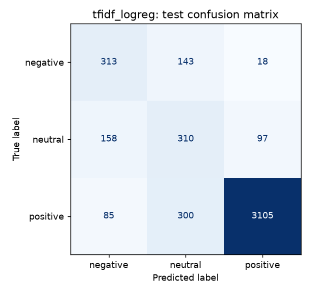
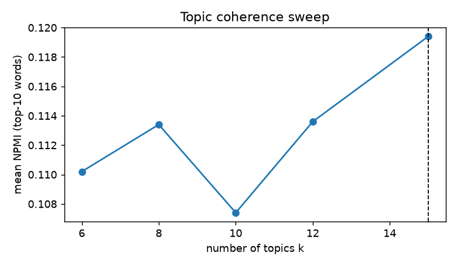
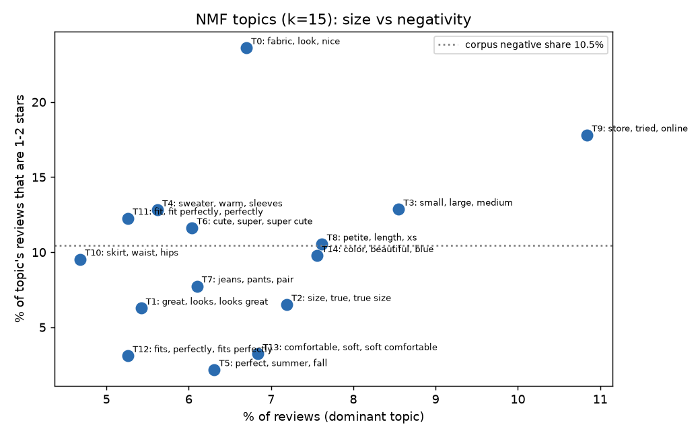
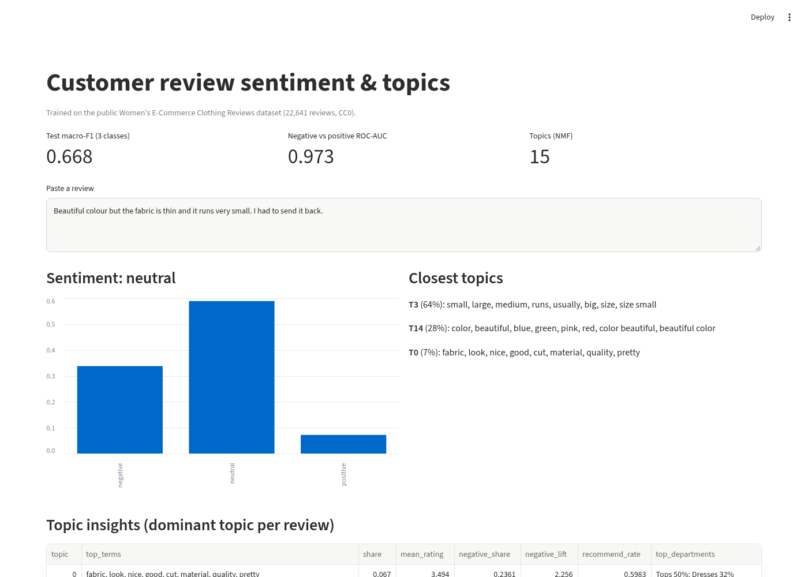

# Customer review sentiment & topic analysis

Classifies customer reviews as negative / neutral / positive, discovers
what customers talk about (topics), and links the two in an
auto-generated insights report: **which themes drive bad reviews, and
where**. Built on **22,641 real, public clothing reviews**.

**Data status:** **real public data** — Women's E-Commerce Clothing
Reviews (CC0 Public Domain). See [`data/README.md`](data/README.md).

New to the code? Start with the [code walkthrough](CODE_WALKTHROUGH.md).
Non-technical summary: [case study](CASE_STUDY.md). The generated
report: [`reports/insights_report.md`](reports/insights_report.md).

---

## Problem

A retailer or app business collects thousands of reviews. Star ratings
say *how* happy customers are, not *why*. The useful outputs are:

1. a sentiment score for new, unlabelled text (emails, social posts,
   survey comments that have no stars), and
2. a map of recurring themes, ranked by how strongly each one is
   associated with unhappy customers.

---

## Approach

**Sentiment (supervised).** Labels from stars (1–2 negative, 3 neutral,
4–5 positive). Stratified 80/20 split (18,112 / 4,529, seed 42); test
used once.

| Model | Details |
| --- | --- |
| Dummy | always "positive" |
| **TF-IDF + logistic regression** | word 1–2-grams + character 2–5-grams, `class_weight="balanced"`; C ∈ {0.5, 2, 8} chosen by 5-fold CV macro-F1 on train |
| MiniLM + logistic regression | `all-MiniLM-L6-v2` sentence embeddings (384-d), balanced logistic regression |

**Topics (unsupervised).** TF-IDF (1–2-grams, English stop words plus
generic review words such as "love", "dress", "retailer") → NMF for
k ∈ {6, 8, 10, 12, 15}. k chosen by mean **NPMI coherence** of each
topic's top-10 words (computed from document co-occurrence in this
corpus). **Stability**: the chosen model is re-fitted with 3 other seeds;
for each topic, the best Jaccard overlap of top-10 words with the
re-fitted topics is averaged.

**Insights.** Each review gets its dominant topic. For each topic:
share, mean rating, negative share, **negativity lift** (topic negative
share ÷ corpus negative share), recommendation rate and top
departments. `src/topics.py` writes these into a Markdown report — no
number in it is typed by hand.

---

## Results

From [`reports/sentiment_metrics.json`](reports/sentiment_metrics.json)
and [`reports/topic_metrics.json`](reports/topic_metrics.json), produced
on 15 November 2026 (Europe/Dublin).

### Sentiment (test set, n = 4,529)

| Model | Accuracy | Macro-F1 | F1 negative | F1 neutral | F1 positive |
| --- | ---: | ---: | ---: | ---: | ---: |
| Dummy (always positive) | 0.7706 | 0.2901 | 0.0000 | 0.0000 | 0.8704 |
| **TF-IDF + LR (C = 0.5)** | **0.8231** | **0.6679** | **0.6078** | **0.4704** | **0.9255** |
| MiniLM embeddings + LR | 0.7710 | 0.6134 | 0.5453 | 0.4041 | 0.8909 |

- 5-fold CV macro-F1 of the chosen TF-IDF model on train: 0.6613 (test
  0.6679 — consistent).
- **Negative vs positive only** (neutral removed): ROC-AUC **0.9725**.
  Telling clearly unhappy from clearly happy customers is easy; the
  3-star middle is not.



Confusion matrix (rows = true, columns = predicted; negative / neutral /
positive): negative 313 / 143 / 18; neutral 158 / 310 / 97; positive
85 / 300 / 3,105. Most errors involve the neutral class. Examples:
[`reports/misclassified_examples.csv`](reports/misclassified_examples.csv).

Strongest TF-IDF words — negative: *not, poor, awful, too small, cheap,
going back, unflattering*; neutral: *not for, however the, returning it,
ok, cute but*; positive: *love, great, perfect, comfortable, flattering*.

### Topics

NPMI coherence by k: 6 → 0.110, 8 → 0.113, 10 → 0.107, 12 → 0.114,
**15 → 0.119** (chosen). Seed stability (mean best-match Jaccard of
top-10 words): **0.63**.



Topics most and least associated with 1–2 star reviews (corpus negative
share 10.5%):

| Topic | Top terms | Share | Negative share | Lift | Recommend |
| --- | --- | ---: | ---: | ---: | ---: |
| T0 | fabric, look, nice, good, cut, material, quality, pretty | 6.7% | 23.6% | **2.26×** | 59.8% |
| T9 | store, tried, online, saw, sale, try, price | 10.8% | 17.8% | 1.70× | 72.0% |
| T3 | small, large, medium, runs, usually, big, size | 8.6% | 12.9% | 1.23× | 77.6% |
| T4 | sweater, warm, sleeves, soft, coat, cozy, itchy | 5.6% | 12.8% | 1.22× | 78.9% |
| … | (11 more in the report) | | | | |
| T13 | comfortable, soft, flattering, compliments, material | 6.8% | 3.2% | 0.31× | 93.5% |
| T12 | fits, perfectly, fits perfectly, fits great | 5.3% | 3.1% | 0.30× | 94.9% |
| T5 | perfect, summer, fall, spring, length, light | 6.3% | 2.2% | **0.21×** | 96.2% |

(Full table with recommendation rates and departments:
[`reports/topic_summary.csv`](reports/topic_summary.csv) and the
[insights report](reports/insights_report.md).)



**Reading it:** reviews dominated by *fabric / material / quality* talk
are more than twice as likely to be negative, and those about *sizing
running small/large* 1.2× as likely; reviews about comfort, a perfect
fit or seasonal wearability are rarely negative. By department, the small
"Trend" department had the highest negative share (17.8%, but only
n = 118); Bottoms the lowest (8.7%).

---

## Demo

The Streamlit app scoring a mixed review ("beautiful colour but thin
fabric, runs small, sent it back") as neutral-leaning-negative and
matching it to the sizing, colour and fabric topics (captured 15
November 2026, Europe/Dublin):



---

## How to run

From this folder, Python 3.11+ (developed on 3.13.5):

```bash
python3 -m venv .venv
source .venv/bin/activate
pip install -r requirements.txt

python src/fetch_data.py         # optional; the CSV is already in data/
python src/train_sentiment.py    # ~4 min on CPU (CV grid + MiniLM embeddings)
python src/topics.py             # ~20 s; writes reports/insights_report.md
pytest -q                        # 5 smoke tests
streamlit run app.py
```

---

## Client value

- **Triage at scale:** route clearly negative feedback to customer
  service immediately (negative-vs-positive AUC 0.97).
- **Fix the right thing:** a ranked list of complaint themes (here,
  fabric quality and sizing) with real review quotes for the product
  team.
- **Repeatable report:** re-run monthly on new reviews to see whether a
  change (new size guide, new supplier) moved the theme's negativity.

---

## Critical evaluation

Written with QQI / NFQ Level 9 expectations in mind.

- **Stars are noisy labels.** A 3-star review can be warm or angry; some
  5-star reviews mention problems. The neutral F1 of 0.47 partly reflects
  label ambiguity, not only model weakness. Hand-labelling a sample to
  measure inter-annotator agreement would set a realistic ceiling.
- **The simple model beat the embedding model.** TF-IDF with character
  n-grams outperformed frozen MiniLM embeddings (macro-F1 0.668 vs
  0.613). Sentiment hinges on specific phrases ("too small", "going
  back") that a general-purpose sentence embedding blurs. Fine-tuning a
  transformer would likely beat both but needs a GPU and more care
  about overfitting.
- **C sat at the edge of the grid** (0.5 was the smallest value tried),
  so slightly stronger regularisation might do a little better.
- **Topic choices are fragile.** Coherence was still rising at k = 15
  (the largest value tried, capped for readability), and seed stability
  of 0.63 means roughly a third of each topic's top words change between
  runs. Topics are a reading aid, not ground truth; several overlap
  (fit / fits perfectly / true to size).
- **Association, not causation.** "Fabric/quality" reviews being more
  negative does not prove fabric causes returns. Dominant-topic
  assignment also ignores reviews that mix themes.
- **Single retailer, single category, US English.** Results may not
  transfer to Irish customers, other products or other languages.
- **Ethics.** The data is CC0 and anonymised; reviewer age is not used.
  Applied to a client's own reviews, text can contain names, order
  numbers or health information and should be treated as personal data.
