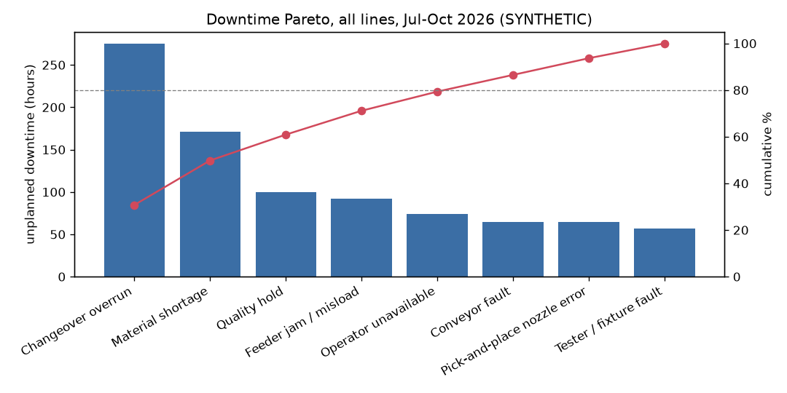
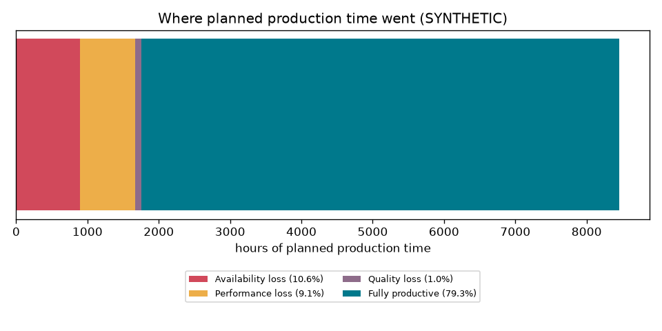
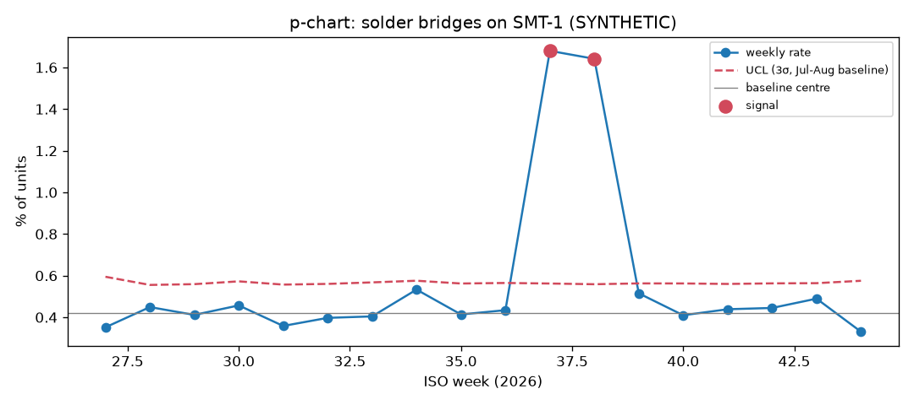
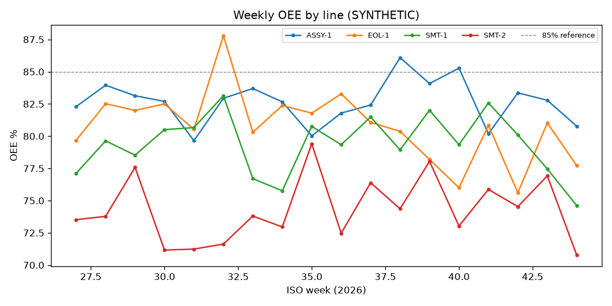
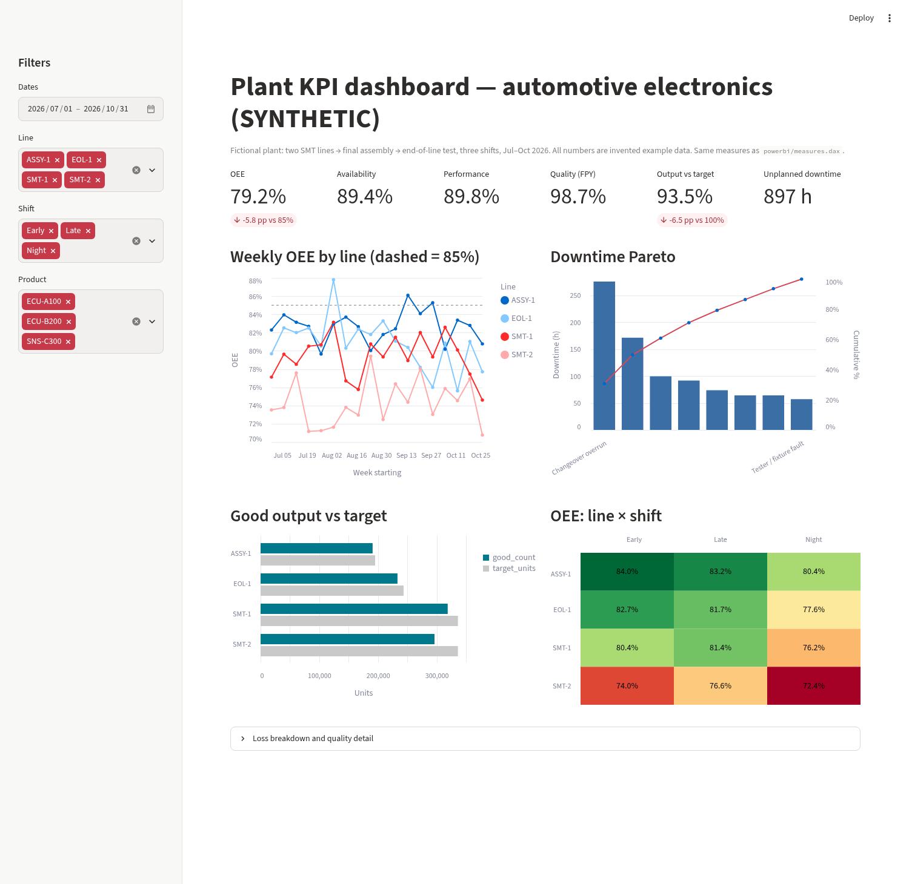

# Manufacturing KPI dashboard: OEE, downtime, defects and output vs target

A plant-floor KPI dashboard for a fictional **automotive electronics
plant** (two surface-mount lines → final assembly → end-of-line test,
three shifts). It is delivered two ways:

- a **Power BI** kit: star-schema CSVs, a full set of DAX measures and a
  step-by-step [build guide](powerbi/POWERBI_BUILD_GUIDE.md);
- a working **Streamlit** dashboard with the same measures, so the
  result can be demonstrated without Windows.

It is a client-facing demo for BI / operations-analytics work and a
piece of evidence toward a QQI Level 9 (Master's) RPL file. The domain
draws on the author's two years as a test engineer in automotive
electronics manufacturing; **no employer data, process or figures are
used**.

**Data status:** **SYNTHETIC**, seeded, generated by
[`src/generate_data.py`](src/generate_data.py). Four problems were
planted on purpose so the monitoring rules can be scored against a known
answer. See [`data/README.md`](data/README.md).

New to the code? Start with the [code walkthrough](CODE_WALKTHROUGH.md).
For a non-technical summary, read the [case study](CASE_STUDY.md).

---

## Problem

Plant managers usually have the raw numbers (shift reports, MES stop
codes, AOI / test-station defects) but not one trusted view of **how
much of the planned time turned into good product, and where the rest
went**. The usual failure modes are spreadsheet OEE that is averaged
instead of weighted, downtime that is never Pareto'd, and quality
spikes noticed weeks late. The brief here:

1. a correct OEE (availability × performance × quality), FPY, rolled
   throughput yield, scrap and output-vs-target at any level (shift,
   line, week, plant);
2. a downtime Pareto and an OEE loss breakdown in minutes;
3. simple, explainable alerts that would have caught real problems early,
   and an honest count of false alarms.

---

## Data

| Table | Grain | Rows |
| --- | --- | ---: |
| `fact_production` | line × shift × day (one product per shift) | 1,128 |
| `fact_target` | line × shift × day | 1,128 |
| `fact_downtime` | one unplanned stop event | 2,348 |
| `fact_defects` | line × shift × day × defect type | 2,697 |
| `dim_date`, `dim_line`, `dim_shift`, `dim_product`, `dim_downtime_reason`, `dim_defect` | lookups | 123 / 4 / 3 / 3 / 8 / 7 |

Period 1 July – 31 October 2026; Monday–Friday three shifts, Saturday
early shift. Every fact row carries `data_flag = SYNTHETIC_EXAMPLE_DATA`
and the loader refuses untagged rows.

**Planted issues** (in [`data/star_schema/planted_issues.json`](data/star_schema/planted_issues.json)):

| ID | Planted problem |
| --- | --- |
| P1 | Solder-bridge rate ×4 on SMT-1, 7–20 September (e.g. a stencil change) |
| P2 | Changeover overruns ×3 as frequent on SMT-2 throughout |
| P3 | Tester / fixture faults ×3 on EOL-1 from 1 October (a wearing fixture) |
| P4 | Night shift performance 4 percentage points lower on every line |

---

## Approach

1. **One definition, three implementations.** The measures are written
   in pandas ([`src/kpi_lib.py`](src/kpi_lib.py)), in SQL on DuckDB
   ([`src/kpi_sql.py`](src/kpi_sql.py)) and in DAX
   ([`powerbi/measures.dax`](powerbi/measures.dax)). All are *sums
   divided by sums*, so they aggregate correctly. The pandas and SQL
   versions are compared automatically.
2. **Loss breakdown.** Planned production time is split into
   availability, performance and quality losses and fully productive
   time (minutes).
3. **Monitoring rules, fixed in advance.** Limits come from July–August
   (phase I) and are applied unchanged to September–October (phase II):
   - weekly **p-chart** (3σ) for every line × defect series;
   - weekly **Poisson c-chart** (99.865% upper limit) for every line ×
     downtime-reason series with enough events;
   - a **line-vs-other-lines rate scan** per downtime reason
     (conditional binomial test, Bonferroni, α = 0.01);
   - a **day-block bootstrap** (1,000 resamples) of the night-minus-day
     performance gap.
4. **Dashboards.** Streamlit + Altair app (filters for dates, line,
   shift, product), and a Power BI build guide with four pages and an
   expected-values table to check the build.

---

## Results

All numbers are copied from [`reports/metrics.json`](reports/metrics.json),
produced by `python src/analyse.py` on 17 November 2026 (Europe/Dublin).

### Plant KPIs, July–October 2026 (SYNTHETIC)

| Measure | Value |
| --- | ---: |
| Availability | 89.40% |
| Performance | 89.78% |
| Quality (= first-pass yield) | 98.73% |
| **OEE** | **79.25%** |
| Rolled throughput yield (SMT → assembly → test) | 96.65% |
| Yield after rework | 99.68% |
| Output vs target (good units / target) | 93.52% |

| Line | Availability | Performance | Quality | OEE | Output vs target |
| --- | ---: | ---: | ---: | ---: | ---: |
| ASSY-1 | 92.82% | 89.82% | 99.15% | 82.66% | 97.81% |
| EOL-1 | 90.90% | 89.81% | 98.95% | 80.78% | 95.74% |
| SMT-1 | 89.76% | 89.78% | 98.56% | 79.42% | 94.82% |
| **SMT-2** | **84.12%** | 89.70% | 98.49% | **74.32%** | **88.12%** |

Where the planned time went: availability loss **10.60%**, performance
loss **9.14%**, quality loss **0.97%**, fully productive **79.29%**.
Top downtime reasons: **changeover overrun 30.7%** of unplanned minutes,
material shortage 19.1%, quality hold 11.1% (61% together).





### Do the three implementations agree?

25 values (5 plant-level, 20 line-level) compared between pandas and
SQL: maximum absolute difference **1.0 × 10⁻¹⁵** (floating-point noise).
The DAX was written to the same definitions but has **not** been
executed (no Power BI on the Linux build machine); the guide's
"check your numbers" table is how to verify it.

### Did the monitoring rules find the planted problems?

| Issue | Rule | Result |
| --- | --- | --- |
| P1 solder spike | weekly p-chart | **2 of 2** planted weeks flagged (weeks 37, 38) |
| P2 SMT-2 changeovers | rate scan | flagged: **3.15×** the other lines' rate, Bonferroni p ≈ 1e-38 |
| P3 fixture faults | weekly c-chart | **3 of 5** October weeks flagged (41, 42, 44); week 40 is part-September, week 43 was 13 events vs a limit of 14 |
| P4 night shift | bootstrap | night − day performance **−4.08 pp**, 95% CI [−4.38, −3.78] |
| False alarms | p-chart | **3** signals in 88 non-planted monitored series-weeks (3.4%) |
| False alarms | c-chart | **0** in 247 |

The rate scan also flagged EOL-1 for tester / fixture faults (9.3× the
other lines). That is mostly **by design** — test-station faults
naturally happen at the test line — plus P3. A statistical scan cannot
tell "structurally different" from "has a problem"; a domain filter is
needed.





---

## Demo

The Streamlit dashboard with all lines, shifts and products selected
(captured 17 November 2026, Europe/Dublin):



---

## How to run

From this folder, Python 3.11+ (developed on 3.13.5):

```bash
python3 -m venv .venv
source .venv/bin/activate
pip install -r requirements.txt

python src/generate_data.py   # star-schema CSVs (seeded, SYNTHETIC)
python src/analyse.py         # KPIs, cross-check, alerts, charts (~10 s)
pytest -q                     # 6 tests
streamlit run app.py
```

For Power BI, follow [`powerbi/POWERBI_BUILD_GUIDE.md`](powerbi/POWERBI_BUILD_GUIDE.md).

---

## Client value

- **One trusted OEE**, defined once and implemented identically in the
  BI layer and in SQL, so the dashboard and the warehouse never argue.
- **Minutes, not just percentages**: the loss breakdown shows the
  biggest prize (here availability, driven by changeovers on one line).
- **Alerts that would have caught the solder spike in its first week**,
  with the false-alarm rate measured, not guessed.
- A **Power BI kit** the client's own team can maintain.

---

## Critical evaluation

Written with QQI / NFQ Level 9 expectations in mind.

- **The data are synthetic, and the alerts were scored on problems I
  planted.** Detection is therefore an upper bound: real problems are
  subtler, overlap, and come with coding errors in stop reasons.
- **The p-chart over-alarms.** 3.4% false signals is well above the
  ~0.1% a 3σ chart promises, because the generator (like real plants)
  has day-to-day variation beyond binomial noise. A Laney p′ chart or
  limits from a longer baseline would be the next fix.
- **Week boundaries cost detection.** P3 starts on a Thursday, so ISO
  week 40 mixes normal and faulty days and was not flagged; a daily
  CUSUM or EWMA would react faster than weekly Shewhart limits.
- **Aggregation detail.** Plant-level A × P × Q (79.25%) and the
  time-based OEE (79.29%) differ by 0.05 pp because quality is
  count-weighted while cycle times differ between products. Both
  measures are provided and the difference is documented. Averaging
  per-shift OEE gave 79.29% here — close only because every shift has
  the same planned time; with mixed shift lengths it would mislead.
- **Power BI was not run.** The DAX follows the same definitions that
  were tested in two other languages, but the `.pbix` must be built and
  checked against the expected-values table on Windows.
- **Targets are a fixed 85% of theoretical capacity.** Real targets
  come from the production plan and change with mix.

## Next steps

Build the `.pbix` and add its screenshots; replace weekly Shewhart
limits with EWMA / Laney p′; add MTBF / MTTR by asset; connect to a
real MES export through the ETL pattern in project 12.
