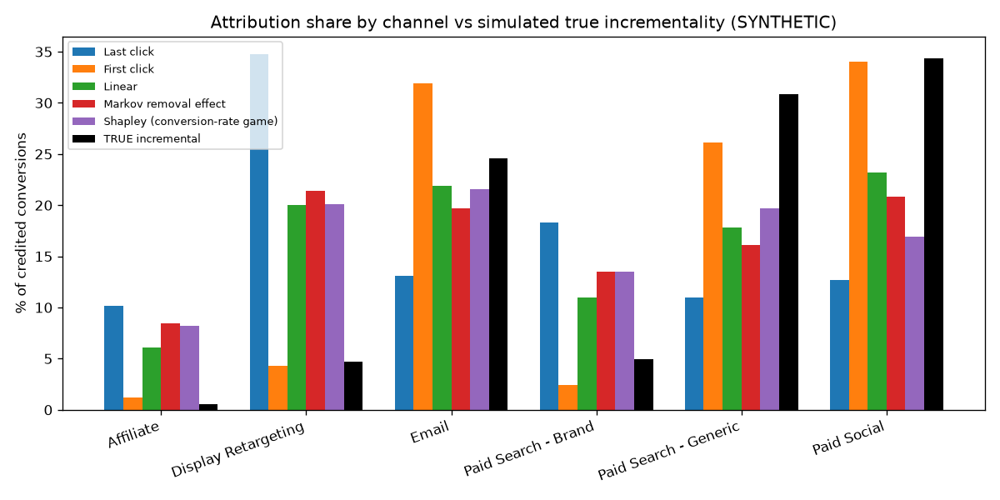
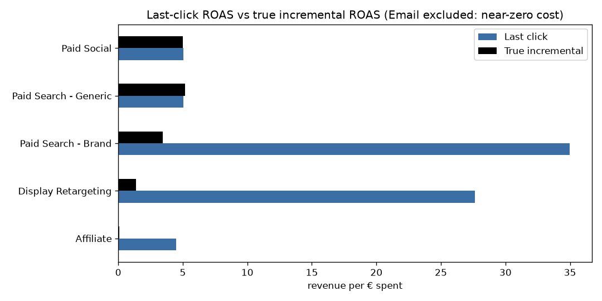
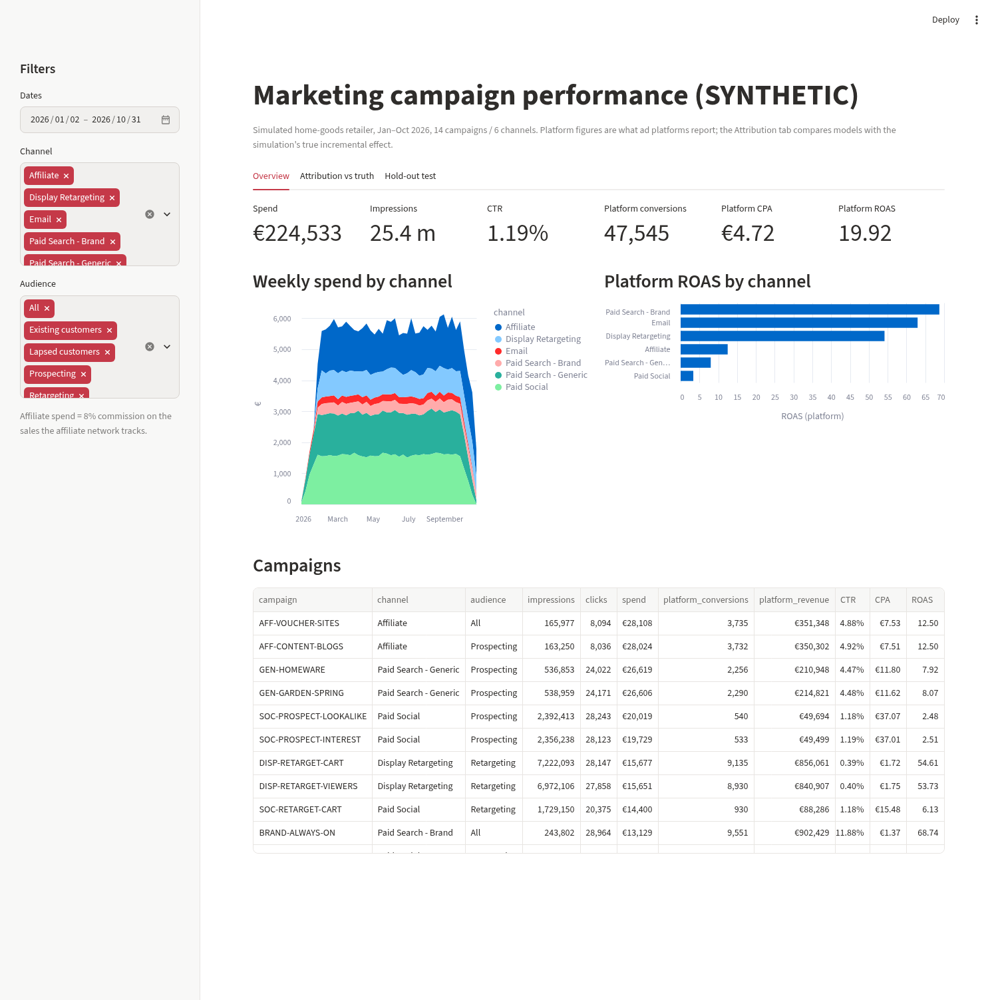
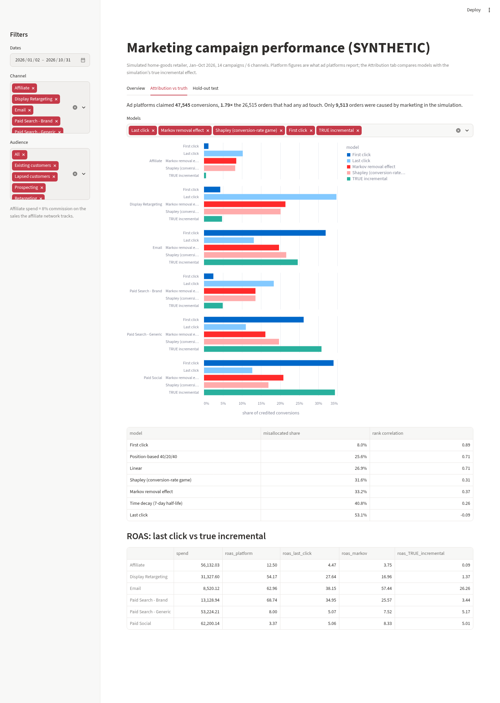

# Marketing campaign performance dashboard with an attribution reality check

A campaign dashboard (spend, impressions, CTR, CPC, conversions, CPA,
ROAS by channel, audience and campaign) plus the question most
dashboards skip: **which channels actually caused the sales?** Seven
attribution models are compared with the *true* incremental effect of
each channel, which is known here because the data are simulated, and
with a randomised hold-out test.

A client-facing demo for marketing-analytics / BI work and a piece of
evidence toward a QQI Level 9 (Master's) RPL file.

**Data status:** **SYNTHETIC**, generated by
[`src/simulate.py`](src/simulate.py) for a fictional Irish home-goods
retailer. A public dataset was preferred, but none combined spend,
user-level journeys *and* a known causal answer under a licence suitable
for client demos (the Criteo attribution dataset, for example, is
CC BY-NC-SA, non-commercial). See [`data/README.md`](data/README.md).

New to the code? Start with the [code walkthrough](CODE_WALKTHROUGH.md).
For a non-technical summary, read the [case study](CASE_STUDY.md) or the
auto-generated [insights report](reports/insights.md).

---

## Problem

Every ad platform reports its own conversions and ROAS, and every
platform takes credit for the same sale. Marketing teams then move
budget using last-click reports that favour channels which reach people
who were going to buy anyway (brand search, retargeting, voucher
affiliates). The brief:

1. a clean dashboard of standard campaign KPIs by channel, audience and
   campaign;
2. a comparison of attribution models (last click, first click, linear,
   time decay, position-based, Markov chain, Shapley);
3. an honest test of which of those numbers can be trusted.

---

## Data

| File | Rows | Content |
| --- | ---: | --- |
| `SYNTHETIC_campaign_daily.csv` | 4,091 | campaign × day: impressions, clicks, spend, platform-reported conversions and revenue |
| `SYNTHETIC_touchpoints.csv.gz` | 301,267 | one ad touch: person, time, channel, campaign |
| `SYNTHETIC_conversions.csv.gz` | 28,499 | one order: person, time, revenue |
| `SYNTHETIC_holdout_test.csv.gz` | 160,000 | randomised 10% hold-out from paid social prospecting |
| `truth_incrementality.json` | – | true incremental conversions and revenue per channel |

**How the truth is known.** 160,000 simulated people each have a purchase
intent and one random draw. Touches raise the log-odds of purchase by a
channel-specific amount (brand search 0.10, generic search 0.40, paid
social 0.35, display retargeting 0.05, email 0.25, affiliate 0.02;
diminishing after three touches). Retargeting, brand search and
affiliates are targeted mostly at high-intent people, and they touch
late in the journey; paid social touches early. Re-running the same
people with one channel switched off gives that channel's true
incremental conversions.

Spend: cost-per-click by channel with noise; email at €0.004 per send;
affiliates paid 8% commission on the sales their network tracks.

---

## Approach

1. **KPIs** from the platform export: CTR, CPC, platform CVR, CPA and
   ROAS by channel, audience and campaign; blended ROAS / CPA on actual
   orders.
2. **Attribution** ([`src/attribution.py`](src/attribution.py)) on the
   journeys of people with at least one touch: five rule-based models; a
   first-order **Markov chain** with removal effects (absorbing-chain
   solution); and **Shapley values** on the conversion rates of channel
   sets.
3. **Scoring against the truth**: share of credit misallocated
   (total-variation distance between a model's channel shares and the
   true incremental shares) and Spearman rank correlation.
4. **Hold-out test**: difference in conversion rate between exposed and
   held-out people eligible for prospecting, with a normal-approximation
   95% CI, scaled to incremental conversions.
5. **Dashboard** ([`app.py`](app.py)) with Overview, Attribution vs
   truth, and Hold-out tabs.

---

## Results

All numbers are copied from [`reports/metrics.json`](reports/metrics.json),
produced by `python src/analyse.py` on 17 November 2026 (Europe/Dublin).

### Headline KPIs (January–October 2026, SYNTHETIC)

| Measure | Value |
| --- | ---: |
| Spend | €224,533 |
| Orders / revenue | 28,499 / €2,671,664 |
| Blended ROAS / CPA | 11.90 / €7.88 |
| Impressions / clicks / CTR | 25.4 m / 301,267 / 1.19% |
| Conversions claimed by platforms | 47,545 (**1.79×** the 26,515 orders with any touch) |
| Orders truly caused by marketing | **9,513** (33% of all orders) |

### Which attribution model is closest to the truth?

| Model | Credit misallocated | Rank correlation |
| --- | ---: | ---: |
| First click | **8.0%** | 0.89 |
| Position-based 40/20/40 | 25.6% | 0.71 |
| Linear | 26.9% | 0.71 |
| Shapley (conversion-rate game) | 31.6% | 0.31 |
| Markov removal effect | 33.2% | 0.37 |
| Time decay (7-day half-life) | 40.8% | 0.26 |
| Last click | 53.1% | −0.09 |

**First click "wins" only because of how this world was built** (the
channels that really work touch early; the ones that harvest demand
touch late). In a world with different timing it would fail just as
badly; it is not a recommendation. The robust finding is that **the
two data-driven models (Markov, Shapley) were no better than simple
linear credit**, because they learn from observational journeys in
which targeting follows intent.



### What last-click ROAS says vs what is true

| Channel | Spend (€) | Platform ROAS | Last-click ROAS | True incremental ROAS |
| --- | ---: | ---: | ---: | ---: |
| Affiliate | 56,132 | 12.50 | 4.47 | **0.09** |
| Display retargeting | 31,328 | 54.17 | 27.64 | **1.37** |
| Email | 8,520 | 62.96 | 38.15 | 26.26 |
| Paid search – brand | 13,129 | 68.74 | 34.95 | **3.44** |
| Paid search – generic | 53,224 | 8.00 | 5.07 | 5.17 |
| Paid social | 62,200 | 3.37 | 5.06 | 5.01 |

Last click looks right for generic search and paid social *in total*,
but it over-states affiliates ~50×, retargeting ~20× and brand search
~10×. A budget moved from social to retargeting on last-click evidence
would lose money.



### Randomised hold-out (paid social prospecting)

| | Exposed | Held out |
| --- | ---: | ---: |
| Eligible people | 48,978 | 5,463 |
| Conversion rate | 17.02% | 13.58% |

Lift **3.44 pp** (95% CI 2.47–4.41, p ≈ 3 × 10⁻¹²). Estimated
incremental conversions **1,685** (95% CI 1,211–2,159) against a
simulated truth of **1,966**: the interval contains the truth, and it
is the only method here whose answer does not depend on targeting.

---

## Demo

Overview tab and Attribution tab (captured 17 November 2026, Europe/Dublin):





---

## How to run

From this folder, Python 3.11+ (developed on 3.13.5):

```bash
python3 -m venv .venv
source .venv/bin/activate
pip install -r requirements.txt

python src/simulate.py     # SYNTHETIC data + truth (~5 s)
python src/analyse.py      # KPIs, attribution, hold-out, charts, insights.md (~7 s)
pytest -q                  # 5 tests
streamlit run app.py
```

---

## Client value

- A **standard KPI dashboard** that your team will recognise (spend,
  CTR, CPC, CPA, ROAS by channel / audience / campaign).
- A clear demonstration of **why platform numbers add up to more than
  your actual sales**, and by how much.
- A **test plan, not just a model**: hold-out tests on the biggest
  budget lines are the evidence that should move money.

---

## Critical evaluation

Written with QQI / NFQ Level 9 expectations in mind.

- **The truth is my own assumption.** The ranking of methods depends
  on the simulated world: effect sizes, targeting bias and touch timing
  are invented. The study shows *how* attribution can mislead and that
  it can be checked; it does not show which model wins on a client's
  data.
- **First click's win is an artefact** of early-touching effective
  channels, as stated above. Reporting it as "first click is best"
  would be a misleading headline.
- **The data-driven models are observational.** Markov removal effects
  and Shapley values both credit channels that co-occur with
  conversions; with intent-based targeting that is correlation. My
  Shapley variant also skips unobserved channel sets and clips negative
  values, which are judgement calls.
- **The hold-out under-estimated** the truth (1,685 vs 1,966) — within
  its CI, but a 10% hold-out gives a wide interval; a real test needs a
  power calculation and enough duration.
- **Simplifications:** one purchase per person, no cross-device
  tracking loss, no ad-stock / saturation over time, no seasonality in
  effects. A media-mix model would be the complementary top-down view.

## Next steps

Media-mix model (ad-stock + saturation) on weekly spend; power
calculator for hold-out tests; a Power BI version using the same
measures pattern as project 11.
