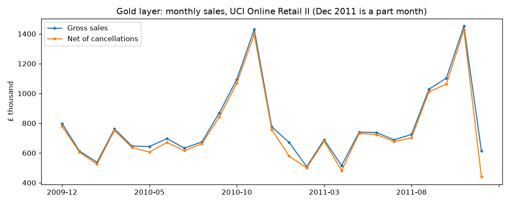

# Medallion lakehouse (bronze / silver / gold), built locally and mapped to Azure and Microsoft Fabric

A working **bronze → silver → gold** lakehouse on Delta tables, run end
to end on a laptop with Python, DuckDB and `deltalake` (delta-rs) over a
real public dataset of **1,067,371** retail transactions. Every piece is
mapped to its **Azure Data Factory / ADLS Gen2 / Microsoft Fabric
Lakehouse / Synapse** equivalent, with Bicep infrastructure-as-code, an
ADF pipeline definition and Fabric notebook ports.

> **Run locally, not on Azure.** No Azure subscription or Fabric
> workspace was used. The local pipeline was executed and tested. The
> Bicep template was *compiled and linted* with the Bicep CLI but never
> deployed; the ADF pipeline JSON and the Fabric PySpark notebooks were
> written and syntax-checked but **not executed**. See
> [`docs/AZURE_FABRIC_MAPPING.md`](docs/AZURE_FABRIC_MAPPING.md).

A learning project for cloud data engineering, a client-facing demo,
and a piece of evidence toward a QQI Level 9 (Master's) RPL file.

**Data status:** **REAL public data**, UCI *Online Retail II*
(Chen, 2012, [doi:10.24432/C5CG6D](https://doi.org/10.24432/C5CG6D)),
licensed **CC BY 4.0**: all transactions of a UK-based online gift
retailer, 1 December 2009 – 9 December 2011. It contains customer IDs
(pseudonymous numbers) but no names or contact details. The raw data is
downloaded by the pipeline and **not committed** to this repository.

New to the code? Start with the [code walkthrough](CODE_WALKTHROUGH.md).
For a non-technical summary, read the [case study](CASE_STUDY.md).

---

## Problem

Teams moving reporting to Azure or Fabric are told to "use a medallion
architecture" but rarely see what each layer must guarantee. The brief:

1. **Bronze**: keep raw files exactly as delivered, with lineage, and
   load only what is new.
2. **Silver**: typed, de-duplicated, classified records that the
   business can rely on, rebuilt safely when a source file is corrected.
3. **Gold**: a star schema and aggregates ready for Power BI.
4. Prove that **incremental loads give the same answer as a full
   rebuild**, that re-runs are idempotent, and that corrections replace
   rather than duplicate data.
5. Show exactly how this maps onto Azure / Fabric services.

---

## Architecture

```
UCI zip ──fetch_and_land.py──► landing/  (25 monthly CSV "extracts", as delivered)
                                   │  ADF / Fabric pipeline: Copy activity
                                   ▼
          bronze.online_retail_ii_raw  (Delta, all strings + _source_file, _sha256, _batch_id)
          _control.ingested_files      (watermark: file name + SHA-256)
                                   │  Fabric notebook / Spark SQL
                                   ▼
          silver.sales_line  (Delta, typed, de-duplicated, line_type, partitioned by month;
                              changed months replaced with a predicate overwrite)
                                   │
                                   ▼
          gold.fact_sales, dim_product, dim_customer, dim_date,
          agg_monthly_country, agg_product_monthly   →  Power BI (Direct Lake)
                                   │
          _dq.results  (10 expectations; error-level failures stop the run)
```

| Local piece | Azure / Fabric equivalent |
| --- | --- |
| `landing/` folder | ADLS Gen2 `landing` container, or Fabric Lakehouse **Files/** |
| `src/bronze.py` + control table | ADF / Fabric **Data Pipeline** Copy activity + watermark Lookup |
| Delta tables via `deltalake` | **OneLake** Delta tables (Lakehouse **Tables/**) |
| `src/silver.py`, `src/gold.py` (DuckDB SQL) | Fabric **Spark notebooks** (ports in [`fabric/notebooks/`](fabric/notebooks/)) or Synapse Spark |
| Gold tables | Fabric **Warehouse** / SQL endpoint; Power BI **Direct Lake** semantic model |
| `src/dq.py` | Notebook DQ gate (or Great Expectations / Purview data quality) |
| `src/run_pipeline.py` | ADF pipeline [`adf/pl_medallion_online_retail.json`](adf/pl_medallion_online_retail.json) with a schedule trigger |
| `conf/lakehouse.json` | Pipeline parameters / Key Vault-backed linked services |
| — | [`infra/main.bicep`](infra/main.bicep): ADLS Gen2, Data Factory (managed identity + RBAC), Log Analytics, optional Fabric F2 capacity |

---

## Results

All numbers are copied from [`reports/metrics.json`](reports/metrics.json),
produced by `python src/evaluate.py` on 17 November 2026 (Europe/Dublin).

### Rows through the layers

| Layer | Rows |
| --- | ---: |
| Bronze (25 files, as delivered) | 1,067,371 |
| Exact duplicate rows removed | 34,335 (3.2%) |
| Rows that failed typing | 0 |
| **Silver** | **1,033,036** |
| Gold `fact_sales` (sales + cancellations) | 1,021,255 |
| Gold `dim_product` / `dim_customer` / `dim_date` | 4,739 / 5,875 / 761 |

Silver line types: 1,003,340 sales, 17,915 cancellations, 5,804
non-product lines (postage, fees, manual entries), 3,392 stock
adjustments, 2,579 zero-price lines, 6 bad-debt adjustments. 22.8% of
silver lines have no customer ID (kept as `UNKNOWN`, flagged `is_guest`).

### Does incremental equal full?

| Test | Result |
| --- | --- |
| Full load in one run vs **three incremental loads** (6 + 7 + 12 files) | **identical** — MD5 over all 7 silver and gold tables |
| **Replay** the same landing zone | 0 files ingested, 25 skipped, all tables **identical** |
| **Corrected re-delivery** of March 2011 (one quantity changed, 10 lines withdrawn) | 1 file replaced, 1 month rebuilt, silver −10 rows, only **2011-03** changed in gold |
| **Delta time travel** | silver version 2 still returns the pre-correction 1,033,036 rows (now version 3) |
| Data-quality checks, full run | **10 / 10 passed** |

Runtime for the full load: **5.4 s** (bronze 2.4, silver 1.4, gold
1.2, DQ 0.5) — about 199,000 rows per second end to end on the build
machine.

### What the gold layer says (business view)

Net sales £18.93 m (gross £19.64 m, cancellations −£0.72 m). The UK is
85.4% of net sales, then EIRE £0.60 m, Netherlands £0.55 m, Germany
£0.37 m and France £0.29 m. 600 of 4,739 products have more than one
description in the source and 12 customers appear in more than one
country — both handled by deterministic rules in the dimensions.



### Infrastructure as code

`bicep build` and `bicep lint` (Bicep CLI 0.49.2): **0 errors, 0
warnings**; compiled ARM template in [`infra/main.json`](infra/main.json).
Not deployed.

---

## How to run

From this folder, Python 3.11+ (developed on 3.13.5):

```bash
python3 -m venv .venv
source .venv/bin/activate
pip install -r requirements.txt

cd src
python fetch_and_land.py            # download (45 MB), verify SHA-256, write 25 monthly CSVs (~40 s)
python run_pipeline.py --reset      # full load: bronze, silver, gold, DQ (~5 s)
python run_pipeline.py --until 2010-11   # (alternative) incremental demo
python evaluate.py                  # full vs incremental, replay, correction, time travel (~30 s)
cd .. && pytest -q                  # 5 tests on an 11-row fixture

# optional, needs the Bicep CLI
bicep build infra/main.bicep --outfile infra/main.json
```

To deploy (not done for this project): `az deployment group create -g
<rg> -f infra/main.bicep -p infra/main.parameters.json`, then import the
notebooks into a Fabric workspace and the pipeline JSON into ADF.

---

## Client value

- A **reference implementation** of bronze / silver / gold with the
  guarantees spelled out and tested, not just three folder names.
- **Cheap to prototype**: the whole pattern runs on a laptop, so
  design questions are answered before any cloud spend.
- **A clear path to Azure / Fabric**: the same Delta tables, the same
  SQL, and IaC for the landing infrastructure with managed identities
  instead of keys.

---

## Critical evaluation

Written with QQI / NFQ Level 9 expectations in mind.

- **Nothing ran in the cloud.** Fabric-specific behaviour (V-Order,
  Direct Lake fallbacks, capacity throttling, OneLake security,
  `mssparkutils`) is described, not tested. The PySpark ports were
  syntax-checked only; Spark and DuckDB differ in places (e.g. ordered
  aggregates, `try_cast` edge cases), so the ports need their own test
  run.
- **Two real bugs were caught by the tests, both relevant in Azure.**
  (1) The bronze row-count check first read the control table's raw
  Parquet files and double counted, because a Delta overwrite leaves old
  files in place until `VACUUM`; always read Delta tables through the
  log. (2) `arg_max` picked arbitrary winners on ties, so `dim_product`
  differed between full and incremental runs; ties are now broken
  explicitly. Both are common in Fabric notebooks too.
- **"Exact duplicate" is an assumption.** 34,335 identical rows were
  treated as duplicates. Some may be genuine repeat lines on the same
  invoice; the source has no line number to tell them apart.
- **Gold is fully rebuilt each run.** Fine at a million rows; at scale it
  should become an incremental `MERGE` keyed on `line_key` with change
  data feed.
- **Personal data.** Customer IDs are pseudonymous, but transaction
  histories are still personal data under GDPR if they can be linked
  back; a client deployment needs access controls and retention rules.

## Next steps

Deploy to a Fabric trial capacity and re-run the evaluation there; add
`MERGE`-based incremental gold and change data feed; build the Direct
Lake semantic model with the project 11 measure pattern; feed
`dim_customer` into the segmentation in project 15.
