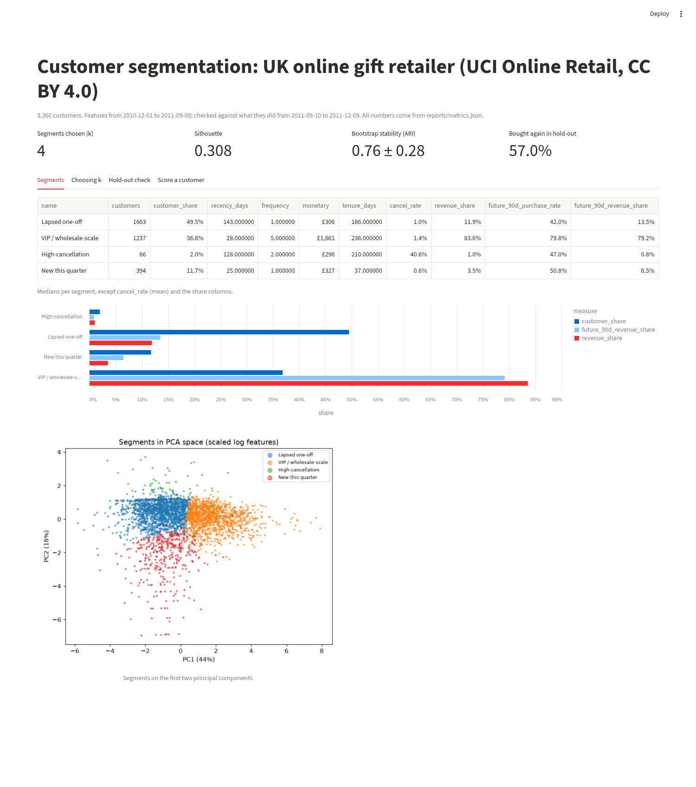
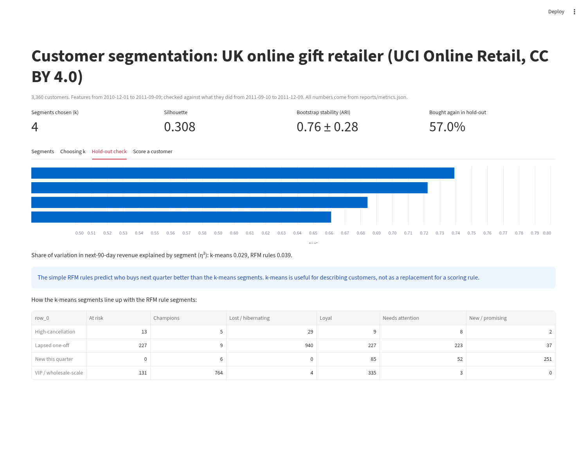

# Customer segmentation with an honest hold-out check

K-means segmentation of **3,360 real customers** of a UK online gift
retailer, built from behaviour features (recency, frequency, spend,
tenure, basket size, range of products bought, cancellation rate).
The number of segments is chosen by a rule fixed in advance. The
segments are then tested on what customers did in the **next 91 days**,
which the model never saw, and compared with a classic RFM rule-based
segmentation.

A portfolio piece for marketing and CRM analytics, a client-facing
demo, and evidence toward a QQI Level 9 (Master's) RPL file.

**Data status:** **REAL public data**, UCI *Online Retail* (Chen, 2012,
[doi:10.24432/C5BW33](https://doi.org/10.24432/C5BW33)), licensed
**CC BY 4.0**. Customer IDs are the dataset's pseudonymous numbers; no
names or contact details. The raw file is downloaded and checksum-checked
by the code and is **not committed**. See [data/README.md](data/README.md).

New to the code? Start with the [code walkthrough](CODE_WALKTHROUGH.md).
For a non-technical summary, read the [case study](CASE_STUDY.md).

---

## Problem

"Segment our customers" is one of the most common analytics requests,
and one of the easiest to do badly. Typical failures: the number of
segments is picked to make a nice slide, the segments change every time
the model is re-run, and nobody checks whether they say anything about
**future** behaviour. The brief:

1. Build customer features from transactions, without using any
   information from the period used for checking.
2. Choose the number of segments with a rule written **before** running.
3. Measure how stable the segments are.
4. Give segments plain names a marketing team can act on.
5. Test whether the segments separate who buys next quarter, and compare
   with the simple RFM rule a CRM team would use anyway.

---

## Approach

| Step | Detail |
|---|---|
| Split by time | Calibration 2010-12-01 to 2011-09-09 (features); hold-out 2011-09-10 to 2011-12-09 (outcomes only) |
| Features | recency_days, frequency (invoices), monetary (net of cancellations), tenure_days, avg_basket_value, distinct_products, cancel_rate |
| Scaling | `log1p` on the six skewed features, cancel_rate clipped to [0, 1], then z-scores |
| Candidates | K-means for k = 2…10 (n_init = 20), plus a Gaussian mixture at each k for comparison |
| Diagnostics | silhouette, Calinski–Harabasz, Davies–Bouldin, inertia, GMM BIC, bootstrap ARI (30 pairs of 80% subsamples) |
| Selection rule (fixed in advance) | highest silhouette among k = 3–8 whose mean bootstrap ARI ≥ 0.75 |
| Naming | rules on segment medians (see `name_segments` in `src/segment.py`) |
| Baseline | RFM quintile scores (R, F, M from 1 to 5) mapped to six standard named segments |
| Hold-out test | AUC for "bought again in the next 91 days" using each group's calibration purchase rate as the score; η² of next-91-day revenue explained by segment |

---

## Results

All numbers below are copied from `reports/metrics.json` and
`reports/segment_profiles.csv`, produced by `python src/segment.py`
(deterministic, seed 42).

### Choosing k

| k | silhouette | Davies–Bouldin | bootstrap ARI (mean ± sd) |
|---|---|---|---|
| 2 | 0.296 | 1.304 | 0.975 ± 0.027 |
| 3 | 0.291 | 1.247 | 0.868 ± 0.146 |
| **4** | **0.309** | **1.079** | **0.763 ± 0.281** |
| 5 | 0.245 | 1.127 | 0.937 ± 0.035 |
| 6 | 0.214 | 1.227 | 0.799 ± 0.091 |
| 7 | 0.212 | 1.224 | 0.875 ± 0.078 |
| 8 | 0.210 | 1.243 | 0.760 ± 0.120 |

The rule picks **k = 4**: it has the best silhouette and the best
Davies–Bouldin score. But it only just clears the stability bar, with a
large spread (sd 0.281). Refitting the final model from 10 random starts
gave a mean ARI of 0.862 against the chosen solution, and a minimum of
0.336. So some runs find a different 4-way split. k = 5 is far more stable
(0.937 ± 0.035) at a lower silhouette, and would be a defensible
alternative. A silhouette of about 0.3 means the clusters overlap; this
is a continuum of customers, not natural groups.

Agreement between k-means and a Gaussian mixture at k = 4 was low
(ARI 0.248), another sign that the boundaries depend on the method.

### The four segments

| Segment | Customers | Median recency (days) | Median orders | Median spend | Share of spend | Bought again in next 91 days | Share of next-91-day revenue |
|---|---|---|---|---|---|---|---|
| VIP / wholesale-scale | 1,237 (36.8%) | 28 | 5 | £1,661 | 83.6% | 79.8% | 79.2% |
| Lapsed one-off | 1,663 (49.5%) | 143 | 1 | £306 | 11.9% | 42.0% | 13.5% |
| New this quarter | 394 (11.7%) | 25 | 1 | £327 | 3.5% | 50.8% | 6.5% |
| High-cancellation | 66 (2.0%) | 128 | 2 | £296 | 1.0% | 47.0% | 0.8% |

The High-cancellation segment has a mean cancellation rate of 40.6% of
its gross order value, against 0.6–1.4% for the others.

The naming rule for "High-cancellation" was **added after the first
run**. Without it, the rules labelled that cluster "Cooling off", which
hid the one trait that defines it. The change is recorded in the code.

### Do the segments predict next quarter?

Overall, 57.0% of customers bought again in the hold-out window.

| Method | AUC (bought again in next 91 days) |
|---|---|
| RFM total score (3–15) | **0.739** |
| RFM named segments | 0.722 |
| Recency alone | 0.684 |
| K-means segments | 0.661 |

| Method | η² of next-91-day revenue |
|---|---|
| RFM named segments | 0.039 |
| K-means segments | 0.029 |

**The simple RFM rule beats k-means on both tests.** K-means segments
describe the customer base well: the VIP segment is a third of customers
and four-fifths of revenue, now and next quarter. But they are not a
better targeting score than RFM. Neither method explains much of the
variation in next-quarter revenue (under 4%), because a few large
wholesale orders dominate it. The two segmentations only partly agree
(ARI 0.372). For example, 764 of the 1,237 VIPs are RFM "Champions" and
335 are "Loyal".

---

## Demo

`streamlit run app.py` opens four tabs: segment profiles, the k-selection
diagnostics, the hold-out check, and a form that assigns a new customer
to a segment with the saved model.




Static charts: `reports/k_selection.png`, `reports/segment_heatmap.png`,
`reports/segments_pca.png`, `reports/holdout_by_segment.png`.

---

## How to run

```bash
cd projects/15-customer-segmentation
python -m venv .venv && source .venv/bin/activate
pip install -r requirements.txt
python src/fetch_and_features.py   # downloads ~23 MB, checks SHA-256, writes data/
python src/segment.py              # ~30 s: grid, final model, reports/, models/
pytest -q                          # 6 tests
streamlit run app.py
```

---

## Client value

- **A segmentation you can defend.** The number of segments, the
  stability and the hold-out result are all on the record, so the
  segments will not change silently at the next refresh.
- **Plain-language segments** with sizes, value share and next-quarter
  behaviour: for example, the VIP third of customers carried 79% of the
  following quarter's revenue, which supports a retention programme.
- **An honest recommendation:** keep RFM scoring for targeting and use
  clustering to describe customers and design offers.

### Transfer to adviser or partner segmentation

The same pipeline applies unchanged to segmenting financial advisers,
brokers or resellers. Swap the features for adviser behaviour (recency
and frequency of submitted business, premium or AUM volume, product
breadth, lapse or cancellation rate, tenure with the firm). Keep the
time split, the fixed selection rule, the stability check and the
hold-out test against a simple tiering rule. This was **not** run on
adviser data; it is a stated transfer of method.

---

## Critical evaluation

- **Weak structure.** A silhouette of 0.31 and unstable k = 4 boundaries
  mean the segments are useful summaries, not discovered "types".
- **Clustering lost to the baseline.** On the hold-out test, the RFM rule
  (AUC 0.739) beat k-means (0.661). I report this rather than tune the
  clustering until it wins, which would leak the hold-out.
- **One naming rule was added after seeing results** (the
  High-cancellation label). It does not change any cluster assignment
  or metric, only a label.
- **Wholesale mix.** Many customers are businesses ordering in bulk, so
  "customer" here is closer to B2B account segmentation than to
  consumer retail.
- **One retailer, one year, pre-2012 data.** Results do not generalise
  without re-running on the client's own data.
- **Selection criteria were mine.** The 3–8 range and the ARI ≥ 0.75 bar
  are judgement calls, stated before running but not validated
  independently.

## Next steps

- Compare with k = 5 (more stable) and a GMM with soft membership.
- Predict next-quarter spend directly (e.g., BG/NBD + Gamma-Gamma) and
  use segments only to explain it.
- Add product-mix features (category shares) to separate wholesale
  from gift buyers.
