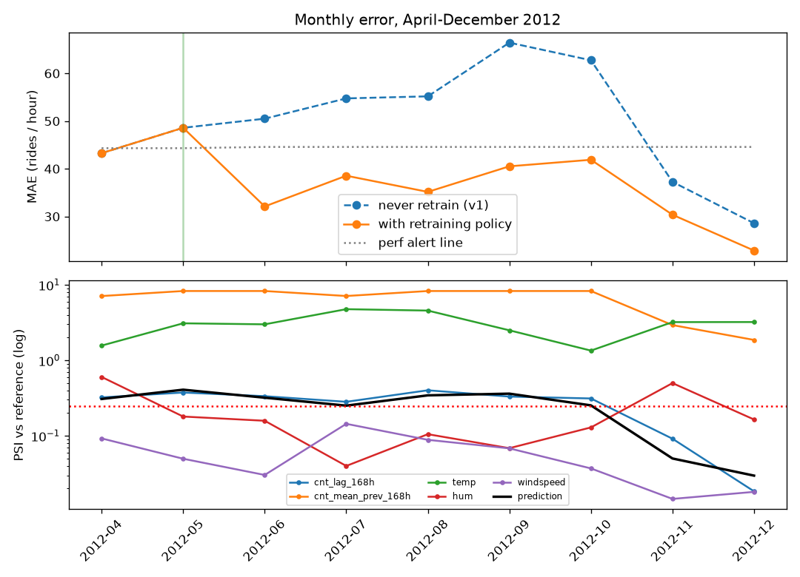

# MLOps: tracked, registered, served and monitored model

An end-to-end MLOps loop around an hourly demand model for **real public
bike-share data** (Washington DC, 2011–2012):

- **MLflow** experiment tracking and a model registry with a `champion`
  alias.
- A **FastAPI** service with input validation, a `/drift` endpoint and
  Prometheus-style `/metrics`.
- A **Dockerfile** and a **GitHub Actions** CI workflow.
- **Data-drift monitoring** (PSI and KS) with a retraining policy, run
  month by month over nine months the model never saw.

A portfolio piece for ML-engineering / MLOps roles, a client-facing demo,
and evidence toward a QQI Level 9 (Master's) RPL file.

**Data status:** **REAL public data**, UCI *Bike Sharing* (Fanaee-T, 2013,
[doi:10.24432/C5W894](https://doi.org/10.24432/C5W894)), licensed
**CC BY 4.0**. It holds hourly rental counts and weather, with no personal
data. The 0.3 MB zip is downloaded and SHA-256-checked by the code, and is
**not committed**.

**What was and was not run:** the training, MLflow tracking and registry,
the drift replay, the API tests, a load test over real HTTP and a
"Docker-less" rebuild of the image's environment all **ran**. The Docker
image was **not built**, because there is no Docker daemon on the build
machine. The GitHub Actions workflow was **not run** either: it is
committed under `ci/`, not `.github/workflows/`, because the push token
lacks the `workflow` scope. Both are ready to run as written.

New to the code? Start with the [code walkthrough](CODE_WALKTHROUGH.md).
For a non-technical summary, read the [case study](CASE_STUDY.md).

---

## Problem

Most portfolio models stop at a notebook score. In production, the
questions are different:

- Which run produced the model that is live?
- Can anyone call it safely?
- How would we know when it goes stale?
- What do we do when it does?

The brief here is a 1-hour-ahead forecast of bike rentals that is
tracked, versioned, served, load-tested and monitored, with a written
rule for when to retrain.

---

## Approach

| Stage | Detail | Code |
|---|---|---|
| Data | 17,379 hourly rows; lag features on a complete hourly grid: previous hour, same hour yesterday, same hour last week, mean of the previous 168 hours | `src/common.py` |
| Split by time | train 2011; validation Q1 2012 (model selection); **Apr–Dec 2012 replayed as "production"** | `src/train.py` |
| Candidates | two naive baselines (same hour last week, previous hour), ridge on one-hot features, two gradient-boosting configs; log1p target | `src/model_lib.py` |
| Tracking | every candidate logged to MLflow (params, metrics, data checksum, signature); best registered as `bike-demand` v1 with alias `champion` | `src/train.py` |
| Serving | FastAPI: `/predict` (1–500 records, pydantic bounds, missing lags allowed), `/health`, `/model`, `/drift`, `/metrics` | `app/main.py` |
| Packaging | `python:3.13-slim`, non-root user, `HEALTHCHECK`, serve-only requirements | `Dockerfile` |
| CI | pytest job, then a Docker build-and-smoke-test job | `ci/github-actions-ci.yml` |
| Monitoring | monthly PSI (quantile bins) and KS per feature and on predictions, against the champion's training data | `src/drift.py`, `src/monitor.py` |
| Policy (fixed before the replay) | drift alert = PSI ≥ 0.25; performance alert = monthly MAE > 1.3 × reference MAE; **retrain only on a performance alert**; challenger = trailing 365 days, promoted if its MAE on the last 14 days is ≤ 0.95 × the champion's | `src/monitor.py` |

**Two feature-set changes were made after seeing validation results**, and
both are recorded here:

1. With `month` as a feature, every model lost to the naive baseline (best
   MAE 90.9 vs 55.8). In 2011, the scheme's first year, `month` encodes
   the ramp-up in demand, not seasonality. I removed it and added lag
   features.
2. Without the previous-hour lag, gradient boosting only beat the baseline
   by 4% (52.4 vs 54.5), so I added it.

The final numbers below come from the last feature set. The validation
quarter was used for these choices, so it is not an untouched test. The
April–December replay is.

---

## Results

All numbers come from [`reports/metrics.json`](reports/metrics.json) and
`reports/monitoring_2012.csv`, recorded on 17 November 2026.

### Model selection (validation, Q1 2012, 2,176 hours)

| Model | MAE (rides/h) | RMSE | R² |
|---|---|---|---|
| Same hour last week (naive) | 54.5 | 92.6 | 0.659 |
| Previous hour (naive) | 63.0 | 96.8 | 0.628 |
| Ridge, one-hot | 51.1 | 78.5 | 0.755 |
| **Gradient boosting, small (registered v1)** | **34.1** | **57.8** | **0.867** |
| Gradient boosting, large | 34.8 | 58.1 | 0.866 |

v1 is **37.5% better** than the best baseline.

### Nine months "in production" (April–December 2012)

| Month | Champion | MAE | MAE if never retrained | Perf alert | Drift alert | Action |
|---|---|---|---|---|---|---|
| 2012-04 | v1 | 43.3 | 43.3 | no | yes | none |
| 2012-05 | v1 | 48.6 | 48.6 | **yes** (1.43×) | yes | challenger 34.3 vs champion 47.7 on the last 14 days → **promoted v2** |
| 2012-06 | v2 | 32.1 | 50.5 | no | yes | none |
| 2012-07 | v2 | 38.6 | 54.8 | no | yes | none |
| 2012-08 | v2 | 35.2 | 55.2 | no | yes | none |
| 2012-09 | v2 | 40.5 | 66.4 | no | yes | none |
| 2012-10 | v2 | 41.9 | 62.7 | no | yes | none |
| 2012-11 | v2 | 30.4 | 37.3 | no | yes | none |
| 2012-12 | v2 | 22.9 | 28.6 | no | yes | none |

Across April–December, hour-weighted MAE was **37.0 with the policy
against 49.7 without retraining (25% lower)**. One retrain was triggered,
and the challenger was registered as v2, took the `champion` alias and was
exported to `models/` for serving.

**The drift alerts fired in all nine months, so on their own they were
useless as a retraining trigger.** Comparing one month of temperature with
a whole year will always look like "drift" (PSI 1.3–4.8), and demand grew
65% in 2012 (1.24 M to 2.05 M rides), so the lag features drift too. Only one month breached
the accuracy rule. This is why the policy retrains on performance, not on
drift. A better reference for weather would be the same month of the
previous year.



### Serving

- **Load test.** These are real HTTP calls to uvicorn with one worker, on
  the same shared 8-vCPU machine as the client. Two other training jobs
  were running at the time, so treat these as rough numbers.

  | Request | p50 | p95 | p99 | Throughput |
  |---|---|---|---|---|
  | 1 record | 8.4 ms | 21.4 ms | 84.9 ms | 80 req/s |
  | 100 records | 9.5 ms | 32.2 ms | 115.8 ms | 6,490 records/s |
  | 8 concurrent clients, 1 record | 80.4 ms | 144.9 ms | – | 86 req/s |

- **`/drift` after the load test.** It flagged 6 features on the 2,000
  June 2012 records it had been sent, the same pattern as the offline
  monitor.
- **Docker-less image check.** `ci/dockerless_smoke.sh` builds a fresh
  environment from `requirements-serve.txt` only, copies the same files
  as the Dockerfile and starts the same uvicorn command. `/health` then
  returned `{"version": 2}`, and `/predict` returned `[599.8, 1.8]` for a
  summer weekday at 8 am and a wet winter Sunday at 3 am.
- **Tests.** 11 pytest tests cover drift maths, lag features, the API
  contract (including 422s for invalid input) and the recorded baseline
  comparison.

---

## How to run

```bash
cd projects/17-mlops-model-serving
python -m venv .venv && source .venv/bin/activate
pip install -r requirements.txt
python src/train.py          # downloads data, logs 5 runs to MLflow, registers v1
python src/monitor.py        # replays Apr-Dec 2012, may register v2 and export it
python src/load_test.py      # starts uvicorn and measures latency
python src/collect_metrics.py
pytest -q                    # 11 tests
mlflow ui --backend-store-uri sqlite:///mlruns/mlflow.db   # browse runs and registry
uvicorn app.main:app --port 8000                           # then POST tests/sample_request.json
docker build -t bike-demand-api . && docker run -p 8000:8000 bike-demand-api   # not run here
```

To turn on CI, copy `ci/github-actions-ci.yml` to
`.github/workflows/mlops-ci.yml` at the repository root.

---

## Client value

- **Traceability.** Every live prediction carries a model version, and
  each version links back to an MLflow run, its parameters, the data
  checksum and its validation score.
- **A safe API.** Inputs are validated, out-of-range requests are
  rejected with clear errors, and health and metrics endpoints are ready
  for a load balancer and Prometheus.
- **A retraining rule that paid off.** In the replay, one retrain cut
  error by a quarter over the following seven months.
- **Honest monitoring.** Drift dashboards that alert every month get
  ignored. The replay showed that, and the policy is designed around it.

---

## Critical evaluation

- **Docker and CI were not executed.** The Dockerfile and workflow are
  standard, and the Docker-less script reproduces their steps, but an
  image build can still fail on things the script cannot catch (base
  image, system libraries).
- **The validation quarter was reused for two feature-set decisions**
  (see Approach). Only the April–December replay is untouched.
- **The retraining rule's thresholds** (1.3×, 0.95×, 14 days, 365-day
  window) are judgement calls. They were fixed before the replay but not
  tuned or stress-tested, and other values would give different numbers.
- **The lag features assume the caller knows last hour's count.** That is
  realistic for a dispatch system, but it makes this a 1-hour-ahead
  nowcast, not a day-ahead forecast.
- **A single, small dataset from one city, 2011–12.** The load test ran
  on a busy shared machine with the client and server on the same host.
- **The in-memory drift window and counters** in the API are per process.
  With several workers they would need Redis or Prometheus.

## Next steps

- Run the workflow on GitHub (needs a token with `workflow` scope) and
  push the image to GHCR.
- Compare drift against a seasonal reference (same month last year) to
  make drift alerts informative.
- Add shadow deployment: score the challenger on live traffic before
  promotion.
