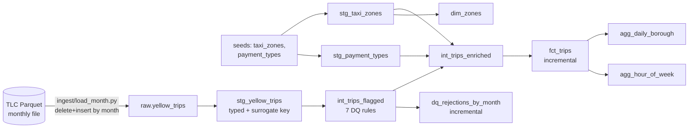
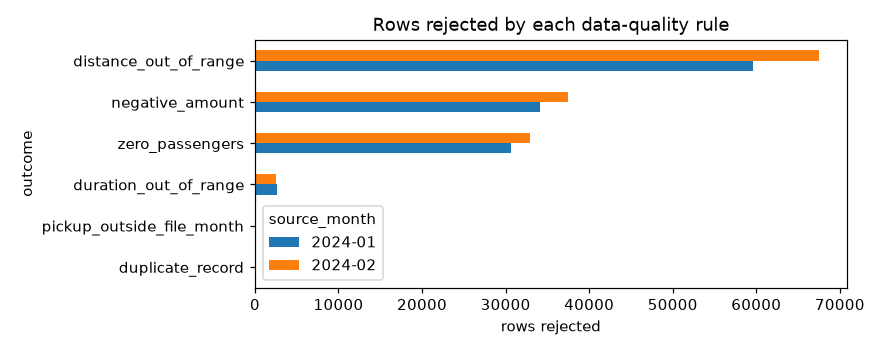
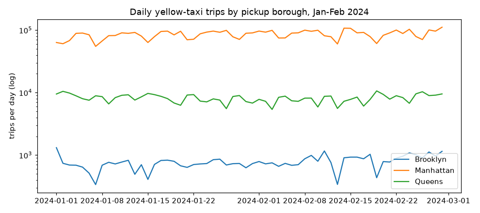
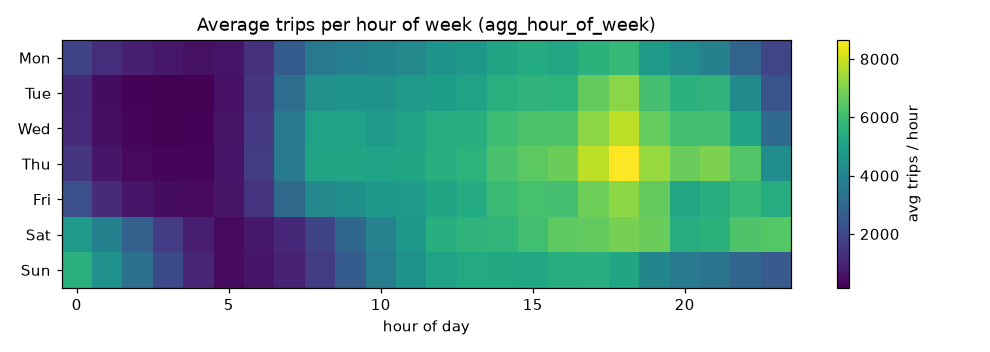

# Modern data stack: dbt + DuckDB, orchestrated by Airflow

A monthly ELT pipeline over **5.97 million real NYC yellow-taxi trips**
(January and February 2024). Python loads each month's file into a DuckDB
raw layer. **dbt** builds staging, intermediate and mart models, with 23
data tests and generated documentation. An **Apache Airflow 3.4** DAG runs
it month by month (extract and load, then `dbt seed`, `dbt build` and a
quality gate). The DAG really ran here, through `airflow dags test`.

A portfolio piece for data-engineering and analytics-engineering roles, a
client-facing demo, and evidence toward a QQI Level 9 (Master's) RPL file.

**Data status:** **REAL public data**, the NYC Taxi & Limousine Commission
(TLC) [Trip Record Data](https://www.nyc.gov/site/tlc/about/tlc-trip-record-data.page),
published under the NYC Open Data terms of use. The records hold no
personal names and identify locations only by taxi zone. The monthly
Parquet files (~50 MB each) are downloaded by the code and are **not
committed**. Their SHA-256 checksums are recorded in
[`data_manifest.json`](data_manifest.json). The 12 KB zone lookup is
committed as a dbt seed.

New to the code? Start with the [code walkthrough](CODE_WALKTHROUGH.md).
For a non-technical summary, read the [case study](CASE_STUDY.md).

---

## Problem

Job adverts for data engineers keep asking for the same stack: **dbt,
Airflow, SQL and a cloud warehouse**. Project 12 built an ETL pipeline in
plain Python and SQL. This project rebuilds the same ideas the way most
teams now do it:

1. Load raw data unchanged, and make reloading a month safe.
2. Transform it in layered, tested, documented SQL (dbt).
3. Process new data **incrementally** while keeping results identical to
   a full rebuild.
4. Run it on a schedule with retries, backfills and a gate that **stops**
   the pipeline when data tests fail (Airflow).

---

## Architecture



Airflow DAG `nyc_taxi_monthly` (`@monthly`, catchup on, one active run):
`extract_load` → `dbt_seed` → `dbt_build` → `quality_gate`.

| Layer | Models | Materialisation |
|---|---|---|
| Raw | `raw.yellow_trips` (+ `source_month`, `_loaded_at`, `_source_file`) | table, loaded by Python |
| Staging | `stg_yellow_trips`, `stg_taxi_zones`, `stg_payment_types` | views |
| Intermediate | `int_trips_flagged` (one `dq_reason` per row), `int_trips_enriched` (valid rows + zone names) | views |
| Marts | `fct_trips`, `dq_rejections_by_month` (both incremental, `delete+insert` by month); `dim_zones`, `agg_daily_borough`, `agg_hour_of_week` (tables) | DuckDB tables |

**Data-quality rules**, applied in this order. The first rule a row fails
becomes its `dq_reason`:

1. An exact duplicate record.
2. A pickup outside the file's month.
3. A duration of zero or less, or over 6 hours.
4. A distance of zero or less, or over 200 miles.
5. A negative fare or total.
6. A total over $1,000.
7. Zero passengers.

**dbt tests (23 per build):**

- **Generic:** `unique`, `not_null`, `accepted_values` and `relationships`
  (trips to zones).
- **Custom generic** (in `tests/generic/`): `non_negative`, `in_range` and
  `unique_combination`.
- **Singular:** every raw row is either in `fct_trips` or counted as
  rejected, and the daily aggregate adds back to the fact table to the cent.

There is also an exposure for the KPI dashboard.

---

## Results

All numbers come from [`reports/metrics.json`](reports/metrics.json)
(`scripts/verify.py`) and `reports/airflow_runs/` (the full Airflow logs are written to `reports/*.log`, which are git-ignored). They were
recorded on 17 November 2026 on an 8-vCPU Linux box that was also
running other jobs.

### Airflow runs

Both DAG runs finished with `state=success`. The first took 15.6 s and the
second 16.8 s, of which dbt was 4.7 s and 5.2 s. Each build ran 10 models
and 23 tests, and every test passed. One teardown log line is a harmless
`aiosqlite` connection-close error from Airflow's own SQLite metadata
store, after the run finished.

| Month | Raw rows | Valid → `fct_trips` | Rejected | Largest rejection reason |
|---|---|---|---|---|
| 2024-01 | 2,964,624 | 2,837,527 (95.71%) | 127,097 | distance out of range (59,622; 2.01%) |
| 2024-02 | 3,007,526 | 2,867,087 (95.33%) | 140,439 | distance out of range (67,492; 2.24%) |

The other rejections in January were:

- 34,138 negative amounts (1.15%)
- 30,677 rows with zero passengers (1.04%)
- 2,642 durations out of range
- 18 pickups outside the file month

February had a similar pattern and one exact duplicate.



### Engineering checks

| Check | Result |
|---|---|
| **Idempotent re-run**: the January DAG run again on the finished warehouse | The loader replaced 2,964,624 rows with 2,964,624. The fingerprints (row count + MD5) of `fct_trips`, `dq_rejections_by_month` and `agg_daily_borough` were **identical** before and after. |
| **Incremental = full refresh**: a copy rebuilt with `dbt build --full-refresh` (13.1 s) | **Identical** fingerprints for all three tables (`fct_trips`: 5,704,614 rows, MD5 `41dd87f9…`). |
| **Quality gate**: two bad rows planted in a copy | The zone-999 row with a negative fare was rejected by the `negative_amount` rule, as designed. The zone-998 row with a valid fare passed the row rules and was caught by the `relationships` test (`fct_trips.pickup_location_id → dim_zones`). `dbt build` exited 1, so the Airflow `dbt_build` task, and with it the run, would fail before `quality_gate`. |

### What the marts show

| Pickup borough | Trips (Jan–Feb) | Revenue | Revenue per trip |
|---|---|---|---|
| Manhattan | 5,136,736 | $117.8 M | $22.93 |
| Queens | 490,233 | $35.5 M | $72.33 |
| Brooklyn | 46,938 | $1.54 M | $32.85 |

Queens' high revenue per trip comes from the airports. There were
256,966 JFK pickups (average total $81.22) and 171,933 LaGuardia pickups
($66.60). The busiest hour of the week is **Thursday 18:00**, at 8,650 trips
per hour on average.




The dbt documentation site (lineage graph, column descriptions, tests) is
committed as a single file at
[`docs/dbt_docs_static.html`](docs/dbt_docs_static.html). Download it and
open it in a browser.

---

## How to run

```bash
cd projects/18-dbt-airflow-modern-data-stack
python -m venv .venv-dbt && .venv-dbt/bin/pip install -r requirements-dbt.txt
python -m venv .venv-airflow && .venv-airflow/bin/pip install -r requirements-airflow.txt
./run_backfill.sh                     # Airflow: Jan + Feb 2024 (downloads ~100 MB)
DBT_BIN=$PWD/.venv-dbt/bin/dbt AIRFLOW_BIN=$PWD/.venv-airflow/bin/airflow \
  AIRFLOW_HOME=$PWD/airflow_home AIRFLOW__CORE__DAGS_FOLDER=$PWD/airflow/dags \
  .venv-dbt/bin/python scripts/verify.py   # idempotency, full-refresh, planted-bad-row checks
.venv-dbt/bin/python scripts/charts.py
DBT_BIN=$PWD/.venv-dbt/bin/dbt .venv-dbt/bin/pytest -q tests     # 4 tests (+1 skipped)
AIRFLOW_HOME=$PWD/airflow_home .venv-airflow/bin/pytest -q tests/test_dag.py   # 1 test
```

dbt alone, without Airflow: `cd nyc_taxi && dbt build --profiles-dir .
--project-dir . --vars '{"month": "2024-01"}'`.

Two virtual environments are used on purpose. Airflow and dbt pin
conflicting libraries, and keeping them apart is the usual production
pattern (in practice, separate containers or `ExternalPythonOperator`).

---

## Client value

- **A pipeline you can rerun safely.** The tests above showed that loading
  a month twice, retrying a task or rebuilding from scratch all give the
  same tables.
- **Problems stop the pipeline.** A bad record that slips past the row
  rules is caught by a dbt test, and Airflow stops the run before the
  dashboards refresh.
- **Every rejected row is accounted for**, by rule and month, so "why
  don't the numbers match the source?" has a ready answer: 4–5% of TLC
  records are removed, mostly for impossible distances.
- **A standard, hireable stack.** dbt models, tests and docs plus an
  Airflow DAG move to Snowflake, BigQuery, Databricks or Fabric by
  changing the dbt adapter and the profile.

---

## Critical evaluation

- **Airflow ran in test mode, not as a deployed service.** `airflow dags
  test` executes every task for real, but in one process with a SQLite
  metadata database. No scheduler, web UI, executor or worker pool was
  deployed, and timing in production would differ.
- **DuckDB is a stand-in for a cloud warehouse.** The SQL is standard, but
  `delete+insert` incrementals, concurrency and cost behave differently
  on Snowflake or BigQuery. Nothing was run on a cloud platform.
- **The quality rules are mine.** Thresholds such as 200 miles, 6 hours
  and $1,000 are judgement calls, not TLC rules. Raw files have no passenger
  count on 140,162 (January) and 185,610 (February) rows. Those rows are
  kept, because NULL is not zero, and 115,218 and 148,895 of them reach
  `fct_trips`. So `passenger_count` is unreliable for analysis.
- **The surrogate key is a hash of trip fields.** Two genuinely different
  trips with identical fields would collapse into one. Only one exact
  duplicate was found in six million rows, so the risk is small but not
  zero.
- **Two months only.** That is enough to show incremental processing, but
  not seasonality, schema changes between TLC releases, or file
  republication (the checksum check would stop the load, untested here).
- **Two planted bad rows test my own tests.** They show that the gate
  works; they do not show that every real defect would be caught.

## Next steps

- Run on a managed warehouse (BigQuery sandbox or Snowflake trial) with
  the same models, and compare cost and run time.
- Add source freshness SLAs, dbt unit tests for the DQ rules, and
  `dbt-expectations` distribution checks (for example, the daily trip
  count within ±30% of the same weekday last month).
- Deploy Airflow with docker-compose (scheduler, API server, Postgres
  metadata) and alert on failure.
