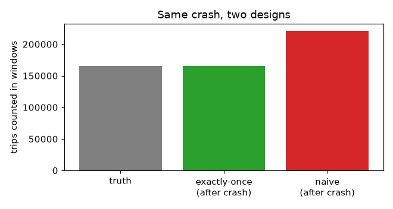
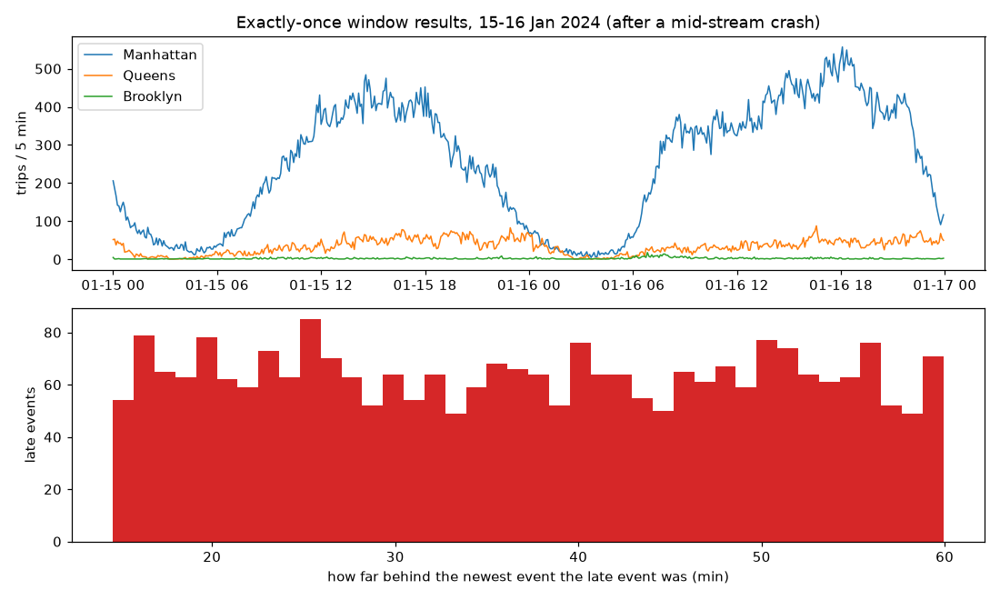

# Real-time streaming pipeline: Kafka, event-time windows, exactly-once results

A stream processor that reads **real NYC taxi trips** from **Apache Kafka**,
counts trips and revenue per borough in **5-minute event-time windows**,
handles out-of-order and late events with a **watermark**, drops
**duplicate** messages, and survives a **crash mid-stream** without losing
or double-counting anything. A live **Streamlit** dashboard reads the
results as they land.

The point of the project is the proof, not the plumbing. The stream is
built with known defects (late events, client retries). The processor's
output is then checked, window by window, against an independent batch
calculation of what the answer *should* be. The same check is run on a
common naive design, to show what goes wrong without these guarantees.

A portfolio piece for data-engineering / streaming roles, a client-facing
demo, and evidence toward a QQI Level 9 (Master's) RPL file.

**Data status:** **REAL public data**, NYC TLC *Yellow Taxi Trip Records*,
January 2024 (City of New York, published for public use). The 15–16
January slice is replayed as a stream: **169,920 messages**. The trips are
real; the **network delays, the 1.5% late events and the 1.0% duplicates
are injected** by seeded code (`src/events.py`) so the pipeline can be
scored. No personal data: TLC records carry zones and amounts, not people.

**What was and was not run:** everything below **ran** against a real
single-node **Kafka 4.4.0** broker (KRaft mode, 4 partitions, replication
factor 1) on one 8-vCPU machine. It was **not** run on a multi-broker
cluster, with replication, or under a network fault; and the crash is a
simulated process kill (`os._exit`), not a machine failure.

New to the code? Start with the [code walkthrough](CODE_WALKTHROUGH.md).
For a non-technical summary, read the [case study](CASE_STUDY.md).

---

## Problem

Streaming dashboards are easy to build and easy to get quietly wrong.
Three things break the numbers in practice:

- **Out-of-order data.** Events arrive after newer ones. Group them by
  arrival time and a busy 5 minutes is split across windows.
- **Duplicates.** Producers retry, so some events arrive twice.
- **Restarts.** A processor that crashes and restarts either replays
  messages it had already counted, or skips ones it had not.

The brief: per-borough trip counts and revenue in 5-minute windows that
are *provably* the same as a careful batch job would produce, even across
a crash, and with late data reported rather than silently dropped.

---

## Approach

| Stage | Detail | Code |
|---|---|---|
| Event stream | Real TLC trips, 15–16 Jan 2024. Event time = pickup time. Arrival = event time + exponential delay (mean 20 s); 1.5% of events delayed 15–60 min (beyond allowed lateness); 1.0% re-sent 1–30 s later as retries. Seeded. | `src/events.py` |
| Producer | `confluent-kafka`, idempotent, `acks=all`, lz4, keyed by borough | `src/producer.py` |
| Windowing | 5-min tumbling windows per borough; watermark = max event time − 10 min; a window closes once the watermark passes its end; events for closed windows go to a **late-event side output**; `event_id` de-dup with a 2-hour TTL | `src/windowing.py` |
| Exactly-once results | offsets never auto-committed; window results, late events, processor state **and the next offset per partition** are written in **one SQLite transaction**; on restart the consumer seeks to the offsets stored in the sink | `src/processor.py` |
| Naive comparison | auto-commit, in-memory state, no de-dup, append-only writes (a common first design) | `src/processor.py --mode naive` |
| Ground truth | the same rules computed in one vectorised batch pass with pandas, independent of Kafka | `src/truth.py` |
| Experiment | max-rate publish; crash after 60,000 messages; resume; naive run with the same crash; compare both sinks with truth; second topic paced at 2,000 msg/s for latency | `src/run_experiment.py` |
| Dashboard | Streamlit, refreshes every 2 s from the sink | `app.py` |

The windowing rules are applied **per Kafka partition**, so the result
for a given input order is deterministic. That is what makes an exact,
window-by-window comparison with truth possible.

---

## Results

All numbers are from `reports/metrics.json`, written by
`src/run_experiment.py` on 17 November 2026.

### Correctness after a crash

The processor was killed after 60,000 messages, with **4,000 messages
processed but not yet committed**, then restarted.

| | Exactly-once design | Naive design |
|---|---|---|
| Windows matching truth exactly | **2,246 / 2,246** | 1,259 / 2,246 |
| Windows wrong | **0** | 987 |
| Trips counted (truth: 165,673) | **165,673** | 221,297 (**+55,624, +33.6%**) |
| Revenue (truth: $4,778,022.44) | **$4,778,022.44** | $6,332,883.18 |
| Late events reported (truth: 2,554) | **2,554, identical set** | none (not tracked) |
| Duplicates in topic | 1,693 dropped | 1,693 counted |

Why the naive design overshot: it auto-commits offsets every second, but
it processed 60,000 messages in under a second and was killed before any
commit. So after the restart it **replayed all 169,920 messages** and
appended a second copy of the windows from the first run. It also counted
every retry as a new trip.





### Throughput and latency

| Measure | Result |
|---|---|
| Producer, max rate (idempotent, `acks=all`) | **102,198 msg/s** (169,920 messages in 1.66 s) |
| Processor, catch-up after restart | **73,686 msg/s** (113,920 messages in 1.55 s of active processing) |
| Paced run: 60,000 messages at 2,000 msg/s | processed at 2,004 msg/s |
| Produce → processed (paced), p50 / p95 / p99 | **56.8 / 102.8 / 108.5 ms** |
| Produce → committed in sink (paced), p50 / p95 / p99 | **528 / 996 / 1,036 ms** |

The committed latency is bounded by the 1-second checkpoint interval; a
shorter interval trades throughput for freshness. Latency figures from the
crash/resume runs are not meaningful (they include the time the messages
sat in Kafka) and are not quoted.

### A finding: partition skew

Keying by borough sent **168,288 of 169,920 messages (99%) to one of the
four partitions**; partition 0 got none. Manhattan dominates taxi pickups
and the hash put the other boroughs in the same place. The pipeline is
correct, but it cannot scale out: three of four consumers would sit idle.
See *Next steps*.

---

## How to run

You need Java 17+ and an unpacked Apache Kafka 4.x release.

```bash
cd projects/19-realtime-streaming-pipeline
python -m venv .venv && source .venv/bin/activate
pip install -r requirements.txt

# 1. start a single-node Kafka (KRaft) in another terminal
KAFKA_HOME=/path/to/kafka_2.13-4.4.0 scripts/start_kafka.sh

# 2. build the event stream (re-uses project 18's download, or fetches it)
python src/events.py

# 3. the full recorded experiment (a few minutes; much of it is waiting
#    for Kafka's 45 s session timeout after each simulated crash)
python src/run_experiment.py
python src/charts.py

# live demo: three terminals
python src/producer.py --recreate --create-only
python src/processor.py
python src/producer.py --rate 2000
streamlit run app.py

# tests (no Kafka needed)
pytest -q
```

`scripts/start_kafka.sh` captures the commands used to start the broker
for this run; the script itself was written afterwards and has not been
run as a file.

**Tests:** 6 tests: window boundaries, watermark closing, late and
duplicate handling, checkpoint save/restore giving identical output,
equality of the streaming logic and the vectorised batch truth on 2,000
random events, and a dashboard render test against the recorded sink
(skipped if the experiment has not been run).

---

## Client value

- **Numbers you can sign off.** The pipeline's output is reconciled to the
  last cent against a batch job, including after a crash. That is the
  evidence a finance or operations team needs before trusting a live view.
- **Late data is reported, not hidden.** 2,554 late events were captured
  with their offsets and watermark, so they can be back-filled or audited.
- **A measured cost of the shortcut.** The naive design overstated trips
  by a third after a single restart. That is the argument for spending the
  extra engineering.
- **Honest about scale.** The skew finding shows the next bottleneck
  before it is hit in production.

---

## Critical evaluation

- **Single broker, no replication.** Durability on the Kafka side was not
  tested. With replication factor 1, a broker disk loss loses data.
- **"Exactly-once" here means exactly-once *results*.** It comes from a
  transactional sink that stores offsets with the data. It is not Kafka's
  transactional read-process-write between topics, which would be needed
  if results went back to Kafka.
- **SQLite sink.** It is a single-writer database, fine for one processor
  on one machine. A shared warehouse sink would need the same
  offsets-in-the-transaction pattern (for example a Postgres upsert).
- **Synthetic defects.** The trips are real, but the delays and retries
  follow simple seeded distributions. Real networks produce bursts.
- **Per-partition watermarks.** Correct for this design, but an idle
  partition never advances its watermark, so its windows close only at
  end of stream. Partition 0 received no data in this run.
- **Crash type.** Only a process kill was simulated, at one point in the
  stream.
- **Hand-rolled windowing.** Flink or Kafka Streams provide this logic
  ready-made and scale it out. Writing it by hand here was to show the
  mechanics and to make the truth check possible.

---

## Next steps

1. Fix the skew: key by pickup zone (about 260 keys) and aggregate per
   borough downstream, then measure the scale-out across 4 consumers.
2. Re-implement the job in Flink or Kafka Streams and run the same truth
   check against it.
3. A 3-broker cluster with replication factor 3, and a broker-kill test.
4. Crash at random points over many runs, not one fixed point.
5. Global (cross-partition) watermarks with idle-partition detection.
