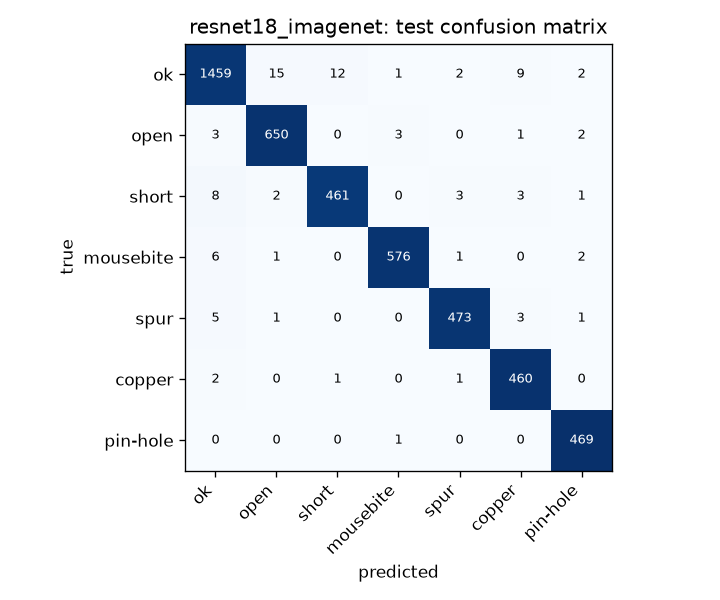
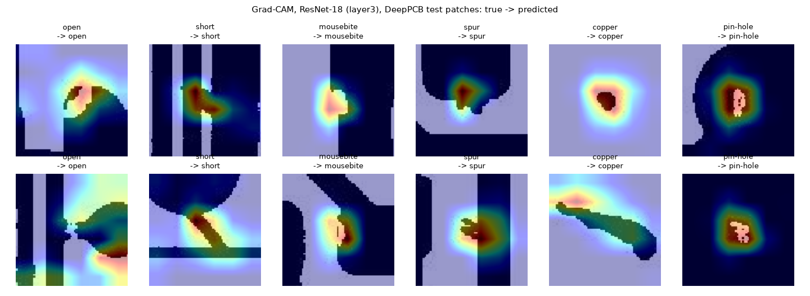

# PCB defect detection: CNN classifiers, a golden-template baseline and anomaly detection

Computer vision for **automated optical inspection (AOI)** of printed
circuit boards, the kind of check that sits on an automotive-electronics
SMT line. Three approaches are compared on the same public test set:

1. **Supervised classifiers** that name the defect type: a small CNN
   trained from scratch, and an ImageNet-pretrained **ResNet-18**
   fine-tuned on the task. **Grad-CAM** shows what each prediction looked at.
2. A **golden-template** baseline: subtract the defect-free reference image
   and count the differing pixels. This is how many classic AOI rules work.
3. **PatchCore-lite** anomaly detection, which learns from **defect-free
   patches only**. That is the realistic case on a new product, before
   any defects have been collected and labelled.

A Streamlit demo scans a whole board and highlights suspect areas.

A portfolio piece for computer-vision / manufacturing-AI roles, a
client-facing demo, and evidence toward a QQI Level 9 (Master's) RPL
file. The framing draws on two years as a Test Engineer in automotive
electronics manufacturing; no employer data is used.

**Data status:** **REAL public data**, *DeepPCB* (Tang et al., 2019,
[arXiv:1902.06197](https://arxiv.org/abs/1902.06197)), **MIT licence**,
pinned to commit `08e98c4`. It has 1,500 pairs of aligned 640×640 tested
and template board images with 6 annotated defect types. **Important:**
the board images are real, but the dataset authors **added the defects
artificially**, so the defects are cleaner and more uniform than real
ones. The images are downloaded by the code and **not committed**.

**What was and was not run:** patch preparation, training of both
classifiers, the template baseline, PatchCore-lite, Grad-CAM and the
Streamlit app (via Streamlit's test runner) all **ran** on CPU. All
scores are **patch-level** (64×64 crops). Whole-board detection
(localising every defect on a board and scoring boxes, e.g. mAP) was
**not** evaluated: the demo's board scan is qualitative only. Nothing
was tested on real production images.

New to the code? Start with the [code walkthrough](CODE_WALKTHROUGH.md).
For a non-technical summary, read the [case study](CASE_STUDY.md).

---

## Problem

An AOI station must do two jobs:

- **Catch defects.** A missed short or open can reach a vehicle.
- **Avoid false calls.** Each false alarm sends a good board to manual
  review. With too many, operators stop trusting the machine.

The brief: compare a learned classifier with the classic template rule
and with a detector that needs no defect examples, using the same split,
and report both missed defects and false alarms.

---

## Approach

| Stage | Detail | Code |
|---|---|---|
| Patches | A 64×64 crop centred on every annotated defect (class = defect type), plus 3 random defect-free crops per image that stay at least 4 px clear of any defect box. The same window is cut from the aligned template. | `src/prepare_patches.py` |
| Split | DeepPCB's official split. `trainval` → train, with its **last two image groups (77000, 92000) held out as validation**; `test` scored once at the end. 4 of the 11 test groups never appear in train/val. | `src/prepare_patches.py` |
| Classifiers | Small CNN (0.19 M params, 64 px input) from scratch; ResNet-18 ImageNet (11.2 M params, 96 px input) fine-tuned. AdamW, one-cycle LR, class-weighted cross-entropy, flips and 90° rotations; 6 epochs; best epoch by validation macro-F1. | `src/train.py`, `src/vision_lib.py` |
| Golden template | Smooth both images, threshold the absolute difference, score = fraction of differing pixels. Smoothing and grey-level threshold chosen by AUROC on the **train** split (no learning involved). | `src/evaluate.py` |
| PatchCore-lite | Frozen ImageNet ResNet-18, layer2 + layer3 features on a 6×6 grid, memory bank of 10,000 vectors randomly sampled from the 2,367 defect-free **training** patches; score = largest nearest-neighbour distance over the grid. | `src/evaluate.py` |
| Decision thresholds | For every method, the defect/OK threshold maximises F1 on **validation**, then is applied unchanged to test | `src/evaluate.py` |
| Explainability | Grad-CAM on ResNet-18 `layer3` | `src/vision_lib.py` |

Patch counts (ok / open / short / mousebite / spur / copper / pin-hole):
train 2,367 / 1,070 / 867 / 1,184 / 956 / 840 / 821; validation
633 / 213 / 161 / 195 / 186 / 170 / 210; **test 1,500 / 659 / 478 / 586 /
483 / 464 / 470** (4,640 patches).

---

## Results

All numbers are from `reports/metrics.json` (written by
`src/evaluate.py`) and `reports/training_log.json`, on the 4,640 test
patches.

### Defect-type classification (7 classes including "ok")

| Model | Accuracy | Macro-F1 | Weakest class (F1) | Train time (CPU, 4 threads) |
|---|---|---|---|---|
| Small CNN, from scratch | 93.73% | 0.935 | short (0.873) | 201 s |
| **ResNet-18, ImageNet fine-tuned** | **98.02%** | **0.981** | short (0.969) | 305 s |

ResNet-18 per class (F1): ok 0.978, open 0.979, short 0.969, mousebite
0.987, spur 0.982, copper 0.979, pin-hole 0.991. The small CNN's main
confusion was **open read as mousebite** (40 of 659), which look alike
at 64 px.

Test image groups never seen in training scored **no worse** (ResNet-18
macro-F1 0.984 on 3,091 unseen-group patches vs 0.974 on 1,549
seen-group patches), so the model is not just memorising board layouts.



### Defect vs OK: missed defects and false alarms

Test set: 3,140 defect patches, 1,500 OK patches. Thresholds were fixed on
validation.

| Method | Needs labelled defects? | AUROC | Recall | Missed defects | False-alarm rate | False alarms |
|---|---|---|---|---|---|---|
| Golden template (5×5 smoothing, >150 grey levels) | no (needs a template) | 0.968 | 98.57% | 45 | 6.00% | 90 |
| PatchCore-lite (OK patches only) | **no** | 0.947 | 98.85% | 36 | 24.27% | 364 |
| Small CNN | yes | 0.992 | 99.81% | 6 | 20.27% | 304 |
| **ResNet-18** | yes | **0.999** | 99.62% | 12 | **5.33%** | 80 |

What this says:

- The **template rule is a strong baseline** on DeepPCB, because the
  template is perfectly aligned and the defects are synthetic. Its AUROC
  was 0.996 on validation but fell to 0.968 on test; at the chosen threshold it
  flagged 38% of the OK patches in one test image group (12000, 42 OK
  patches) against 0–10% elsewhere, which looks like misregistration. Real lines have alignment drift, so this is the rule's
  weak point.
- **ResNet-18 had the fewest false alarms and about a quarter of the
  missed defects** of the template rule (12 vs 45), and it also names the defect type.
- **PatchCore-lite** catches 98.85% of defects without seeing a single
  one, but at this threshold it raises a false alarm on 1 in 4 good
  patches. That is acceptable for screening a new product; it is not
  acceptable as the final call.
- Thresholds chosen to maximise F1 favour recall here. A line would set
  them by the cost of an escape against the cost of a manual review.

### Grad-CAM



In the 12 sampled test patches (2 per defect class, fixed seed) the
attention sits on the defect itself, not on the surrounding tracks.

CPU inference (batched): 2.1 ms per patch for the small CNN and 4.0 ms
for ResNet-18. One 640×640 board at stride 32 is 361 windows, so roughly 1.5 s with
ResNet-18 on CPU (an estimate from the per-patch figure; board scans
were not timed).

---

## How to run

```bash
cd projects/20-pcb-defect-vision
python -m venv .venv && source .venv/bin/activate
pip install -r requirements.txt

python src/prepare_patches.py   # clones DeepPCB at the pinned commit, cuts patches (data/patches, ~11 MB)
python src/train.py --threads 4 # ~8.5 min on CPU; writes models/*.pt and reports/training_log.json
python src/evaluate.py          # test metrics, baselines, PatchCore-lite, charts -> reports/
streamlit run app.py            # board scan demo
pytest -q
```

The small CNN weights (0.8 MB) are committed. The ResNet-18 weights
(45 MB) are **not**: `src/train.py` re-creates them, and the app falls
back to the small CNN until they exist. Seeds are fixed, but CPU thread
scheduling means a re-train can differ slightly from the recorded run.

**Tests:** 9 tests: preprocessing, augmentation, model output shapes,
Grad-CAM map range, board-scan coverage, the template rule, consistency
of `metrics.json` (confusion matrix totals and accuracy), the model
loader, and the Streamlit app rendering a real DeepPCB board.

---

## Client value

- **A like-for-like comparison** of a learned model, the classic template
  rule and a no-labels detector, reported in the two numbers a line cares
  about: escapes and false calls.
- **A path for new products:** start with anomaly detection on good
  boards from day one, collect the flagged patches, then train a
  classifier once labelled defects exist.
- **Explainable calls:** Grad-CAM shows the operator *where* the model
  looked, which helps at the review station and in audits.
- **Runs on a CPU.** No GPU is needed for inference at this scale.

---

## Critical evaluation

- **Synthetic defects.** DeepPCB's defects were added artificially to real
  board images. Real defects (solder, component, contamination) vary
  much more. These scores are an upper bound, not a production forecast.
- **Bare boards only.** DeepPCB shows bare-copper boards, not assembled
  boards with components and solder joints, which is where most
  automotive SMT inspection effort goes.
- **Patch-level evaluation.** Defect patches are centred on the defect,
  while OK patches are random crops. A model could partly learn
  "something in the middle". Whole-board detection was not scored.
- **PatchCore-lite is simplified:** random rather than greedy-coreset
  sampling, a 6×6 grid, and no image-level re-weighting. The full method
  would likely do better.
- **Thresholds** were picked by F1 on validation, which has only 2 image
  groups. They were not tuned to a real escape-vs-review cost.
- **Small compute budget:** 6 epochs, inputs of 64 and 96 px, CPU only,
  one seed. No variance across seeds is reported.

---

## Next steps

1. Score whole boards: sliding window or a detector (e.g. Faster R-CNN or
   YOLO) with box-level mAP, using DeepPCB's box annotations.
2. Test on real defects, e.g. assembled-board datasets or line images
   under an NDA.
3. Full PatchCore (greedy coreset, higher resolution) and a
   template-plus-learned hybrid.
4. Pick thresholds by cost per escape and cost per manual review, with
   confidence intervals across seeds.
5. Export to ONNX and measure latency on edge hardware.
