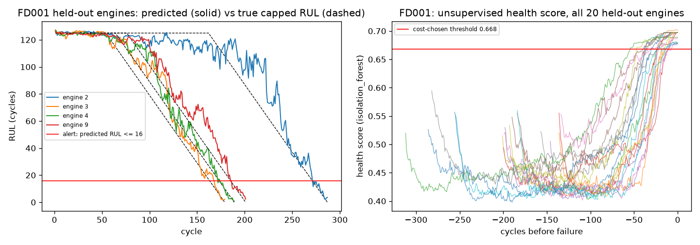
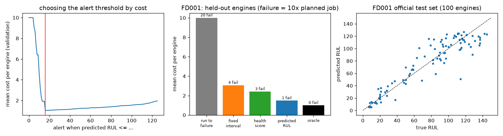

# Predictive maintenance: anomaly detection, remaining useful life and a cost-based alert

Sensor-based **predictive maintenance** on the NASA **C-MAPSS** turbofan
run-to-failure data. The pipeline does three things:

1. **Detects degradation without labels.** It learns "healthy" from the
   start of each engine's life only.
2. **Predicts remaining useful life (RUL)** in cycles, against naive
   baselines.
3. **Turns predictions into a maintenance decision.** The alert threshold
   is chosen by **cost**, a missed failure against maintenance done too
   early, and compared with run-to-failure and a fixed service interval.

The same questions apply to test and production equipment in automotive
electronics manufacturing: when to service a pick-and-place head, a
reflow oven or an end-of-line tester before it fails mid-shift.

A portfolio piece for ML / reliability-engineering roles, a client-facing
demo, and evidence toward a QQI Level 9 (Master's) RPL file.

**Data status:** **public data, simulated.** NASA C-MAPSS (Saxena,
Goebel, Simon and Eklund, *Damage Propagation Modeling for Aircraft Engine
Run-to-Failure Simulation*, PHM08, 2008), a US Government work in the
public domain. These are **simulated** turbofan engines, not field data.
The headline is **FD001** (100 training engines, one operating condition,
one fault mode). **FD003** (two fault modes) repeats the whole pipeline as
a check. The 12.4 MB archive is downloaded and checksum-verified by the
code and **not committed**.

**What was and was not run:** everything below **ran**, for both
sub-datasets, on CPU. The full experiment takes under 2 minutes, including
5 repeated engine splits. **Not done:** FD002/FD004 (six operating
conditions), deep sequence models (LSTM/CNN), and any test on real
machine data. The **costs are assumptions** (stated below), not figures
from a real operation.

New to the code? Start with the [code walkthrough](CODE_WALKTHROUGH.md).
For a non-technical summary, read the [case study](CASE_STUDY.md).

---

## Problem

A maintenance team has three options:

- **Run to failure:** cheapest per job, but failures are unplanned,
  disruptive and expensive.
- **Fixed interval:** service every *T* cycles. This is predictable, but
  it throws away useful life on healthy machines and still misses
  short-lived ones.
- **Condition-based:** service when the sensors say so. This is only
  worth it if the alert is **early enough to plan**, and not so early
  that it wastes life.

The brief: build the condition signal, show that it beats simple
baselines, and pick the alert rule by what errors cost rather than by
accuracy alone.

---

## Approach

| Stage | Detail | Code |
|---|---|---|
| Split by **engine** | 100 FD001 training engines split 60 / 20 / 20 into fit / validation / **held-out test** (seeded). A trajectory is never in two splits. NASA's official test set (100 truncated engines with true RUL) is scored as well. | `src/data.py` |
| Causal features | 12 informative sensors (constant ones dropped). Per sensor: value, 10-cycle rolling mean and std, 20-cycle rolling slope, EWMA; plus cycle count. 61 features. **Each value uses only cycles ≤ t**, which a test checks. | `src/features.py` |
| Anomaly detection | Fitted on the **first 30 cycles** of the fit engines only (engines start healthy, per the dataset description). Four scores on standardised EWMA sensors: per-sensor **limit check** (max \|z\|, the classic baseline), **Mahalanobis** (Ledoit-Wolf), **PCA residual (SPE)**, **Isolation Forest**. Statistical alarm: 99.5th percentile of validation-engine healthy scores, 3 cycles in a row. | `src/anomaly.py` |
| RUL regression | Target capped at 125 cycles (the usual piecewise-linear target). Baselines: **mean RUL** and **fleet-life** (median life − cycle, what a time-based schedule assumes). Models: ridge and gradient boosting (HGB), small grids chosen on validation RMSE. | `src/rul.py` |
| Cost model | An alert books maintenance **10 cycles later**. If the engine fails first: **unplanned failure = 10**. Otherwise **planned job = 1**, plus **0.005 per cycle** of life thrown away (one planned job's worth per ~200 cycles, about one FD001 engine life). No alert = failure. | `src/alerting.py` |
| Policies | run-to-failure; **fixed interval** *T*; **health-score alert** (cost-chosen threshold on the selected anomaly score, 3 in a row); **predicted-RUL alert** (alert when predicted RUL ≤ θ); oracle (alert exactly 10 cycles before failure). Every parameter chosen on the **validation** engines by mean cost, then applied unchanged to the held-out engines. | `src/run.py` |
| Robustness | Failure cost varied (5, 10, 20, 50) and the whole experiment repeated on **5 random engine splits** | `src/run.py` |

---

## Results

All numbers are from `reports/metrics.json`, written by `src/run.py` on
18 November 2026. Unless marked, the figures are FD001 on the 20
held-out engines (split seed 21).

### 1. Anomaly detection (no failure labels used)

AUROC separates the first 30 cycles (healthy) from the last 30 before
failure. Lead time is the true RUL when the alarm (99.5th percentile, 3
in a row) first fires.

| Score | Validation AUROC | Test AUROC | Engines never alarmed | Alarm in first 30 cycles | Median lead time (min–max) |
|---|---|---|---|---|---|
| Limit check (max \|z\|) | 0.992 | 0.988 | 0 / 20 | 0 | 11 cycles (2–60) |
| Mahalanobis | 0.883 | 0.911 | **11 / 20** | 0 | 21 (2–31) |
| PCA residual (SPE) | 0.439 | 0.536 | **20 / 20** | 0 | n/a |
| **Isolation Forest** (selected on val) | **0.9999** | **0.999** | 0 / 20 | 1 | **37.5 (19–280)** |

- The **PCA residual failed**: wear moves the sensors *along* the main
  healthy directions, so the residual does not grow. On FD003 the same
  score reached 0.949 test AUROC, so this depends on the fault.
- The **limit check** catches every engine, but its median warning is only
  11 cycles, barely more than the 10 needed to plan a job.
- **Isolation Forest** gives the earliest warning. One test engine
  alarmed at cycle ≤ 30, 280 cycles before failure: a false alarm.

### 2. Remaining useful life

| Model | Held-out RMSE (all cycles, capped) | Held-out RMSE (last 50 cycles) | **Official test RMSE** (100 engines, true RUL) | Official NASA score (lower is better) |
|---|---|---|---|---|
| Baseline: mean RUL | 41.76 | 63.99 | 43.12 | 34,318 |
| Baseline: fleet life − cycle | 34.28 | 34.34 | 37.69 | 25,671 |
| Ridge | 18.56 | 20.51 | 19.38 | 676 |
| **Gradient boosting** | **14.59** | **11.80** | **15.58** | **449** |

The official-test models were refit on fit + validation engines with the
settings chosen on validation. Gradient boosting is **2.4× more accurate
than the fleet-life schedule assumption** on the official test set. For
context only: published deep models report FD001 test RMSE of roughly
12–16 (e.g. LSTM 16.14, Zheng et al. 2017; CNN 12.61, Li et al. 2018).
Those were not re-run here and their set-ups differ.

Across 5 engine splits, the held-out RMSE was 14.23–16.93.

### 3. Maintenance policy by cost (failure = 10× a planned job)

| Policy (parameter chosen on validation) | Mean cost per engine | Failures / 20 | Mean life wasted |
|---|---|---|---|
| Run to failure | 10.00 | 20 | – |
| Fixed interval (service at cycle 150) | 3.07 | 4 | 67.4 cycles |
| Health-score alert (Isolation Forest ≥ 0.668) | 2.42 | 3 | 16.1 cycles |
| **Predicted-RUL alert (RUL ≤ 16)** | **1.48** | **1** | **7.0 cycles** |
| Oracle (perfect foresight) | 1.00 | 0 | 0 |

**Repeated over 5 engine splits** (mean ± sd of cost per engine):
fixed interval 2.35 ± 1.09; health score 1.81 ± 0.65; **predicted RUL
1.57 ± 0.38**; oracle 1.00. The predicted-RUL policy had 0–2 failures
per 20 engines.

**FD003 (two fault modes), same pipeline:** gradient boosting official
test RMSE **16.01** (fleet-life baseline 45.55). Here the **health-score
alert was cheapest**: 1.16 per engine with 0 failures, against 1.48 for
the predicted-RUL alert. Over 5 splits it was 1.22 ± 0.07 against
1.40 ± 0.36, with no failures on any split. So the best policy depends on
the fleet; that is a reason to run this comparison and not assume.





**Sensitivity:** with failure costs of 5, 10, 20 or 50, the thresholds
chosen on validation did not change. For both alert policies, the
validation optimum already had no failures, so a dearer failure does not
move it. The policy ranking on held-out engines stayed the same for
FD001. That also shows the limit of a 20-engine validation set: the
chosen RUL threshold (16) sits just above the point where validation
cost rises steeply (left chart), with only 6 cycles of margin over the
10-cycle lead time. In practice I would add a safety margin.

---

## How to run

```bash
cd projects/21-predictive-maintenance-cmapss
python -m venv .venv && source .venv/bin/activate
pip install -r requirements.txt

cd src
python run.py            # downloads + verifies the data, runs FD001 and FD003 (< 2 min on CPU)
python charts.py
cd ..
streamlit run app.py     # replay a held-out engine and watch each policy decide
pytest -q
```

**Tests:** 10 tests: engine split disjointness, **feature causality**
(features computed on truncated data equal the full-data features),
health scores rising with wear on a synthetic fleet, the consecutive-alarm
rule, the cost model, threshold choice on a perfect predictor, the
fixed-interval schedule, RMSE / NASA score / baselines, consistency of the
recorded `metrics.json` with the saved predictions, and an app render.

---

## Client value

- **Answers the question managers ask:** "what does this save?". It
  compares cost per asset against what they do today (run to failure or
  fixed interval), not RMSE alone.
- **Works before failures have been labelled:** the health score needs
  only data from healthy running, so monitoring can start on day one.
- **Transparent assumptions:** the cost of a failure, the planning lead
  time and the value of wasted life are inputs you can change, and the
  threshold is re-chosen from them.
- **Honest comparison of methods:** two of the four anomaly scores did
  badly on FD001. That is reported, not hidden.

---

## Critical evaluation

- **Simulated data.** C-MAPSS engines degrade smoothly and fail
  deterministically. Real assets have maintenance history, sensor faults,
  operating changes and censored lives (most machines are serviced before
  they fail, so true lives are rarely observed).
- **Small evaluation sets.** Policy costs come from 20 held-out engines.
  One failure moves the mean cost by 0.45. The 5-split repeat shows the
  spread, but more engines would be needed for firm claims.
- **Assumed costs and lead time.** They are illustrative, not from a real
  operation.
- **Healthy-start assumption.** The anomaly models treat the first 30
  cycles as healthy, which the dataset documents. On real equipment, the
  "healthy" window has to be confirmed.
- **Single-condition sub-datasets only.** FD002/FD004 need
  operating-condition normalisation first, which is not implemented.
- **Classical models only.** Deep sequence models might improve RUL; they
  were not tried here, to keep the comparison on CPU and explainable.

---

## Next steps

1. FD002/FD004: cluster operating conditions and normalise per condition.
2. Prediction intervals (quantile gradient boosting or conformal) and an
   alert on the lower bound instead of the point estimate.
3. A 1D-CNN or LSTM over the same causal windows, with the same
   validation protocol.
4. Survival-analysis framing for censored real-world data.
5. Apply to real line equipment data (tester cycle counts, fixture wear,
   oven heater current) under NDA.
